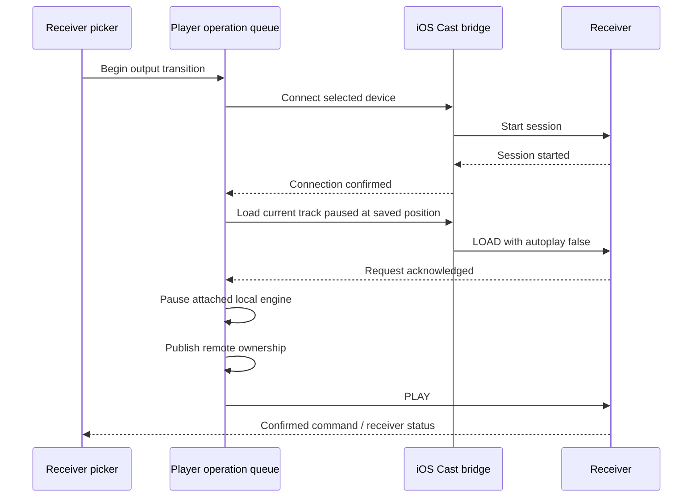

# iPhone Cast sender

The single app targets iOS 16+, as selected by the maintainer. AirPlay stays on
the system route picker. Google Cast uses the existing app receiver picker and
default media receiver; listening for channel events does not initialize the SDK
or start discovery. Opening receiver settings opts into a bounded four-second
scan. SDK analytics logging and automatic discovery are disabled.

## Dependencies and native proof

Google Cast **4.8.6** comes from the official static archive, SHA-256
`e1fe7fd6f2bf4b58e830d378fafc435d159bd755f7ee20fd3033aa1ce313cd6e`.
The app's local pod specification preserves the official resources and privacy
manifest, adds an archive checksum and pins GTMSessionFetcher **3.5.0**. It also
ships Google's open-source notice index/data as `LokalCastNotices.bundle`.
Package inspection requires those notices, the privacy manifest and core resources.
The SDK retains Google's terms; see `THIRD_PARTY_NOTICES.md`.

[SDK probe 2](https://github.com/lokal-music/lokal-mobile/actions/runs/40274734369)
compiles and links the **actual production transport** with Xcode 26.0.1 for
arm64 device and simulator, at minimum iOS 16.0. It uses the same archive through
the official SPM revision `543701c0bea92cfea527fce2fde3b82ee73f2902`.
The report records the transport source hash
`d529f2ebec4453883a823387211d74f9557ddf8e18857291e4abce4688238d1f`;
The subsequent shutdown/numeric hardening passes
[SDK probe 3](https://github.com/lokal-music/lokal-mobile/actions/runs/40286173923)
at transport SHA-256
`228ed599e8437196cbc0c74f8a72f6dc4d9c2c959afe9b98ae36276974c74881`.
The complete application/receiver gates remain separate.
Both compiler logs have no warnings/errors. This proves linkage, not invocation,
Flutter application integration, discovery, receiver or background acceptance.

## Playback ownership

The whole transfer is serialized with local playback operations. A new selection
or manual pause invalidates an older snapshot immediately. Preparation loads the
receiver paused, so the local engine can keep playing while connection/source
work runs. The local engine yields before remote Play. Queue IDs/order and the
saved position remain owned by PlayerService.

On failure, confirm receiver shutdown before releasing ownership and resuming
the same unchanged local selection. A newer selection wins. If shutdown is
unconfirmed, keep remote ownership, pause the phone and expose a retryable Stop
casting action. A queued Play cannot silently fall through to the local engine.
Pausing a track before connection keeps it paused on the receiver.

Every SDK media request retains its weak delegate until one completion, failure,
abort or a 20-second deadline. Session start has a 25-second deadline. The Flutter
method returns success only on the SDK confirmation, with typed errors on failure.
SDK suspension does not emit session-ended or start local playback. Foreground
resumption reattaches status updates only to the selected device. Unexpected
session end releases ownership only after receiver shutdown is known; a lost
connection retains remote ownership and a retryable Stop casting action. Before
ending a session that may be playing, require acknowledgement of a media STOP:
the SDK's session-ended callback alone can also mean a lost sender connection.

## Source and background constraints

Receiver-accessible HTTP URLs can play directly. Header-protected streams cannot
inherit the phone's cookies/Authorization through the default receiver; they use
an authorized app-owned copy served by the phone instead. Embedded URL passwords,
loopback URLs, content URIs and opaque add-on handles are not sent as direct
receiver URLs. Actual URL container metadata takes precedence over catalog format
when selecting MIME type. Receiver codec/protocol support remains authoritative;
this adapter does not transcode unsupported files or promise every add-on stream.

iOS may suspend the app-owned HTTP server when the phone leaves the foreground.
The receiver screen explicitly asks users to keep Lokal open for phone-hosted
files. Network-hosted receiver-accessible tracks do not require that phone server.
Do not claim background local-file Cast parity. A durable desktop/server offload
would need a separate explicit transfer, receiver-accessible authorization and
device qualification. Silent audio is not used to keep the server alive.

DLNA and Cast scans are independent on iPhone: failure of one backend preserves
the other's results and exposes a discovery error. Actual multicast permission,
entitlements and Windows signing behavior remain qualification work.

## Validation and remaining acceptance

The first handoff/channel selection passes **16** host tests. A broader selection
passes **48** cases including the existing HTTP server, iOS processing/session
fallback, player notification/path/failure and diagnostics behavior. These are
contract tests, not receiver simulations. The final Cast/source/HTTP selection
passes **20** cases, including header-protected and loopback source handling and
actual URL MIME selection. Integrated native validation follows these checks.

The native application harness checks the real registered bridge returns typed
disconnected errors and remains uninitialized before/after non-discovery commands.
This new check is pending the integrated hosted build. It does not prompt for LAN
permission or establish discovery acceptance.

Still required: integrated release/simulator compilation and resource inspection;
actual Cast receiver discovery, denied/restored LAN access, connect/cancel/failure;
local/network/header-protected formats; play/pause/seek/volume/queue; unexpected
disconnect and receiver-side changes; foreground/background restoration; and
physical iPhone plus Windows sign/install/update testing. No receiver acceptance
or qualified public release is claimed.
