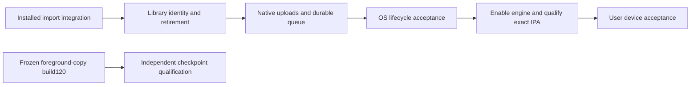

# iPhone completion milestones

Scope decision: 30 October 2026. The user restored the native background-transfer
work after temporarily trimming it. Complete the fixed milestones below; do not
keep expanding the feature list. Build120 is a foreground-copy engineering
checkpoint, separate from the finished native-engine target.

## Fixed work remaining

| Milestone | Completion evidence |
| --- | --- |
| 1. Integrated import | Installed coordinator + actual native transport/lease/file writer + actual Isar + bundled media reader complete a verified import and reconcile without duplicates. The isolated probe is now in source; Apple execution is pending. |
| 2. Library identity and retirement | Atomic CUE expansion/update and a private durable recording-ID counter have actual rollback/reopen coverage. The counter survives deleted derived tracks, library clearing and receipt pruning. Whole-CUE removal now reads full-file metadata and atomically restores a surviving identity; rollback/reopen and re-expansion are covered. Completed-import history now retains the newest 200 entries and compacts older acknowledged records without losing replay protection. Remaining mutation coverage and the queue controls still need completion. |
| 3. Native uploads and queue | The private upload snapshot boundary has bounded copy/integrity/cancellation and actual process-exit coverage. Native admission, file-backed POST and bounded verified receipts now have host coverage; uncertain outcomes pause. Positive content-match recovery, drained terminal-body cleanup and their owner/epoch-checked Dart bridge are now implemented. Intent is durable before preparation; a fresh source grant can retry a never-started copy. Native Music-root source grants and actual-Isar upload admission are now wired into the app lifetime owner behind the disabled capability. Source preparation rechecks the reviewed desktop/account and current song metadata. Clear also drains upload-only scopes. Queue UI, source-preparation retry presentation and safe ambiguous audio retry remain. Real HTTP tests cover the wire shape; desktop durability/idempotency and Apple background delivery remain unqualified. Unavailable features are not advertised. |
| 4. Lifecycle and final IPA | Storage-failure cancellation and actual OS suspension/relaunch pass. Enable the engine only after its gates pass, then qualify the exact release/AOT IPA, simulator app and independent package/source/symbol audit. |

Keep the implemented iOS16+ app and relevant Android parity through merged PR368 (including PR363 source priority):
ordinary imports/CUE, library/playlists, lyrics/artwork, local/online playback,
add-ons/downloads, desktop link, network libraries, share/export and supported
casting/output adapters. PR361's live settings-search and bounded gapless queue
changes retain the iPhone retirement guards; PR362's SMB diagnostics, WebDAV
certificate approval and failed-sync preservation are included. Android's LAN
permission prompt remains Android-only; iOS uses its existing local-network
permission declaration. PR363 adds new-install promotion and drag-and-drop
source priority, with preference rejection treated as a save failure. PR365 adds native libsmb2 and NAS WebDAV href compatibility, with iPhone
scan-retirement guards and pinned-framework preparation/package checks. PR367
bounds NAS artwork/resource use and recovers embedded art; PR368 makes full
desktop sync manual while automatic listening-stat pages remain bounded. See
[the NAS verification scope](IOS_NAS.md). Host tests do not establish iPhone NAS interoperability or
measured gapless latency on an iPhone. Background audio remains required. Home Screen widgets
and impractical Android-specific direct audio remain excluded.

Keep PR356–357 data-safety and historical-ID fixes. Native `libraryImport` and
`upload` flags stay false until the replacement engine is accepted. Foreground
copying remains usable: keep Lokal open with the iPhone unlocked and the desktop
awake on Wi-Fi, and check again after interruptions to retry unfinished files.
The iPhone copy UI remains accurate while native transfers are disabled.

## Candidate qualification and handoff

Preserve each frozen candidate's source and qualification evidence. Build120
may qualify the foreground-copy checkpoint; it does not contain later engine
changes. Use the existing app/simulator acceptance and independent IPA audit,
and rebuild only for actual implementation changes or concrete failures.

The user handles physical iPhone signing, installation/upgrade and device
playback/route acceptance using the Windows instructions. Provide the matching
unsigned IPA, build/commit, checksum, source/notices and symbols. Never infer
physical acceptance from host tests or report an unexecuted native probe as passed.

