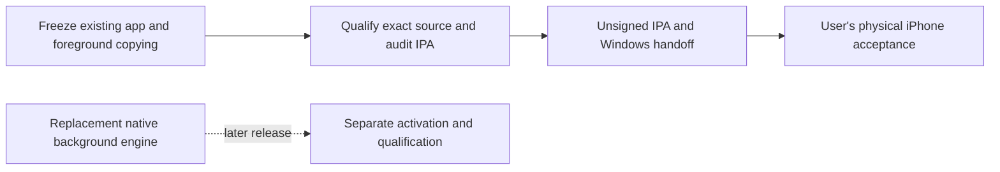

# First iPhone sideload release

Scope decision: 30 October 2026. This is the current release checklist and
supersedes older statements that make unfinished native background transfers
mandatory for the first IPA. Historical build/architecture records remain evidence,
not an expanding release backlog.

## Ship the existing foreground transfer path

Keep the implemented iOS16+ app: local import and ordinary CUE handling, library,
playlists, lyrics/artwork, playback and lock-screen controls, online services and
add-ons, downloads, desktop link/copying, network libraries, share/export, and
supported casting/output adapters. Applicable merged Android changes through
PR350 are included. This scope change does not remove ordinary app features.
Background **audio playback** remains required.

Desktop file copying uses the existing Dart flow. Keep Lokal open with the iPhone unlocked and the desktop
awake on Wi-Fi; after interruption, check for missing files again. Do not promise
that copies continue while iOS suspends or terminates the app. The copy UI states
that requirement. Completed files remain available locally.

Keep the Clear/Forget, writer-generation and historical-ID safeguards in PRs356–357.
Do not undo tested data-safety work to shorten the plan. Native `libraryImport`
and `upload` capabilities remain false. Ordinary foreground copy/upload is still
available; those flags describe the replacement native engine.

## Defer replacement-engine work

| Deferred work | Why it does not block this release |
| --- | --- |
| Native background import/upload and durable queue/progress UI | Foreground copying is already implemented. No first-release promise of suspended-app transfer completion. |
| CUE mapping for a native-import receipt anchor | Applies to the disabled replacement importer. Ordinary local/foreground-imported CUE support stays in scope. |
| Native transfer history pruning and identity watermark | No product jobs are admitted by the replacement importer; retain its bounded admission and existing receipts rather than add pruning. |
| New positive native-import integration fixture and storage-failure/OS-daemon recovery qualification | Required before enabling the replacement engine, not before shipping the established foreground path. Existing checks of shipped behavior remain required. |
| Home Screen widgets and impractical Android-specific direct audio paths | Already excluded by the user; lock-screen controls and ordinary iOS audio stay in scope. |

## Bounded exit checklist

1. **Freeze a candidate.** Use the stack through PR357 plus this scope/UI change.
   Check review findings for actual data-loss, security, startup or playback defects.
   Add no speculative transfer infrastructure or unrelated feature work.
2. **Qualify that exact source once.** Require a successful release/AOT iPhone IPA,
   the existing selected regressions and installed iOS18.6/26 acceptance, and the
   independent package/source/checksum/symbol audit. Earlier builds103/111 do not
   qualify later source. CI waits remain skipped until the packaging/qualification
   step is taken; local Dart compilation is not a substitute for Apple acceptance.
3. **Hand off the matching unsigned IPA.** Include its build/commit, checksum,
   source/notices/symbols and the Windows signing/upgrade instructions. The user
   handles physical installation, upgrade and device playback/route checks.

Aim for one candidate qualification run. Rebuild only for a concrete failure or
critical review finding; a discovered optional improvement goes to follow-up.
Record untested device/service combinations honestly rather than inventing
acceptance or turning every future enhancement into another prerequisite.

