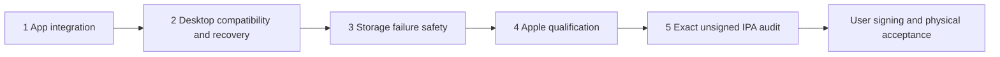

# iPhone completion milestones

Scope decision: 30 October 2026. The user restored the native background-transfer
work after temporarily trimming it. Complete the fixed milestones below; do not
keep expanding the feature list. Build120 is a foreground-copy engineering
checkpoint, separate from the finished native-engine target.

## Fixed completion list

This is the complete pre-device list, fixed on 31 October 2026 (Europe/Paris).
Report these five items consistently; their implementation details do not become
additional milestones. Do not call the release nearly finished based on an
isolated foundation or quote a build count before the remaining source is frozen.

| Item | Definition of done and current evidence |
| --- | --- |
| 1. App integration | Copy-plan submission, the persistent native queue view, cancel/resume/preparation recovery, and verified import completion work together. Source now connects the existing approved desktop preview to a frozen native plan; admitted IDs survive lost replies and no post-submission foreground fallback occurs. The root-owned queue has bounded consistent pages and explicit uncertain-upload receipt checks. Real Isar, host FFprobe and portable native tests pass separately. The registered installed-app import probe exists; execution of the final connected source belongs to item 4. |
| 2. Desktop compatibility and upload recovery | Qualify the real desktop protocol, persist per-operation upload identity, safely handle uncertain/cancelled/requeued copies, and reconcile successful upload receipts with current local song identity. Current desktop head `15c4a5c` has content matching but no durable upload idempotency key; its pre-insert content checks can race. Native uncertain audio remains paused. Cancelled/completed upload history must not be bypassed with new UUIDs. This protocol work remains open and is required before enabling native uploads. |
| 3. Storage failure handling | Journal failure stops all native network/file admissions, revokes source/import authority, cancels and drains OS tasks and file work, preserves owned data, and permits only explicit recovery of durable truth. The centralized source path now has actual held-download/upload coverage, refused bad-storage recovery, eight coalesced recovery callers, no late callback writes, and no resend after restored recovery. Apple daemon behavior belongs to item 4. |
| 4. Apple qualification | Compile the final Swift/Flutter source with Apple SDKs; pass installed-app integration on iOS18.6/26, mixed-direction transfers, background interruption and relaunch, and storage/identity recovery. Host tests and a Dart debug kernel are not this qualification. The user requested no CI polling/waiting; no new Apple result is claimed for this continuation. |
| 5. Release artifact | After items 1–4 pass, enable only qualified capabilities and produce/audit the exact release/AOT unsigned IPA with matching source, licenses, checksum, binary inventory and symbols. Physical signing, installation/upgrade and device acceptance remain the user's separate step. |

Existing isolated foundations—atomic CUE transitions, monotonic song IDs,
Clear/Forget custody reconciliation and completed-download history compaction—
remain part of item 1. They are not extra release items. The new app flow
shows preparation separately from queued/completed transfers and asks the user
to keep Lokal open until all selected files have been admitted. Native downloads
are submitted as one immutable batch; each source-authorized upload retains its
exact intent after an ambiguous reply. Existing private-copy recovery, external
sources and CUE segment export retain the complete foreground plan before native
admission; a partial native submission never switches to foreground copying.

Keep the implemented iOS16+ app and relevant Android parity through merged PR368 (including PR363 source priority):
ordinary imports/CUE, library/playlists, lyrics/artwork, local/online playback,
add-ons/downloads, desktop link, network libraries, share/export and supported
casting/output adapters. PR361's live settings-search and bounded gapless queue
changes retain the iPhone retirement guards; PR362's SMB diagnostics, WebDAV
certificate approval and failed-sync preservation are included. Android's LAN
permission prompt remains Android-only; iOS uses its existing local-network
permission declaration. PR363 adds new-install promotion and drag-and-drop
source priority, with preference rejection treated as a save failure. PR365 adds native libsmb2 and NAS WebDAV href compatibility, with iPhone
scan-retirement guards and pinned-framework preparation/package checks. PR367
bounds NAS artwork/resource use and recovers embedded art; PR368 makes full
desktop sync manual while automatic listening-stat pages remain bounded. See
[the NAS verification scope](IOS_NAS.md). Host tests do not establish iPhone NAS interoperability or
measured gapless latency on an iPhone. Background audio remains required. Home Screen widgets
and impractical Android-specific direct audio remain excluded.

Keep PR356–357 data-safety and historical-ID fixes. Native `libraryImport` and
`upload` flags stay false until the replacement engine is accepted. Foreground
copying remains usable: keep Lokal open with the iPhone unlocked and the desktop
awake on Wi-Fi, and check again after interruptions to retry unfinished files.
The iPhone copy UI remains accurate while native transfers are disabled.

## Candidate qualification and handoff

Preserve each frozen candidate's source and qualification evidence. Build120
may qualify the foreground-copy checkpoint; it does not contain later engine
changes. Use the existing app/simulator acceptance and independent IPA audit,
and rebuild only for actual implementation changes or concrete failures.

The user handles physical iPhone signing, installation/upgrade and device
playback/route acceptance using the Windows instructions. Provide the matching
unsigned IPA, build/commit, checksum, source/notices and symbols. Never infer
physical acceptance from host tests or report an unexecuted native probe as passed.

