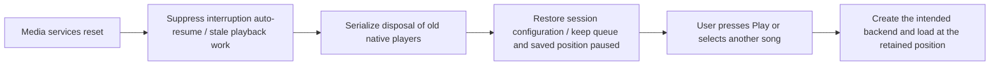

# iPhone integration follow-up

Updated 28 October 2026. These findings guide remaining implementation; they do
not establish receiver, account or physical-iPhone acceptance.

## Media-services reset

Apple requires orphaned audio objects and session configuration to be rebuilt,
with playback remaining paused until a user starts it again. See
[the current AVAudioSession reset contract](https://developer.apple.com/documentation/avfaudio/avaudiosession/mediaserviceswereresetnotification).
This differs from an ordinary resumable interruption.

The port now implements epoch-fenced recovery with native session notifications,
confirmed output retirement, preserved paused selection/queue and explicit Play
to reconstruct output. The [implementation architecture](IOS_MEDIA_RESET_ARCHITECTURE.md)
records request fencing, radio participation and cleanup ordering. Build 67
passes the complete iOS 18.6/26 controlled-notification suites. Later builds 72
and 73 have incomplete WebKit acceptance and do not supersede that package.
See [the current evidence ledger](IOS_PORT.md) for exact source scopes; posted
notifications do not prove a real media-daemon restart.

Implementation must retain song IDs, queue order, processing preferences and the
selected source. A pending new user selection wins over an older reset snapshot.
Keep one audio-session owner and await native cleanup before constructing another
Rust/Core Audio output; a Dart timeout alone cannot cancel native cleanup. Remote
receiver playback must not be paused merely because the phone's local media
services restarted. Clear interruption auto-resume state so an old interruption
end cannot restart music after reset.

Qualification requires both ordinary system playback and Rust/DSP playback,
playing/paused states, repeated resets, a concurrent song selection and an active
remote receiver. A posted notification can exercise recovery logic, but does not
prove an actual media-daemon restart. Use Apple's Developer Settings reset on a
real test phone for that acceptance.

## Chromecast

Google's current [iOS package manifest](https://github.com/googlecast/google-cast-ios-sdk/blob/main/Package.swift)
selects SDK 4.8.6 and **iOS 16**. Its setup page has older summary text mentioning
15, so the executable package requirement takes precedence for build planning.
[Google's setup guide](https://developers.google.com/cast/docs/ios_sender)
requires the generic and receiver-specific Bonjour service declarations and
explicit discovery for a custom picker. Current CocoaPods publication ends at
4.8.6; newer integration uses SPM or a verified direct framework distribution.

The maintainer has now chosen one full-featured iOS 16+ app. The previous
iOS 15 baseline is retired for new builds; older engineering artifacts retain
their recorded minimum. The current SDK and actual sender transport now compile/link for arm64 device
and simulator; see [the Cast implementation and evidence](IOS_CAST_TRANSPORT.md).
Integrated application and receiver acceptance remain pending.
AirPlay remains the system route UI. Then adapt the existing Cast channel/state
contract, file HTTP server, transport controls and local/remote ownership handoff.
A simulator discovery fixture cannot substitute for an actual Cast receiver.

## Discord Rich Presence

Discord's [August 2026 mobile announcement](https://discord.com/blog/mobile-platform-support-arrives-in-discord-social-sdk)
confirms an official iOS Social SDK; it is incorrect to call iPhone presence
categorically impossible. The existing Mornye bridge is Android-only. Its use of
the installed Android client's unauthenticated RPC session does not establish an
equivalent iOS transport.

The candidate iPhone path is the official SDK and explicit account linking. See
[the SDK client/authentication reference](https://discord.com/developers/docs/social-sdk/classdiscordpp_1_1Client.html)
and [release notes](https://discord.com/developers/docs/social-sdk/release_notes.html).
Use the minimal presence scopes; Lokal needs no voice, DM or friends-list UI for
music presence. Confirm this application's configuration/eligibility, callback
scheme, supported iOS minimum and existing SDK redistribution/notices handling
before enabling an opt-in iOS account control. The SDK now has mobile-specific
authentication fixes, so select an observed version and test it instead of
assuming old Android bridge behavior transfers unchanged.

No Discord account credentials are needed in CI. No iOS presence is implemented
or accepted yet. The existing community invite button is a separate working URL
feature.

## Music video and timed lyrics from PRs 199–200

The shared full player includes Video and synchronized-only Space actions.
Android uses Media3. The explicit non-Android branch uses the existing official
YouTube iframe in WKWebView, rather than attempting an Android platform view on
an iPhone. It does not pretend the album recording shares the video's clock.
Direct native AVPlayer paired-stream presentation is still a separate port task;
watching through the authorized embed is the current fallback.

Verify pause-before-enter, stop-before-song-resume, dismissal, backgrounding,
fullscreen and failed/expired embeds on iPhone. In particular, the fallback's
asynchronous WebView teardown needs an observed audio-ownership handoff before
claiming no overlap with local playback. Timed Space lyrics use the shared song
clock; unsynchronized lyrics must not acquire invented timestamps. The native
harness now supplies local generated LRC lyrics and checks entering/leaving Space
with the real player paused at a known position. That check passes on iOS 18.6 in build 24, with an actual screenshot; iOS 26
and physical-device qualification remain pending.

The current player follow-up includes PR #210's preserved artwork/Space overlay
and a [controlled official-embed transport](IOS_VIDEO_TRANSPORT.md). The dedicated
video clock and native WebKit release path are implemented with host/JavaScript
contracts; live WebKit/video qualification is still pending. The earlier
asynchronous-exit handoff is superseded by serialized external-output leases.

The branch now includes main through #216 (37 merged PRs after #172). Both
runtimes pass the complete build-27 native checkpoint through #210. The subsequent
UI/transport work is recorded in the PR audit: unobstructed official video,
correct HTTP ranges, smooth concurrent captions and provider-controlled iPhone
video quality. A new manual live-WebKit probe records observed behavior without
turning a network restriction into successful acceptance.

The earlier reset design below is now implemented; its physical daemon-reset
qualification remains separate. The implementation must continue to invalidate in-flight Rust HTTP probes before they can create a new output,
await confirmed old-engine destruction, preserve queue/position while staying
paused until user action, and include the separate radio player. Merely rebuilding
the Dart player or queuing cleanup behind an old Play is insufficient: the former
leaves native requests alive, and the latter can deadlock if old Play waits on its
own queued recovery. No reset recovery is claimed by ordinary interruption tests.
