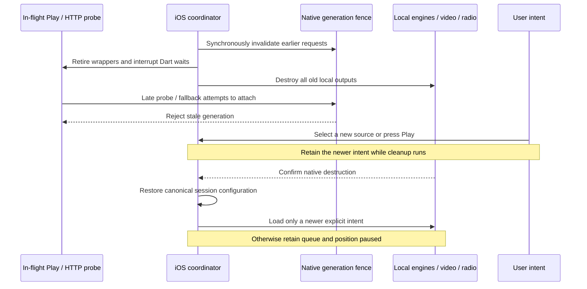

# iPhone media-services reset recovery

Status: hosted iOS 18.6 reset-path validation and continued acceptance,
27 October 2026 (Europe/Paris). **Production observation remains deferred.**
Build 39 passes the complete iOS 18.6 suite, including actual posted reset,
late-native-HTTP and radio checks. Build 40 passes the complete iOS 26 suite on the parity source through #225,
but exposes a background gain retirement race on iOS 18.6. The corrected WebKit
and retained-session-observer continuation passes host tests and requires native execution.
Physical daemon/background/accessory acceptance remains open.

Apple's [media-services reset contract](https://developer.apple.com/documentation/avfaudio/avaudiosession/mediaserviceswereresetnotification)
requires orphaned audio objects and session configuration to be recreated, without
automatically restarting playback. The locked `audio_session` 0.2.4 exposes
`AVAudioSession().mediaServicesWereResetStream` and the corresponding lost stream.
Its native plugin forwards the notifications; it does not rebuild Lokal's engines.
The locked `just_audio` 0.10.6 has no automatic reset handler in its native player.
Use the existing session owner rather than adding a competing Swift configuration.

## Ownership and state

One iOS coordinator owns lifecycle state and an increasing reset generation.
PlayerService remains the owner of queue, selected song, intended output and saved
position. Radio participates explicitly: it owns a separate native player today.
The coordinator must not pause a remote Cast receiver when the phone loses media
services. Video is a local external owner and must yield before any local audio
backend is reconstructed.

Lost blocks new phone output immediately and clears interruption auto-resume,
ducking and pending local loads. It must not hold an operation-queue task open
while waiting indefinitely for Reset. Queue edits, source selection and remote
receiver controls remain available. Recovering retains song IDs, queue order,
position, radio station and processing preferences; it must not relabel the last
playing state as successful recovery.

A newer selection or Play is recorded immediately with its intent revision. It
can load only after cleanup is confirmed, and wins over the recovery snapshot.
Reset by itself never authorizes resume. If cleanup is unconfirmed, local output
stays blocked with a useful recovery/restart action; a timeout is not cancellation.

## Cancel native requests as well as Dart futures

A Dart disposed flag is insufficient. `audio_play_from_http` probes the URL before
`ensure_audio_engine`, so a slow, already-submitted Rust request could create a
Core Audio output after Dart has replaced its player. A request can also wait in
FRB's worker pool before its Rust function starts.

The implementation therefore needs a synchronous native invalidation boundary
that does no I/O and does not wait on the global engine mutex. Each iOS request
that can create or resume local output must carry its expected generation,
captured **in Dart before submitting the FFI call**. Capturing it only at the start
of the Rust worker misses requests queued before Reset but executed afterwards.
The candidate adds a synchronous epoch getter and optional generation parameters
to 25 asynchronous mutators; pinned FRB 2.13.0 regeneration produces 140
entrypoints in the foundation (141 in the connected candidate below). iOS rejects missing generations; Android's existing unscoped callers
retain their behavior. Generator-owned bindings are not edited manually. FRB's
unneeded build_runner phase is disabled so it cannot remove the unrelated tracked
Isar/Riverpod outputs.

Validate that generation before and after expensive probes, inside engine
creation/attachment critical sections, and before enqueueing playback or queue
commands. A reset racing with an already-running initializer must still await its
complete teardown. Keep a request's generation through fallbacks and dead-engine
retry; refreshing it there would revive a cancelled operation. Retired Dart
wrappers must reject later callbacks, state publication and fallback creation.
Android's existing rendering/transport behavior must stay intact.

Do not put a recovery barrier behind a Play that then awaits the same barrier:
that deadlocks the player's serialized operation queue. Retirement must let the
old Dart operation unwind without waiting for its slow native network future.
The underlying native future remains observed, and its generation prevents late
side effects. Cleanup runs under explicit ownership and is awaited independently
before newer operations may construct output.

## Concrete integration points

| Component | Required change |
| --- | --- |
| PlayerService | Subscribe once to lost/reset; invalidate local intent and interruption resume; retain queue/position; publish recovery state; serialize newer intent after confirmed cleanup. |
| AudioEngineManager | Invalidate pending attachment tokens immediately, retire wrappers, cancel subscriptions, and await disposal of both current and pending candidates. |
| RustAudioEngine / RustAudioService | Fence submissions with their captured generation; race Dart waits against retirement; reject stale state/retry/fallback work; stop polling and require confirmed shutdown. |
| Rust API / engine manager | Atomic generation boundary; generation-aware prepare/play/HTTP/queue/resume and attachment checks. Preserve command-worker shutdown/join completion before allowing a replacement output. |
| System engine | Cancel native loads, dispose old AVPlayer objects, retain the paused source/position, and create a new native player only after disposal. |
| RadioPlayerNotifier | Cancel request generations and readiness timers, retire its independent just_audio instance, retain the station paused, and join central output/recovery ownership. |
| Music video | Await the existing lease and real native WebKit suspension; prevent delayed API readiness from restarting playback. A later video request is a new explicit intent. |
| Session/notification UI | Reapply the canonical session configuration after native cleanup, clear old auto-resume state, and publish paused metadata without losing the selected recording. |

Current `_disposeUsbEngine` tolerates shutdown errors and clears its availability
flag. Reset cleanup cannot treat that tolerance as confirmed native destruction.
The native manager releases its state mutex before blocking shutdown, and the
engine handle joins its command thread; preserve that acknowledgement boundary.
Do not open a replacement output because a Dart timeout expired.

## Acceptance before enabling the feature

1. Deterministic concurrency tests must cover an HTTP probe submitted before
   invalidation but started afterwards, a probe finishing after cleanup, late
   fallback/retry, a pending engine attach, repeated resets and new user intent.
2. Host tests must prove queue IDs/order, preferences and saved position survive;
   old interruption-end cannot resume; cleanup failure blocks replacement; and
   receiver controls remain independent of the phone's local reset.
3. The native harness should post the actual AVAudioSession reset notification
   through a DEBUG-only helper, then exercise real AVPlayer and Rust/DSP disposal,
   paused preservation and explicit manual replay. Include a delayed real HTTP
   fixture and radio. A posted notification is app recovery-path evidence, not a
   real daemon restart.
4. Physical iPhone acceptance must use Apple's Developer Settings media-services
   reset, actual background/foreground transitions and routes/accessories. Cover
   playing and paused system/Rust/radio/video, repeated resets and denied cleanup.

Until those gates pass, retain the honest unimplemented status in the port plan.

## Current candidate evidence

- **314 Rust tests pass**, including delayed/queued requests, mutation-drain
  races, generation exhaustion, nested fallback and unconfirmed-cleanup fencing.
- **21 focused Flutter tests pass**, including the eight lifecycle scenarios,
  five pending-attachment/cleanup cases, failed source replacement, Rust paused
  state, retired HTTP resolution and pending initialization, and iOS DSP choice.
- Whole `lib`/integration analysis reports **no errors**, with the existing 562
  warnings/information items. This is not a complete-Flutter-suite-green claim.
- Swift calls the atomic functions through C declarations in the Runner bridging
  header. The next native acceptance run must prove actual Swift/FRB counter
  agreement and rejection of an old generation through a DEBUG-only final probe.
  That destructive fence probe is not a posted notification or daemon reset.
- Native notification subscription and full owner reconstruction are still
  pending. No hosted build or physical reset pass is claimed for this candidate.

The changed native library also compiles for Android ARM64 using the real pinned
NDK through Cargokit (`BUILD SUCCESSFUL`). Android CI remains manually disabled;
this is compilation evidence, not a USB/DAC or physical-device acceptance pass.

A broader **30-test** selection also passes lifecycle retirement, player output
transitions, Android session fallback and Rust paused/retired wrappers (overlaps
the 21 above). Re-running pinned bridge generation leaves all three generated
audio/bridge files byte-for-byte identical.

## System-player and radio ownership continuation

The next candidate revision tracks each iOS just_audio object at construction,
including pending factories, and shares its real disposal future across owners.
The iPhone system wrapper rejects late loads and awaits primary, secondary and
pending crossfade players. The ordinary Android branch retains its existing
rendering and cleanup policy. Radio now registers retirement, clears readiness
waiters and timers, rejects stale completions, retains the selected station
paused, and awaits native disposal. A later explicit toggle can recreate it.

The registry/system/radio-timeout/output-transition selection passes **36** host
tests, including disposal after a real wrapper crossfade role swap. The wrapper
ownership check uses the real event loop; simulated-clock fixture teardown was
not a product failure. This is still preparation: the native observer remains
uninstantiated, and PlayerService reset state, local queue cancellation, video
reconstruction, recovery UI and full notification-path acceptance remain open.

Build 35 at `f03be49ea413030d6641bdd8b0e93a144ae39155` has compiled and packaged
the release iPhone app, including the new Swift C-ABI references; runtime checks
are ongoing. It predates the system/radio continuation above.

### Build-35 fence-test correction

Build 35 compiles/packages both app variants, but its iOS 18.6 suite fails with
LocalAudioRequestRetired after the final destructive counter probe invalidates
active Dart work. This is not a recovery acceptance pass. The raw shared-counter
probe now runs through a testing-only bootstrap callback immediately after FRB
initialization, before playback owners exist. It still verifies Swift/FRB counter
agreement and rejects an old token; the full ordinary suite then exercises an
actual nonzero generation. Actual notification/daemon reset tests remain pending.

The updated candidate passes the exact **217-test** contract command committed
in the iPhone workflow, covering shared output ownership, Cast, video/Space,
retirement, lyrics/provider/download localization and add-ons. This is host
contract evidence; the revised bootstrap fence probe and latest source still
require the next hosted native run.

## Connected recovery candidate and acceptance gate

PlayerService now retires its local operation queue outside native disposal,
retains canonical song/source identity, queue order and position, clears stale
interruption resume/duck flags, and restores the existing session configuration
without activation or Play. Explicit receiver controls use a separate captured
scope and continue while local output is unavailable; an old remote operation
cannot acquire fresh local fallback across reset. Old session initializations
cannot clear a newer confirmed engine. A recovered pending online selection can
resolve on explicit Play; seeking an unattached recovered track updates its
paused position without creating an output.

The video lease retains the selected video and raw source position. Native
WebKit suspension must complete before replacement; detached/disposed widgets
retain an acknowledgement ledger, and failures remain closed. The old platform
view stays mounted until suspension returns. iPhone documents defer autoplay to
the host, which checks the request epoch and foreground state before Play. A
reset replacement cues the saved position paused. Existing WebKit views also
receive early native suspension on the notification thread's main-queue handoff;
this safeguard is not substituted for the actual cleanup acknowledgement.
Android retains its existing iframe autoplay policy.

The recovery notice takes layout space below the content, including video
controls, hides for an active Cast receiver, and announces state changes to
accessibility. It directs the user to the selected source's Play control or to
close/reopen the app when cleanup is uncertain. There is no simulated restart
button. All eleven shipped locales fit a 320px phone at 200% text size.

The regenerated bridge now has **141 entrypoints**: the additional synchronous
retirement function fences requests if the observation channel fails or cleanup
cannot be confirmed within twelve seconds. The actual disposal futures remain
owned and observed; a timeout never authorizes replacement playback.

Validation of this source before native publication:

- The exact iPhone workflow contract selection passes **234 Flutter tests**,
  including video/Space/Cast, stale requests, session retirement, lyrics,
  downloads, radio timeouts and the localized recovery notice.
- **315 Rust tests pass**; Android ARM64 compiles with the real pinned NDK.
- Pinned FRB 2.13.0 regeneration reproduces all three bridge/API files exactly.
  Whole lib/integration analysis reports no errors (569 warnings/information).
- Ten simulator/control coordinator tests pass, including evidence preservation
  when initial simulator inventory times out. Workflow actionlint passes.
- Native harness additions post actual AVAudioSession reset notifications while
  playing and paused through AVPlayer and Rust DSP, require explicit replay,
  hold cleanup while a newer selection and repeated reset arrive, and hold a
  real loopback HTTP probe until a replacement output is playing. These checks
  are **pending hosted execution**. No actual daemon restart is claimed.

[Build 36](https://github.com/lokal-music/lokal-mobile/actions/runs/40347453464)
uses prior source `e549395101eb8a11ea98ac693402ba59ddaeb341` (tree
`8fc2728deb15c855ff32c630fca11121b7fad06c`): unsigned release packaging and the
complete ordinary iOS 18.6 suite pass with the shared-counter bootstrap probe.
Its fresh iOS 26 host times out listing simulator devices before boot; no app
acceptance ran there. Inventory now has a bounded ninety-second cold-service
allowance and preserves partial output on failure. Build 34 remains the latest
complete dual-runtime checkpoint. Build 36 does not test this connected recovery
implementation.

Still required after this gate: radio and retained WebKit notification-path
acceptance, actual daemon resets/background/routes on an iPhone, and Windows
sign/install/update acceptance. Public YouTube challenge responses remain
inconclusive for live video playback; no challenge bypass is used.

### Build 37 dependency failure and radio continuation

[Build 37](https://github.com/lokal-music/lokal-mobile/actions/runs/40373620894)
at `beb956ed476df2db4c259806426b27335166eed7` stops before application
compilation because the pinned FFmpeg archive download returns HTTP 504.
Neither native app suite runs. Both independent Apple Rust target probes pass
for this source (device and simulator, regenerated API 141).

The dependency helper now retries only bounded transient transport failures,
discards incomplete downloads, verifies the unchanged pinned SHA-256 before
publishing its path, and never retries a checksum mismatch or permanent HTTP
error. A cached archive is reusable only after its bytes are checked again.
All sixteen dependency/simulator/control Python tests and actionlint pass.

The native radio continuation uses a loopback WAV station through the production
radio notifier and actual AVPlayer. It requires native Ready, retained paused
station state across reset, and an actual fresh HTTP open on explicit replay.
This is a deterministic local fixture, not a live public station or audible
hardware acceptance. Its native execution is pending with the other reset gates.
A paused/cued iPhone video seek now cues the new position instead of issuing a
seek that may start playback. Thirteen focused production-JavaScript/controller
tests pass, including the unchanged Android autoplay policy. Source analysis of
this continuation has no issues. Production observation remains deferred.

### Build 38 and canonical queue/evidence correction — 27 October 2026

[Build 38](https://github.com/lokal-music/lokal-mobile/actions/runs/40374844619),
head `43f1352b71bb7a76f60f7010cc9015bcc2b79bf8`, compiles and packages the
release and simulator apps, and reaches the new repeated-reset selection check
on iOS 18.6. That check incorrectly expects the unrotated input playlist even
though the existing wrap-around preference places the selected song first.
The assertion now captures canonical IDs/order and selection index immediately
after selection, then requires exact preservation after reset. It still checks
both expected song IDs, selected index, paused state, zero position and explicit
replay; it does not weaken queue retention into unordered equality.

The driver also rejects the old camel-case backend screenshot name, preventing
JSON evidence export on the failed test. Producers now use lowercase system /
rust-dsp names. JSON evidence is written even if screenshot export fails, and
the export failure still fails the driver. The old run is not a recovery pass.

The isolated iOS 26 device reports Booted but times out waiting for SpringBoard;
its screenshot is empty and no app runs. The next boot starts Simulator.app for
the exact selected device before bootstatus, retaining the same boot/control/app
gates. Display-service logs are preserved on failure. This is a host startup
correction awaiting native validation, not a proven iOS 26 recovery fix.
All sixteen dependency/simulator/control Python tests pass.

## Build 39: confirmed iOS 18.6 recovery path

[Build 39](https://github.com/lokal-music/lokal-mobile/actions/runs/40435716700)
passes the complete iOS 18.6 suite at candidate head
`c2ee76b9f3c5b52831849cd2b24b8c8eef4a1f79` (candidate tree
`63f4e889a5f8b8ced7c0daea2a2a20793e88405e`). The preserved runtime report
records compiled PR-merge source `168230c85616c0c793abe0f04c6e1a7eb00d1af5`.
The runtime artifact SHA-256 is
`a0e000016c4cf610527fd9d40d1bb39dbb5d4b9d2cb87dc3f3c20e888e3e703f`.
JSON and actual system/Rust paused/recovering screenshots are now exported.

| Native case | Confirmed result |
| --- | --- |
| AVPlayer playing + paused reset | Two posted notifications; queue, preferences and paused position retained; explicit replay advances 304 ms. |
| New selection during repeated reset | Waiting Play retires; canonical order/index and newer selection retained paused; explicit replay advances 303 ms. |
| Rust DSP playing + paused reset | Two posted notifications; retained paused state; explicit replay advances 309 ms. |
| Delayed native HTTP | Actual loopback probe is released only after replacement starts, is rejected as stale and does not displace replacement; further progress 544 ms. |
| Radio | Actual AVPlayer Ready, two resets, retained station paused and four real loopback HTTP opens across explicit replay. |

These are app/notification-path checks, not a media-daemon restart, audible
hardware proof or live public-service qualification. The separate iOS 26 job
fails listing available devices after ninety seconds, before selection/boot or
application launch. Simulator GUI startup is therefore not exercised there.
The next workflow pins the system-selected Xcode to the same declared build
installation before simulator services are used; its effect is pending validation.
The required iOS 26 boot/control/full-suite gates remain intact.

## Final owner/event lifetime continuation

The new host regression reproduces a persistent session subscription inheriting
the request generation that installed it. After reset its next interruption
could no longer enter local playback. Session/noisy observers now register with
neutral local/remote tickets while preserving their error zone; each subsequent
event captures a fresh request. Pending loads and retries retain their original
tickets. Expected reset retirement of background pause/duck/resume is observed,
and a phone noisy event does not pause an active receiver.

Both successful and failed awaited results are fenced before fallback/error
publication, including native invalidation before Dart receives the event.
A video release captures its owned native acknowledgements at submission and
retires if reset or replacement ownership arrives meanwhile. It cannot clear
the retained video selection, authorize another output, or wait indefinitely
on a replacement view's future. Native-quiet failures stay observed while the
command sender is pending and remain failures for the actual waiter.

The additional native gate posts Lost/Reset and interruption notifications via
the real audio_session plugin, requires old interruption-end to stay paused and
requires a fresh interruption to pause/resume after recovery. These additions
are pending Mac execution.

## Offline real-WebKit media acceptance

The new debug-only document seam runs the exact production Lokal iframe bridge
against a generated twelve-second 96x54 H.264/AAC video in an iframe. Data URIs
eliminate public-network/provider availability from this gate. FFprobe confirms
both codec tracks, duration and 49,935 bytes; fixture SHA-256:
`416a7558921761a26aca370a294be0080ae969afb3249acfef720b3d54b24f37`.
The generation command is retained beside the base64 test asset. Product routes
continue to construct the official YouTube embed.

The native check requires actual WKWebView creation, real decoded-frame counts
and un-interpolated HTML media time. Space must preserve the presentation and
current native view; reset must acknowledge quiescence, replace that view,
retain the selected video/time/Space paused, and advance again only after Play.
A second paused reset must reconstruct another paused view. This is prepared
native acceptance, **not a reported native pass or YouTube qualification**.
The public YouTube probe remains separate and opt-in.

The exact expanded workflow selection passes **304 Flutter tests**; sixteen
Python dependency/simulator/control tests and actionlint pass. Whole lib and
integration analysis reports no errors (571 warning/information items). Native
Rust, API 141 bindings and dependency locks are unchanged. The ordinary Android
transport/interruption path is retained by the iPhone-only facade boundaries.

## Build 40: iOS 26 pass and background gain acknowledgement race

[Build 40](https://github.com/lokal-music/lokal-mobile/actions/runs/40438681830)
uses head `07eb69f3468ad4fce42eb33cb6d1dea12a5f88d2`, tree
`bd50a0c83d58894717abcb2ba9e691842d0960fc` and compiled PR merge
`ccfb0170bc9385889aeec79239bcb75ba59036cd`. The complete iOS 26 report passes:
system reset replay 303 ms, newer selection 304 ms, Rust reset replay 554 ms,
late HTTP replacement progress 502 ms and four radio HTTP opens. Artifact
`12707319273` SHA-256:
`52225bef7c5ea9c36ea5f47f2ae3851aae6feb5e0d5db6975b2415b2b6c79e41`.
The GUI-before-bootstatus strategy therefore reaches app acceptance on this host;
earlier intermittent inventory failures are not proven resolved.

On iOS 18.6 the system and Rust reset checks pass, then an unawaited diagnostics
volume reconciliation exposes `LocalAudioRequestRetired` from
`RustAudioService.setVolume` after reset. The native fence correctly rejects the
old acknowledgement, but the background owner does not observe cancellation.
The test fails; subsequent missing-fixture errors are teardown after that failure,
not a separate codec diagnosis. Runtime artifact `12706658265` SHA-256:
`41207cb74c5307d434138bca2b6e684feedbd9fcf70f876843ba3e8985b0cdb6`.
Full diagnostics artifact `12706683331` SHA-256:
`b08df97e41d7ffa7277a024a1a4a9ebd033e9b1409449b4554d85503cafc4e43`.

All background gain reconciliations, including system ReplayGain folds, now
explicitly observe expected retirement.
The whole reconciliation enters the original request scope; awaited callers still
receive cancellation so they cannot continue stale work. The host regression
holds a native gain acknowledgement across reset, observes prompt background
cancellation and a later native error, forbids stale publication, and verifies
that an unrelated current gain failure still propagates. No global error-handler
filter, refreshed request ticket, weakened assertion or automatic retry is used.
