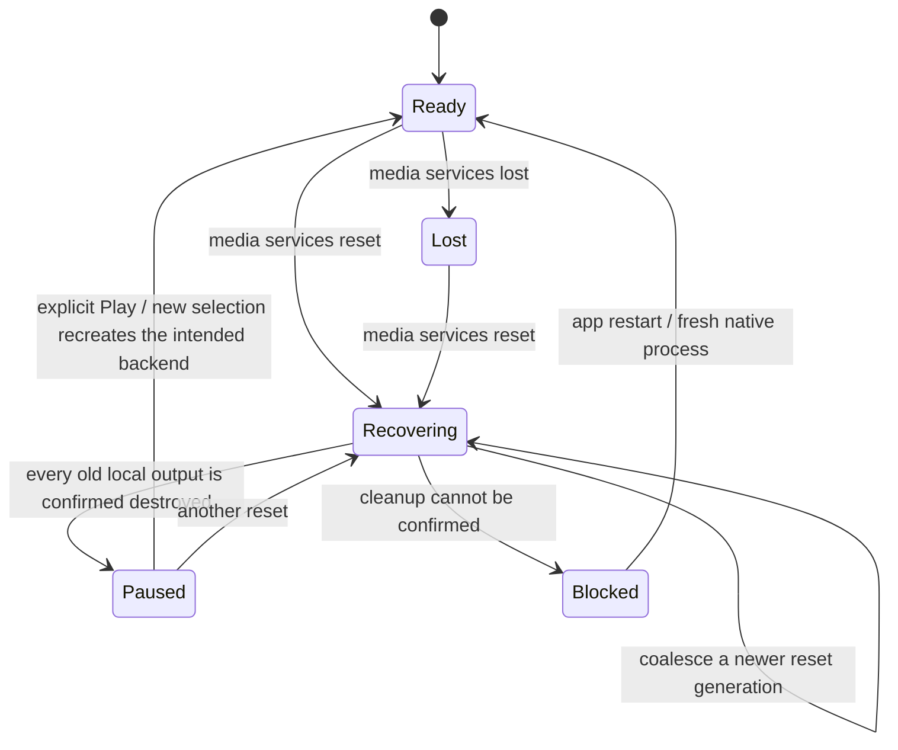
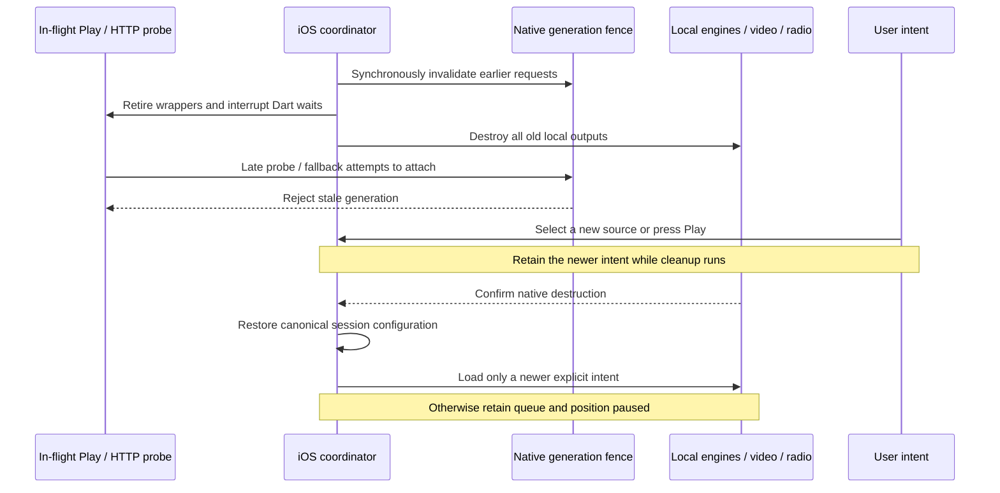

# iPhone media-services reset recovery

Status: implementation in progress, 26 October 2026 (Europe/Paris). **Not enabled
or qualified.** The request fence, scoped Rust/DSP callers, retirement coordinator,
pending-attachment guards and deferred Swift observer now exist in the recovery
candidate. The observer is deliberately not instantiated until PlayerService,
radio, video and session/UI cleanup are connected. Ordinary interruption and
build-27 playback tests do not establish reset recovery.

Apple's [media-services reset contract](https://developer.apple.com/documentation/avfaudio/avaudiosession/mediaserviceswereresetnotification)
requires orphaned audio objects and session configuration to be recreated, without
automatically restarting playback. The locked `audio_session` 0.2.4 exposes
`AVAudioSession().mediaServicesWereResetStream` and the corresponding lost stream.
Its native plugin forwards the notifications; it does not rebuild Lokal's engines.
The locked `just_audio` 0.10.6 has no automatic reset handler in its native player.
Use the existing session owner rather than adding a competing Swift configuration.

## Ownership and state

One iOS coordinator owns lifecycle state and an increasing reset generation.
PlayerService remains the owner of queue, selected song, intended output and saved
position. Radio participates explicitly: it owns a separate native player today.
The coordinator must not pause a remote Cast receiver when the phone loses media
services. Video is a local external owner and must yield before any local audio
backend is reconstructed.

Lost blocks new phone output immediately and clears interruption auto-resume,
ducking and pending local loads. It must not hold an operation-queue task open
while waiting indefinitely for Reset. Queue edits, source selection and remote
receiver controls remain available. Recovering retains song IDs, queue order,
position, radio station and processing preferences; it must not relabel the last
playing state as successful recovery.

A newer selection or Play is recorded immediately with its intent revision. It
can load only after cleanup is confirmed, and wins over the recovery snapshot.
Reset by itself never authorizes resume. If cleanup is unconfirmed, local output
stays blocked with a useful recovery/restart action; a timeout is not cancellation.

## Cancel native requests as well as Dart futures

A Dart disposed flag is insufficient. `audio_play_from_http` probes the URL before
`ensure_audio_engine`, so a slow, already-submitted Rust request could create a
Core Audio output after Dart has replaced its player. A request can also wait in
FRB's worker pool before its Rust function starts.

The implementation therefore needs a synchronous native invalidation boundary
that does no I/O and does not wait on the global engine mutex. Each iOS request
that can create or resume local output must carry its expected generation,
captured **in Dart before submitting the FFI call**. Capturing it only at the start
of the Rust worker misses requests queued before Reset but executed afterwards.
The candidate adds a synchronous epoch getter and optional generation parameters
to 25 asynchronous mutators; pinned FRB 2.13.0 regeneration produces 140
entrypoints. iOS rejects missing generations; Android's existing unscoped callers
retain their behavior. Generator-owned bindings are not edited manually. FRB's
unneeded build_runner phase is disabled so it cannot remove the unrelated tracked
Isar/Riverpod outputs.

Validate that generation before and after expensive probes, inside engine
creation/attachment critical sections, and before enqueueing playback or queue
commands. A reset racing with an already-running initializer must still await its
complete teardown. Keep a request's generation through fallbacks and dead-engine
retry; refreshing it there would revive a cancelled operation. Retired Dart
wrappers must reject later callbacks, state publication and fallback creation.
Android's existing rendering/transport behavior must stay intact.

Do not put a recovery barrier behind a Play that then awaits the same barrier:
that deadlocks the player's serialized operation queue. Retirement must let the
old Dart operation unwind without waiting for its slow native network future.
The underlying native future remains observed, and its generation prevents late
side effects. Cleanup runs under explicit ownership and is awaited independently
before newer operations may construct output.

## Concrete integration points

| Component | Required change |
| --- | --- |
| PlayerService | Subscribe once to lost/reset; invalidate local intent and interruption resume; retain queue/position; publish recovery state; serialize newer intent after confirmed cleanup. |
| AudioEngineManager | Invalidate pending attachment tokens immediately, retire wrappers, cancel subscriptions, and await disposal of both current and pending candidates. |
| RustAudioEngine / RustAudioService | Fence submissions with their captured generation; race Dart waits against retirement; reject stale state/retry/fallback work; stop polling and require confirmed shutdown. |
| Rust API / engine manager | Atomic generation boundary; generation-aware prepare/play/HTTP/queue/resume and attachment checks. Preserve command-worker shutdown/join completion before allowing a replacement output. |
| System engine | Cancel native loads, dispose old AVPlayer objects, retain the paused source/position, and create a new native player only after disposal. |
| RadioPlayerNotifier | Cancel request generations and readiness timers, retire its independent just_audio instance, retain the station paused, and join central output/recovery ownership. |
| Music video | Await the existing lease and real native WebKit suspension; prevent delayed API readiness from restarting playback. A later video request is a new explicit intent. |
| Session/notification UI | Reapply the canonical session configuration after native cleanup, clear old auto-resume state, and publish paused metadata without losing the selected recording. |

Current `_disposeUsbEngine` tolerates shutdown errors and clears its availability
flag. Reset cleanup cannot treat that tolerance as confirmed native destruction.
The native manager releases its state mutex before blocking shutdown, and the
engine handle joins its command thread; preserve that acknowledgement boundary.
Do not open a replacement output because a Dart timeout expired.

## Acceptance before enabling the feature

1. Deterministic concurrency tests must cover an HTTP probe submitted before
   invalidation but started afterwards, a probe finishing after cleanup, late
   fallback/retry, a pending engine attach, repeated resets and new user intent.
2. Host tests must prove queue IDs/order, preferences and saved position survive;
   old interruption-end cannot resume; cleanup failure blocks replacement; and
   receiver controls remain independent of the phone's local reset.
3. The native harness should post the actual AVAudioSession reset notification
   through a DEBUG-only helper, then exercise real AVPlayer and Rust/DSP disposal,
   paused preservation and explicit manual replay. Include a delayed real HTTP
   fixture and radio. A posted notification is app recovery-path evidence, not a
   real daemon restart.
4. Physical iPhone acceptance must use Apple's Developer Settings media-services
   reset, actual background/foreground transitions and routes/accessories. Cover
   playing and paused system/Rust/radio/video, repeated resets and denied cleanup.

Until those gates pass, retain the honest unimplemented status in the port plan.

## Current candidate evidence

- **314 Rust tests pass**, including delayed/queued requests, mutation-drain
  races, generation exhaustion, nested fallback and unconfirmed-cleanup fencing.
- **21 focused Flutter tests pass**, including the eight lifecycle scenarios,
  five pending-attachment/cleanup cases, failed source replacement, Rust paused
  state, retired HTTP resolution and pending initialization, and iOS DSP choice.
- Whole `lib`/integration analysis reports **no errors**, with the existing 562
  warnings/information items. This is not a complete-Flutter-suite-green claim.
- Swift calls the atomic functions through C declarations in the Runner bridging
  header. The next native acceptance run must prove actual Swift/FRB counter
  agreement and rejection of an old generation through a DEBUG-only final probe.
  That destructive fence probe is not a posted notification or daemon reset.
- Native notification subscription and full owner reconstruction are still
  pending. No hosted build or physical reset pass is claimed for this candidate.

The changed native library also compiles for Android ARM64 using the real pinned
NDK through Cargokit (`BUILD SUCCESSFUL`). Android CI remains manually disabled;
this is compilation evidence, not a USB/DAC or physical-device acceptance pass.

A broader **30-test** selection also passes lifecycle retirement, player output
transitions, Android session fallback and Rust paused/retired wrappers (overlaps
the 21 above). Re-running pinned bridge generation leaves all three generated
audio/bridge files byte-for-byte identical.
