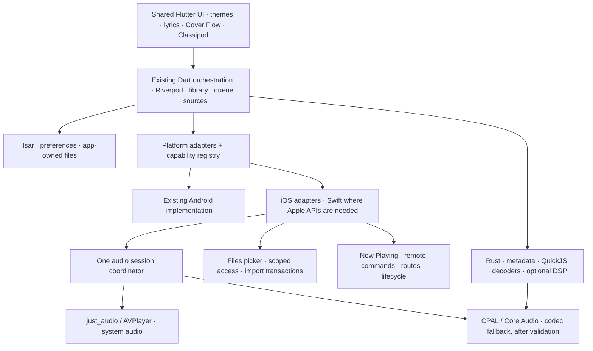

# Lokal Mobile for iPhone: architecture and release plan

Status: implementation and hosted runtime investigation, 25 October 2026.
The original audit used `42f8f1dbc939`; implementation is tracked in
[PR #172](https://github.com/lokal-music/lokal-mobile/pull/172).

Hosted Xcode 26.0.1 builds the complete simulator app and release/AOT iPhone app.
The first unsigned engineering IPA passed package inspection (33 Mach-O binaries,
iPhone arm64 platform, bundle metadata and checksum). Native Rust probes pass for
both device and Apple Silicon simulator with raw USB excluded. **Runtime acceptance
has not passed: the automatically selected iOS 18.5 simulator aborts loading
`libswiftWebKit`, matching [WebKit bug 293831](https://bugs.webkit.org/show_bug.cgi?id=293831).
CI now explicitly selects iOS 26.0; this runtime correction is awaiting its run.** Native console/crash-report collection is now part of CI.
No signed installation or physical iPhone behavior is validated.

The engineering artifact is in
[build 7](https://github.com/lokal-music/lokal-mobile/actions/runs/40147725974).
It is a diagnostic build, not a qualified release. See
[Windows installation and acceptance](IOS_SIDELOADING.md) for distribution limits.

### Implementation already in place

- iPhone-only runner, iOS 15 floor, generated alternate icons, pinned build tools
  and locked dependencies, source/license bundle and unsigned IPA inspection.
- Swift document imports with scoped/coordinated transactional copies; persistent
  app-owned library root and ID-preserving sandbox-path rebasing; database files
  in Application Support with a nondestructive legacy migration.
- Explicit iOS system and Rust/Core Audio modes; single audio-session owner,
  interruptions, Now Playing/remote controls, route diagnostics and AirPlay UI.
  Rust is selected for DSP or unsupported system formats without claiming direct
  USB or bit-perfect output. These native routes still need runtime validation.
- Spotify's existing web-session protocol ported to isolated WKWebView and the
  existing Keychain-backed credential store. Live account checks remain pending.
- Integration smoke test exercises real startup, scanner, QuickJS, system WAV
  playback, Rust DSP and WavPack fallback. No native mocks substitute for these
  operations; the current native launch failure blocks execution.

Chromecast sender integration, WidgetKit, Discord feasibility and resumable
background transfers remain open work. Live add-on stream handles currently
retain the system streaming adapter and explicitly report Rust DSP bypass;
DSP support for those sources remains open rather than attempting to open an
opaque stream handle as a native file. Shared UI and source availability do not
establish iOS parity.

## Product brief

Deliver a sideloadable iPhone version with the Android product's features wherever
iOS reasonably supports them. Time is not a constraint. Preserve Lokal's visual
identity, local-first library, optional online services, and existing Android
behavior. Do not trade away online sources, add-ons, or desktop integration to
reach an early release date.

Advanced audio is a separate feasibility track: direct USB, bit-perfect output,
native DSD/DoP, DAP controls, Android codec selection and privileged audio paths
are not required. Ordinary headphone/Bluetooth/USB audio through iOS, reliable
playback, codec coverage, and practical sound controls remain product goals.
DSD **file decoding to PCM** is distinct from native DSD output.

The maintainer uses Windows and currently has no Mac, iPhone, or paid Apple
Developer membership. Build using hosted macOS/Xcode. Sign on the installer's
Windows machine using their own Apple account. Recruit an iPhone tester before
calling any build release-ready. Keep account credentials out of CI and chat.

## Recommended architecture

Keep Flutter/Riverpod/Isar and the existing Rust bridge. Add small platform
adapters around the platform-dependent services; preserve repositories, queue
rules, library identity and shared presentation. A SwiftUI rewrite would duplicate
the largest tested part of the product while still requiring native audio and
file integration. A web wrapper would discard useful existing native work.



These are architectural boundaries, not a requirement for a new class per box.
The current adapters extend the existing player and platform channels; focused
regression coverage protects the shared Android paths.

| Boundary | Responsibility and rule |
| --- | --- |
| Platform capabilities | Availability and reason for each feature, plus runtime route/permission state. Hide irrelevant Android controls. Unsupported actions return a typed result; a missing plugin is not success. |
| Playback backend | Add an explicit iOS system mode rather than persisting `normalAndroid` or displaying Oboe on iOS. Keep queue ownership in the existing player. Exactly one active playback backend. |
| Audio session | Adapt `audio_session` for iOS music playback, activation, interruption, route loss and media-services reset. One owner configures the process-wide session, including video/radio/casting handoffs. Swift observes or supplies missing events without independently fighting that owner. |
| System media controls | Map current notification-owner semantics to `MPNowPlayingInfoCenter` and `MPRemoteCommandCenter`. Library, radio and desktop remote must publish the actual current owner. Remove duplicate command handlers on disposal. |
| Library file access | Represent an app-owned file or leased external resource, not an Android `content://` URI. Resolve imported paths against the current sandbox; never persist its absolute installation prefix as identity. |
| Native integration | Typed contracts for document imports, build identity, route diagnostics, OAuth, share/save, casting and lifecycle. Use generated Pigeon bindings if the added contract surface justifies that dev dependency. Preserve existing Android channel names. |
| Credentials | Use iOS Keychain through the existing secure-storage package. Audit access-group requirements with free signing; do not require shared groups or iCloud entitlements for the base app. |
| Jobs | Separate active playback from scan/copy/download work. Use resumable persisted job state; iOS suspension is normal. Background audio is not permission for indefinite unrelated work. |

### Audio decision and experiments

Use the existing `just_audio` iOS backend as the baseline for system-supported
formats. It already declares iOS support. Validate real gapless transitions,
seeking, background playback and protected-header streams on the locked version.
Do not infer support from Android's implementation or from the package's latest
documentation.

The shared Rust engine remains needed by metadata and add-ons at startup. Compile
it with `--no-default-features --features native_audio,rquickjs/bindgen` on iOS. Prove the dependency
graph contains no `rusb`/`libusb1-sys`. Cargokit now selects the iOS feature set
by platform, while Android retains its default `native_audio` and `uac2` features.

The resolved `rquickjs-sys` 0.14.0 ships macOS bindings but no
`aarch64-apple-ios` or simulator bindings. The manifest now enables generated
bindings for iOS with the matching Xcode SDK
and explicit Clang device/simulator triples; macOS ABI bindings are not reused.
The native probes and Cargokit integration compile this configuration.

For formats that AVPlayer cannot play, investigate the already-vendored CPAL iOS
Core Audio backend with Rust decoders. Its source exists, but includes TODOs for
session-derived sample rates and buffer sizing. Compare it against AVPlayer using
the same fixture corpus and measured interruptions/route changes. Do not choose
it as the default based only on a successful compile. Avoid full-file PCM
transcoding as the normal fallback: it adds startup delay and storage cost.

Preserve practical EQ, ReplayGain, crossfade and speed controls where the iOS
backend actually implements them. Some existing just_audio extensions are
Android-specific: pitch, Android effects and boost must be explicitly audited.
Use the Rust DSP path if it meets stability and power targets; otherwise record
the limitation with the exact affected feature. Do not label mixed or
DSP-processed output bit-perfect.

Activation occurs after the listener presses Play. On interruption, remember both
the prior playing state and subsequent user actions. Resume only when permitted
and still wanted. Headphone removal pauses without unexpectedly moving audio to
the speaker. Rebuild routes/streams after media-services reset and report the
actual rate/channel count, rather than requested values.

### Files, imports and desktop transfers

Default to copying listener-selected files into app-owned persistent storage
through the Files document picker. A picker may return an iCloud/File Provider
resource that must first be coordinated and downloaded. Security-scoped access
must stay valid until the operation completes and be released on all exits.

Use staging -> validation -> atomic finalization -> database update. Persist a
relative locator and stable track ID; resolve against the current application
container on each launch. Handle duplicate imports, cancellation, low disk space,
provider errors, moves and relaunch after interruption. Imported music is not an
evictable cache. Exclude reproducible caches from backup and choose/document the
backup policy for music and user data. Offer export/backup before destructive
library operations.

External-folder references can follow after a spike proves picker support,
bookmark persistence, stale/revoked access and provider coordination on real
iPhones. Never pass a bare external path to a long-running Rust scan after its
access lease ends. iOS does not offer Android-style whole-device scanning.

Desktop sync keeps the existing authentication/pairing and song identities.
Write copied songs through the same import transaction. Test local-network
permission denial and changed Wi-Fi networks. Bonjour service declarations are
needed only if used. Audit raw multicast discovery against iOS entitlements;
provide manual address/QR pairing if needed. Plain local HTTP requires a narrow,
justified transport policy; do not disable ATS globally as a shortcut.

## Source audit and feature disposition

The source findings below record the **original audit**, not the current tree.
The last column remains the acceptance target. Consult the implementation and
validation ledger above for current evidence. Shared source and plugin
registration are not evidence that an iOS feature works.

| Area | Finding in audited source | iPhone plan / acceptance evidence |
| --- | --- | --- |
| App shell/startup | No root `ios/` runner. `main.dart` awaits `RustLib.init`, database and external playback before `runApp`. | Generate and commit an iPhone runner using pinned Flutter. Prove clean launch with no Android plugins installed. |
| External intents | `ExternalPlaybackService._consumePendingExternalPlayback` calls an Android channel and catches `PlatformException`, not `MissingPluginException`. | Supply iOS document/open-URL integration and capability-gate Android Locker integration. Add a real startup regression at this seam. |
| Library and playlists | Existing Flutter/Isar library and Rust scanner; Android MediaStore/SAF channels in storage services. | Reuse models/IDs; implement import and supported folder access, export, metadata/tag editing, lyrics/artwork sidecars. Verify install updates preserve data. |
| Player, radio and controls | `NotificationService` uses `com.mossapps.flick/player`; session selection and interruption setup assume Android. | iOS media/session adapter, background audio mode, system controls and ownership handoffs. |
| Codec coverage | Rust scanner lists MP3/FLAC/Ogg/Opus/M4A/WAV/AIFF/ALAC/DSF/DFF/WavPack. | Fixture matrix per container/codec; system path first, Rust fallback where needed. DSD-to-PCM remains a normal codec goal. |
| Lyrics | Timed lyrics, translation, romanization and imported files already shared. | Preserve all modes, provider ordering and manual correction; test iOS file import and Reduce Motion. |
| Discovery/accounts | Shared online sources, in-app webviews and secure storage; Spotify OAuth has an Android channel. | Preserve each existing protocol: browser PKCE for the Web API integration; isolated WKWebView for the existing Spotify web-session bridge. Audit callback origins, cookies and Keychain. No embedded client secret. |
| Downloads and add-ons | Rust `rquickjs` plus Dart host/network/package manager; FFmpeg plugin declares iOS. | Preserve opt-in add-ons for the sideload build. Test QuickJS without JIT, filesystem sandbox, cancellations, binary slices and provider authentication. Persist/restart jobs interrupted by suspension. |
| Network libraries/scrobbling | Shared Subsonic/Jellyfin/WebDAV/SMB/UPnP and Last.fm/ListenBrainz integration. | Per-service contract tests plus representative live integration; offline/error states, TLS and credential redaction. |
| Desktop link | Pairing, remote controls, merge and bidirectional copying already exist; destination storage is Android-specific. | Retain the full feature set using iOS destinations, local-network permission and restartable transfer state. |
| Artwork and presentation | Shared Flutter themes, motion artwork, Classipod, queue gestures and glass shaders. | Keep the full experience; safe areas, keyboard, accessibility, high-refresh pacing and real-device shader/memory checks. |
| Listening/library tools | Flow, personal mixes, recaps/stats, sleep timer, CUE/EAC, metadata editing, duplicate detection and file organization exist in the shared product. | Preserve ordinary features; validate timers under suspension and edits/organization within scoped file access. Assess Automix, gapless, crossfade, EQ and skip-silence backend support individually. |
| Sharing/images | Picker/share/gallery channels and platform plugins coexist. | Use native share sheet, Files export and Photos save permissions only in context. Test cancellation and temp-file cleanup. |
| Casting | Existing Chromecast native channel and DLNA route integration; no AirPlay backend was found in the audited casting directory. | Add system AirPlay route UI; investigate Chromecast iOS sender integration and DLNA discovery/control. Test actual receivers; handle multicast restrictions without promising unverified parity. |
| Bluetooth/USB | Android Bluetooth, volume and direct UAC2 controls. | Normal iOS output routes, system volume and diagnostics. Defer raw USB, codec forcing and Android-specific direct audio. A USB DAC can still be an ordinary iOS system route. |
| Discord | Local `mornye_discord` plugin declares Android only. | Investigate an officially supported iOS integration. Do not present a no-op as working presence; document unsupported account/device behavior if necessary. |
| Widgets/icons | `home_widget` declares iOS; app-side widget implementation is Android-specific. | Plan WidgetKit and declared alternate icons. Prove entitlements/re-signing before enabling widgets; avoid an extension dependency for basic playback. |
| Car/overlay integrations | Android Auto and draw-over-other-app player are Android services. | Evaluate CarPlay separately: appropriate entitlement is a prerequisite. Use in-app mini-player and system controls on iPhone; arbitrary floating overlays have no equivalent public iOS API. |
| Updates/build identity | APK updater, Play updates and custom build-info channels. | iOS bundle metadata adapter and Windows sideload update instructions. No in-app APK installer. Preserve library and Keychain behavior across re-signing tests. |

The resolved plugin inventory contains 22 iOS registrations including the Rust
builder and integration-test plugin. `flutter_displaymode`, `in_app_update` and
`mornye_discord` declare Android-only implementations. Federated packages use
different Android/iOS package names, so subtracting those name lists would create
false missing-plugin findings.

The locked file picker, FFmpeg audio and home-widget native specifications declare
iOS 14 floors. The app targets **iOS 15+**; all 33 device Mach-O binaries in the
first engineering package declare minimum versions at or below that floor.
Actual OS-version compatibility still needs runtime and physical-device tests.
The hosted workflows now pin Xcode 26.0.1 (17A400), Flutter 3.47.1 and Rust 1.98.0.
Binary compilation is proven for that combination; runtime compatibility remains
under investigation.

The standalone environment dump has been removed from
`rust_builder/cargokit/build_pod.sh`, and the pod explicitly invokes Bash. Inspect pod linker flags/static symbol retention and the
flutter_rust_bridge loader on iOS; staticlib support in the manifest alone is
insufficient. FFmpeg downloads and all vendored native libraries need device and
Apple Silicon simulator slice checks plus their redistribution notices.

## Build, signing and Windows installation


An unsigned IPA is an input to a signing/install tool; it cannot be installed by
tapping a download link. The iPhone build must use Flutter **release/AOT**, not a
debug build requiring a JIT/debugger. Simulator output is a different artifact
and cannot be packaged as an iPhone app.

Flutter's pinned `build_ios.dart` explicitly skips IPA export with
`--no-codesign`. For the later artifact job, use `flutter build ios --release
--no-codesign`, validate the resulting bundle, and package its actual `.app` under
`Payload/` using macOS `ditto` to preserve bundle metadata/symlinks. Do not assume
`flutter build ipa --no-codesign` produces the desired IPA. Build from a clean
output directory and fail if expected current outputs are absent.

Before publishing an artifact, inspect the main executable and embedded
frameworks using `file`, `lipo` and `otool` for correct device platform/slices and
dependencies; verify executable permissions, bundle identity, build number,
minimum iOS, icon, background-audio configuration and intended entitlements.
Supply SHA-256, source commit, toolchain versions, license notices and matching
source. Keep dSYMs for crash symbolication. This package inspection is separate
from a successful local signing/install test.

The locked FFmpeg plugin's `setup_ios.sh` creates its arm64 simulator variant by
retagging the device slice with `vtool`; its x86_64 simulator slice is separately
supplied. Therefore a simulator platform tag is not evidence of a genuine
simulator compilation for that dependency. The real FFmpeg conversion fixture
must pass, and a source-built simulator dependency should replace this workaround
if it causes runtime incompatibility. Do not apply this technique to other
native libraries as a substitute for correct target compilation.

Use Sideloadly on Windows as the first documented install route; AltStore Classic
is an alternative. Their documentation supports free Apple accounts. Free-account
installs generally expire after seven days and must be refreshed; Apple also
limits concurrently installed apps/App IDs. AltStore itself occupies an app slot.
Extensions can increase signing/capability complexity. Maintain a stable bundle
identity and signing account across updates to protect access to application
data/Keychain; verify the actual chosen tool's rewrite behavior.

The installer supplies their account directly to the chosen tool, never the
repository, CI or this chat. Device trust and Developer Mode may be required.
Avoid uninstalling the app as a routine refresh/update instruction; that can
delete imported music. Explain expiry, refresh and backup in user-facing install
documentation. A paid program is for a later TestFlight/App Store route, not a
prerequisite for this unsigned-artifact pipeline.

Sideload distribution preserves the existing GPL-3.0 and third-party attribution
requirements. App Store distribution is a separate decision: re-evaluate current
Apple review rules for downloadable add-ons/online services and GPL distribution
compatibility before treating it as a straightforward signing change.

## Phases and exit criteria

These are evidence-based gates, not calendar estimates. The complete feature
scope remains the destination; an engineering milestone is not a public release.

| Phase | Deliverable | Exit criteria |
| --- | --- | --- |
| 0 — Investigate | Source audit, architecture, capability matrix, baseline tests, native probe tools. | Concrete blockers and unknowns recorded; maintainer's Windows/sideloading/full-parity requirements incorporated. This document is the initial result. |
| 1 — Prove the build | Hosted Mac builds actual Rust for device and simulator; clean Flutter iOS runner links locked plugins, FFI and database. | Both native targets compile without raw USB; scanner and QuickJS execute in a simulator smoke test; no Android channel blocks startup. Pin observed Xcode/CocoaPods/native SDK versions. |
| 2 — Prove playback/storage | iOS session/media adapters, transaction-based import, native/system codec experiments. | Import -> scan -> play -> lock screen -> interrupt -> resume -> relaunch passes. Real iPhone tester recruited; sample-rate/route and unsupported codecs are measured. |
| 3 — Restore product parity | All ordinary features in the matrix: online services/add-ons, downloads, desktop link, lyrics/artwork, network libraries, share/export, presentation. | Each applicable row has contract tests plus simulator/device evidence. Each exception names the actual platform restriction or failed experiment, and receives a product decision. |
| 4 — Integrations/polish | Casting, widgets/icons, Discord feasibility, accessible iPhone UX, diagnostics, migration/update robustness. | Actual receiver/accessory tests where relevant; optional entitlement-dependent features cannot block base-app signing. No silent no-ops or Android-only settings. |
| 5 — Package and qualify | Versioned unsigned IPA, checksum/source/notices, Windows signing/refresh/update guide. | Cold install, second-build upgrade and refresh tested from Windows; release/AOT works without debugger; library preserved; no unresolved critical data-loss/playback issue. |

For feedback, show the first simulator recording after Phase 1, the playback/import
prototype after Phase 2, and a completed feature matrix before release
qualification. Consult the maintainer on concrete tradeoffs (e.g. widgets with
signing constraints or a service lacking a supported iOS SDK). Routine platform
adapter work does not require repeated approval.

## Validation strategy

| Layer | Tests and required evidence |
| --- | --- |
| Shared logic | Existing focused Flutter suites; queue/state transitions, source auth, add-on permissions, sync merge and import identity. Preserve Android behavior while introducing adapters. |
| Native compilation | Device `aarch64-apple-ios` and simulator `aarch64-apple-ios-sim`; later Intel simulator only if supported. Check features and binary slices. Compile success does not establish FFI linkage or runtime behavior. |
| Simulator integration | Cold start, actual Rust scanner/QuickJS calls, database reopen/migration, local fixture playback, denied permissions, import cancellation, queue/control transitions and accessibility semantics. No native mocks in the iOS smoke test. |
| Real iPhone | Screen-off/background playback; calls/Siri/alarms; Bluetooth connect/disconnect; USB-C/Lightning system output; route removal; media-services reset; large libraries; low storage; thermal/memory pressure; downloads/desktop transfers through suspension. |
| Installation | Windows sign/install, free-account entitlement compatibility, app launch without debugger, expiry/refresh, stable bundle identity, upgrade/re-sign keeping library and usable credentials, backup/restore. |
| Receivers/services | Real AirPlay/Chromecast/DLNA targets and opt-in live service checks; local fixture tests do not establish account/API availability. |

Build a licensed or generated fixture corpus: MP3 VBR/CBR, AAC/M4A, ALAC, FLAC,
WAV/AIFF, Ogg/Vorbis, Opus, WavPack, DSF/DFF-to-PCM, malformed/truncated files,
Unicode paths, artwork, tags and timed lyric sidecars. Include 44.1/48/96 kHz
cases, stereo/mono and gapless album transitions. Check audio progress/content,
not merely the UI's playing flag. Test network headers, MIME types and byte-range
behavior; iOS format/container matching can be stricter than Android's.

Establish performance budgets from the first real-device baseline: cold start,
time to first audio, import throughput, peak RSS, battery/thermal behavior and
frame-time percentiles. Target the device's refresh interval (16.7 ms at 60 Hz,
8.3 ms at 120 Hz), respect Reduce Motion and Dynamic Type, support VoiceOver,
use safe areas and accessible touch targets. Profile release/profile builds on
hardware. Simulator frame rates and battery readings are not device evidence.
Set a measured soak duration and acceptance threshold before qualification;
include long screen-off sessions and repeated route/interruption cycles.

### Tooling available in this change

Run from the repository root (Python 3.11+):

```text
python3 tool/ios_readiness.py
python3 tool/ios_readiness.py --json
python3 tool/ios_readiness.py --require-scaffold
```

The last command checks that the iOS scaffold exists; it is only a structural
gate, and currently passes. After `flutter pub get --enforce-lockfile`, the inventory also
lists the actual resolved iOS plugins and all discovered literal channel
callsites. JSON contains source-relative locations and no credential values.

On a Mac with Xcode, Rustup and Python 3.11+:

```text
bash tool/ios_native_probe.sh aarch64-apple-ios
bash tool/ios_native_probe.sh aarch64-apple-ios-sim
```

The `iOS native feasibility probe` Actions workflow runs both targets without
Apple credentials and has passed on the pull request.
GitHub requires the manual workflow to exist on the default branch before the
normal Run workflow UI is available. Public/private repository runner quotas and
costs follow the repository's Actions plan. This probe bypasses Cargokit to isolate
native-engine feasibility; it does not exercise the pod script, Flutter plugin
linkage, simulator runtime, or IPA packaging. Do not count a green probe as an
iPhone app build.

### Original baseline evidence

The following observations were recorded before implementation. They remain
historical evidence; the current validation ledger follows this section.

- Locked Flutter dependency resolution passed with Flutter 3.47.1 / Dart 3.13.1;
  `pubspec.lock` was preserved.
- Cargo manifest metadata resolved with Rust 1.98.0 and the existing lockfile;
  the manifest defaults to `native_audio` plus `uac2`.
- The locked iPhone dependency graph resolved with native audio and no default
  features; it includes Core Audio, Rust decoders and QuickJS and excludes
  `rusb`/`libusb1-sys`. This is dependency-resolution evidence, not compilation.
  It also resolved successfully with explicit `rquickjs/bindgen` enabled.
- 109 existing Flutter tests passed across engine failure recovery, notification
  state, scan sessions, player gestures/Reduce Motion, Spotify, Morneye add-ons
  and codec routing. An initial invocation also referenced a nonexistent
  external-playback test file; the corrected complete command passed.
- Scoped analysis of `main.dart`, audio-session manager, external playback,
  permissions and player found **11 existing informational lints**; it exited
  nonzero. No analyzer errors or warnings were reported in that scope. This is
  not a clean full-project analysis claim.
- The read-only inventory ran, found 44 literal channel callsites and correctly
  reported the absent runner. Python compilation, shell syntax and diff whitespace
  checks passed. Hosted native compilation remains unrun.
- This Linux host has no Xcode or iOS simulator. No iPhone was available. No IPA
  or iOS hardware behavior has been verified.

Re-run the focused baseline with:

```text
flutter test --no-pub test/services/player_service_engine_failure_test.dart test/services/player_service_notification_test.dart test/services/scan_session_controller_test.dart test/widgets/lokal/lokal_player_route_test.dart test/spotify test/morneye test/services/song_engine_routing_test.dart
flutter analyze --no-pub lib/main.dart lib/services/audio_session_manager.dart lib/services/external_playback_service.dart lib/services/permission_service.dart lib/services/player_service.dart
```

## Current validation ledger

- Full simulator and release iPhone builds passed on hosted macOS/Xcode 26.0.1.
  Engineering IPA inspection passed; its SHA-256 is published with the artifact.
- Both native Rust target probes passed with no `rusb`/`libusb1-sys` dependency.
- A selected shared regression run passed 158 tests; the later iOS storage,
  routing and processing regression run passed 63 tests. These counts overlap.
- Follow-up storage/routing/session tests passed 15 tests; download tests passed
  eight, including the iPhone app-owned fallback. The existing Cargokit helper
  checks passed for Android arm64/armv7, native linker failure and Rust pinning.
- Application/integration analysis has no errors; existing warnings/information
  remain. This is not a clean repository-wide lint claim.
- The broad Flutter run recorded 578 passes, two skips and 27 failures including
  a crossfade timeout. All 26 other failing test cases reproduced on the untouched
  audit baseline; the crossfade hang reproduced separately there too. The full
  suite remains red; this comparison does not turn baseline failures into passes.
- Native console identified the startup abort: iOS 18.5 simulator cannot load
  `libswiftWebKit`, matching WebKit bug 293831. The launcher subprocess can linger
  after this dyld failure, so the probe now also checks the actual app service.
  CI selects iOS 26.0 explicitly. The smoke test has not passed yet.
- The smoke harness uses the supported Flutter drive existing-app adapter and
  probes the real loopback Dart VM directly, with native console capture and
  bounded timeouts. Its HTTP handshake was checked against a real local Dart VM;
  that check is not an iOS runtime pass.
- FFmpeg's 25,612,207-byte native archive matches the pinned GitHub release digest
  `63da3becdd2c7cefd77292054683e4f9b712efd09a4d8a8b2319d92f9fbcdd30`.
  CI verifies it before regenerating native dependency outputs; the archive-fetch
  and CI handoff were exercised in an isolated temporary package fixture.
- No physical iPhone, Windows re-sign/install/update, background playback,
  Bluetooth/USB/AirPlay receiver, or live-account acceptance has occurred.

## Reference material checked

Checked 25 October 2026. External documentation describes platform possibilities;
the repository's locked versions and actual builds decide compatibility.

- [Flutter: build and release iOS](https://docs.flutter.dev/deployment/ios) — macOS/Xcode requirement and versioned iOS release process.
- [Pinned Flutter source: build_ios.dart](https://github.com/flutter/flutter/blob/6655482ec06e547f90abf8ae7590466f4415978d/packages/flutter_tools/lib/src/commands/build_ios.dart) — unsigned build skips IPA export.
- [GitHub hosted runner selection](https://docs.github.com/en/actions/how-tos/write-workflows/choose-where-workflows-run/choose-the-runner-for-a-job) — hosted macOS and Apple Silicon runner options.
- [Sideloadly](https://sideloadly.io/) — Windows IPA signing/install support and free-account expiry.
- [AltStore Classic on Windows](https://faq.altstore.io/altstore-classic/how-to-install-altstore-windows) and [refresh/installed-app limits](https://faq.altstore.io/altstore-classic/your-altstore) — installation and seven-day refresh model.
- [Apple developer account overview](https://developer.apple.com/help/account/basics/about-your-developer-account) — account/program distinctions.
- [Apple: activating an audio session](https://developer.apple.com/library/archive/documentation/Audio/Conceptual/AudioSessionProgrammingGuide/ConfiguringanAudioSession/ConfiguringanAudioSession.html) — activation/refusal, interruption and background lifecycle. Archived reference; verify current API behavior on supported OS versions.
- [Apple: directory access](https://developer.apple.com/documentation/uikit/providing-access-to-directories) — document-picker directory access and scoped resource ownership; consult during the storage spike.
- [just_audio platform matrix](https://pub.dev/documentation/just_audio/latest/) — documented iOS capabilities and file/network requirements; validate locked 0.10.6 separately.
- [Flutter app extensions](https://docs.flutter.dev/platform-integration/ios/app-extensions) — extension lifecycle and shared-resource/App Group considerations.
