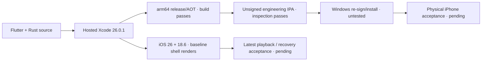
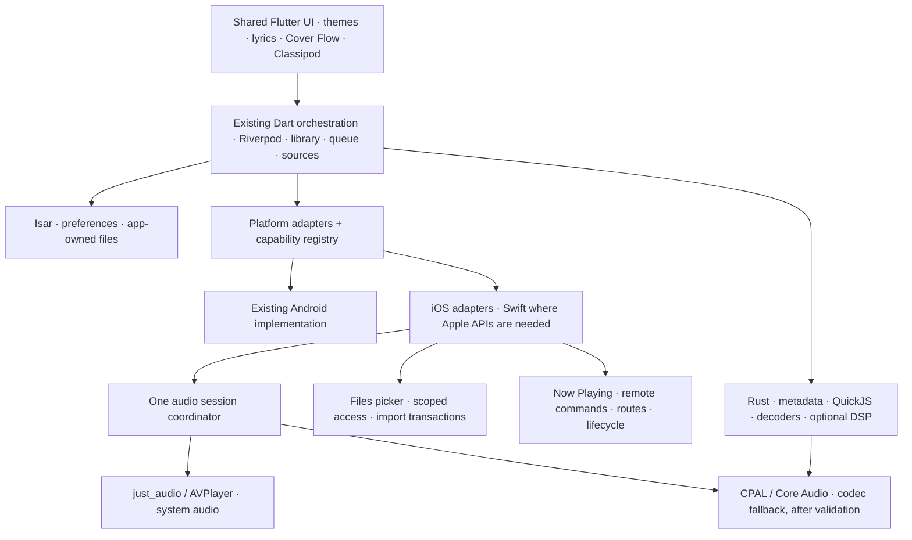
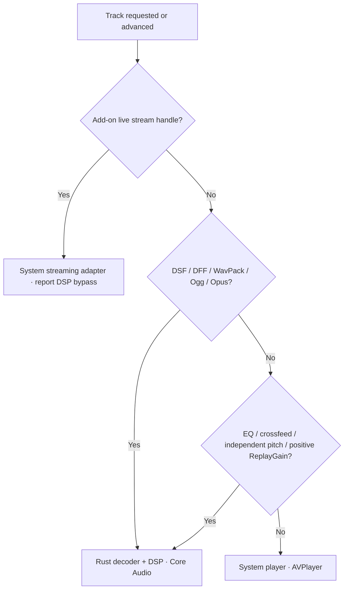
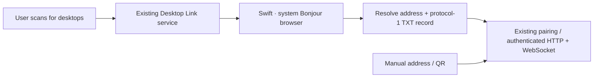
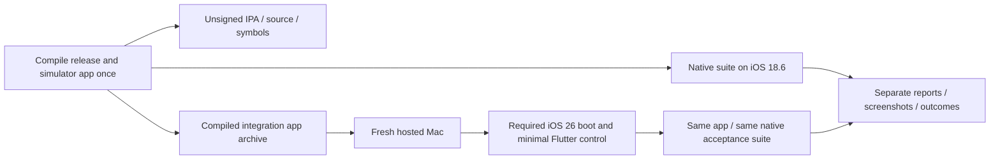
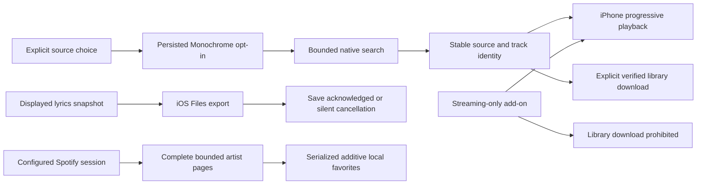
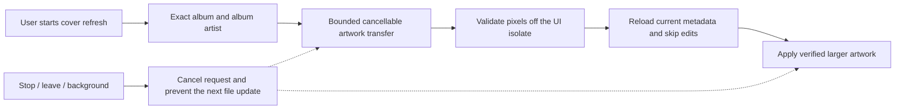

# Lokal Mobile for iPhone: architecture and release plan

Status: implementation and hosted native validation, 27 October 2026 (Europe/Paris).
The original audit used `42f8f1dbc939`; implementation is tracked in
[PR #172](https://github.com/lokal-music/lokal-mobile/pull/172).

Hosted Xcode 26.0.1 builds the complete simulator app and release/AOT iPhone
app for the iOS 16+ port. The current parity source includes **72 reviewed merged
mobile PRs after #172 through #272**. Search keyboard behavior, the single
authoritative queue, inline Home modes, configurable Discovery shelves and
transparent Cover Flow are included in the latest continuation.
[The source audit](IOS_POST172_REVIEW.md) records the exact merged commits
and platform adaptations.

**This source is not a finalized release.** Build 67 is the current independently
verified engineering package, passing both complete native suites on iOS 18.6
and 26.0 through #261. Its generated WebKit fixture passes settled-seek,
native-clock and newly delivered frame gates on explicit replay, with repeated
playing/paused resets. Actual queue reorder and unconfigured widget-channel
checks also pass. The inspected unsigned IPA, source, notices and matching
symbols are preserved together; build 53 remains an older retained checkpoint.
The later logger/sharing/through-#272 source requires its own full native
acceptance. The expanded latest-source host selection passes 803 cases.

| Checkpoint | Accepted scope and limit |
| --- | --- |
| Build 34 | Complete dual-runtime baseline through #217; preserved IPA/source/symbols. Does not qualify later changes. |
| Build 40 | Complete iOS 26 suite through #225; iOS 18.6 exposed a retired background-gain update, corrected in the continuation. |
| Builds 45–46 | Actual initial WebKit frame callbacks and clock progress pass; explicit replay fails. Blob transport alone did not resolve the stuck seek. |
| Builds 47/49 | Engineering package builds; iOS 18.6 replay still fails and iOS 26 host boot times out before app acceptance. |
| [Widget native run 7](https://github.com/lokal-music/lokal-mobile/actions/runs/40481024530) / PR #248 | Real Flutter bridge checks pass for iOS 16 arm64 device/simulator with Swift 6 warnings-as-errors, plus 85 Flutter, 45 reader, 20 store and 14 publisher cases. App Group provisioning, runtime sampling and WidgetKit UI are separate gates. |
| [Build 53](https://github.com/lokal-music/lokal-mobile/actions/runs/40483603986) / PR #252 | Complete iOS 18.6 and 26 acceptance through #246. Actual queue reorder and unavailable widget protocol checks pass. WebKit explicit replay advances bridge/native time and new frames. Preserved tree `eaa818198e4fe6988416ff8696f36dcb29738831`. |
| [Widget run 14](https://github.com/lokal-music/lokal-mobile/actions/runs/40504214809) / PR #253 | 23 actual store cases, including 50×24-worker POSIX creation and 50×24-worker real publication/read rounds; 45 reader, 14 publisher and 88 Flutter cases plus both real Flutter bridge SDK checks pass. This later lock correction is outside the build-53 IPA. |
| Build 56 / live-sampling candidate | iOS 18.6 times out awaiting paused WebKit replacement; iOS 26 passes. The candidate adds gate diagnostics and live widget sampling; full native acceptance remains pending. |
| [Build 59](https://github.com/lokal-music/lokal-mobile/actions/runs/40510204116) / PR #259 | Complete iOS 18.6 pass for the live-sampler source; iOS 26 explicit replay reaches source end but presents only two new frames after its settled baseline, failing the unchanged three-frame gate. This is not a complete dual-runtime acceptance. |
| [Widget run 21](https://github.com/lokal-music/lokal-mobile/actions/runs/40553935455) / PR #271 | All four focused native jobs pass: device/simulator extension linkage, contracts and 450 actual images in eleven locales, including nine independent OCR checks of visible recording/artist/recommendation text. Static layout evidence does not qualify live timer drawing, installed Home Screen behavior or signed shared access. |
| [Build 66](https://github.com/lokal-music/lokal-mobile/actions/runs/40524454354) / PR #265 | iOS 18.6 reaches an initial native view but no local decoder/JavaScript readiness; release cleanup also times out. iOS 26 fails its control/recovery boot before app acceptance. This source has no complete dual-runtime acceptance. |
| [Build 67](https://github.com/lokal-music/lokal-mobile/actions/runs/40551780392) / PR #270 | Complete iOS 18.6 and 26 acceptance through #261. Both settled replays advance bridge/native clocks and five new frames, with repeated playing/paused resets. IPA/source/notices/34 binaries/26 native symbol bundles are independently reverified. Tree `054b7aa18dbbbae333802eeea73a9e225cb42735`. This does not qualify later logger, sharing or through-#272 changes. |

Unsigned engineering packages pass binary/resource/privacy/source/notices and
matching-symbol inspection. Installation still requires local signing. See
[Windows installation and acceptance](IOS_SIDELOADING.md), the
[widget implementation gates](IOS_WIDGETKIT.md), and
[current integration feasibility findings](IOS_FOLLOWUP_FEASIBILITY.md).

The earlier iOS 18.5 startup abort matches
[WebKit bug 293831](https://bugs.webkit.org/show_bug.cgi?id=293831). CI explicitly
tests iOS 18.6 first and iOS 26.0 second, using an isolated iPhone 16. The old launcher-subprocess and launchctl-label checks were not
reliable evidence of app liveness; direct VM readiness now supplies that gate.
Native console, process sampling, screenshots and crash reports remain available.

The IPA is an engineering build, not a qualified release. See
[Windows installation and acceptance](IOS_SIDELOADING.md).



### Implementation already in place

- iPhone-only runner, iOS 16 floor, generated alternate icons, pinned build tools
  and locked dependencies, source/license bundle and unsigned IPA inspection.
- Swift document imports with scoped/coordinated transactional copies; persistent
  app-owned library root and ID-preserving sandbox-path rebasing; database files
  in Application Support with a nondestructive legacy migration.
- Explicit iOS system and Rust/Core Audio modes; single audio-session owner,
  interruptions, Now Playing/remote controls, route diagnostics and AirPlay UI.
  Rust is selected for DSP or unsupported system formats without claiming direct
  USB or bit-perfect output. System WAV, Rust DSP and WavPack routes pass the
  simulator smoke test; physical routes and interruptions remain unvalidated.
- Spotify's existing web-session protocol ported to isolated WKWebView and the
  existing Keychain-backed credential store. Live account checks remain pending.
- Native Files export for recap CSV/TXT and M3U/M3U8 playlists; manual playlist
  import persists an app-owned snapshot before resolving existing song IDs.
  Cancellation/provider errors and bounded UTF-8 input have contract coverage.
  The native picker UI and exports still need iPhone acceptance.
- Integration smoke test exercises real startup, scanner, QuickJS, system WAV
  playback, Rust DSP and WavPack fallback. No native mocks substitute for these
  operations; these assertions passed on iOS 26.0. Broader fixture and device
  coverage remain acceptance work.

The [Cast sender transport](IOS_CAST_TRANSPORT.md) now has a pinned real SDK,
native channel adapter, confirmed commands and a guarded local/remote handoff.
Its standalone native device/simulator linkage and integrated application tests
pass; actual receiver acceptance remains pending. WidgetKit extension delivery, Discord feasibility and resumable
background transfers remain open work. The [widget metadata foundation](IOS_WIDGETKIT.md)
now implements the canonical-state writer, bounded JSON, tolerant native reader,
atomic store, artwork publication and actual Flutter channel. Runtime sampling,
provisioned App Group publication, widget UI/actions and Windows signing remain pending. Native desktop Bonjour discovery
passes its controlled service/HTTP checks on build 18 / iOS 18.6. Live add-on stream handles currently
retain the system streaming adapter and explicitly report Rust DSP bypass;
DSP support for those sources remains open rather than attempting to open an
opaque stream handle as a native file. Shared UI and source availability do not
establish iOS parity.

## Product brief

Deliver a sideloadable iPhone version with the Android product's features wherever
iOS reasonably supports them. Time is not a constraint. Preserve Lokal's visual
identity, local-first library, optional online services, and existing Android
behavior. Do not trade away online sources, add-ons, or desktop integration to
reach an early release date.

Advanced audio is a separate feasibility track: direct USB, bit-perfect output,
native DSD/DoP, DAP controls, Android codec selection and privileged audio paths
are not required. Ordinary headphone/Bluetooth/USB audio through iOS, reliable
playback, codec coverage, and practical sound controls remain product goals.
DSD **file decoding to PCM** is distinct from native DSD output.

The maintainer uses Windows and currently has no Mac, iPhone, or paid Apple
Developer membership. Build using hosted macOS/Xcode. Sign on the installer's
Windows machine using their own Apple account. Recruit an iPhone tester before
calling any build release-ready. Keep account credentials out of CI and chat.

## Recommended architecture

Keep Flutter/Riverpod/Isar and the existing Rust bridge. Add small platform
adapters around the platform-dependent services; preserve repositories, queue
rules, library identity and shared presentation. A SwiftUI rewrite would duplicate
the largest tested part of the product while still requiring native audio and
file integration. A web wrapper would discard useful existing native work.



These are architectural boundaries, not a requirement for a new class per box.
The current adapters extend the existing player and platform channels; focused
regression coverage protects the shared Android paths.

| Boundary | Responsibility and rule |
| --- | --- |
| Platform capabilities | Availability and reason for each feature, plus runtime route/permission state. Hide irrelevant Android controls. Unsupported actions return a typed result; a missing plugin is not success. |
| Playback backend | Add an explicit iOS system mode rather than persisting `normalAndroid` or displaying Oboe on iOS. Keep queue ownership in the existing player. Exactly one active playback backend. |
| Audio session | Adapt `audio_session` for iOS music playback, activation, interruption, route loss and media-services reset. One owner configures the process-wide session, including video/radio/casting handoffs. Swift observes or supplies missing events without independently fighting that owner. |
| System media controls | Map current notification-owner semantics to `MPNowPlayingInfoCenter` and `MPRemoteCommandCenter`. Library, radio and desktop remote must publish the actual current owner. Remove duplicate command handlers on disposal. |
| Library file access | Represent an app-owned file or leased external resource, not an Android `content://` URI. Resolve imported paths against the current sandbox; never persist its absolute installation prefix as identity. |
| Native integration | Typed contracts for document imports, build identity, route diagnostics, OAuth, share/save, casting and lifecycle. Use generated Pigeon bindings if the added contract surface justifies that dev dependency. Preserve existing Android channel names. |
| Credentials | Use iOS Keychain through the existing secure-storage package. Audit access-group requirements with free signing; do not require shared groups or iCloud entitlements for the base app. |
| Jobs | Separate active playback from scan/copy/download work. Use resumable persisted job state; iOS suspension is normal. Background audio is not permission for indefinite unrelated work. |

### Audio decision and experiments

Use the existing `just_audio` iOS backend as the baseline for system-supported
formats. It already declares iOS support. Validate real gapless transitions,
seeking, background playback and protected-header streams on the locked version.
Do not infer support from Android's implementation or from the package's latest
documentation.

The shared Rust engine remains needed by metadata and add-ons at startup. Compile
it with `--no-default-features --features native_audio,rquickjs/bindgen` on iOS. Prove the dependency
graph contains no `rusb`/`libusb1-sys`. Cargokit now selects the iOS feature set
by platform, while Android retains its default `native_audio` and `uac2` features.

The resolved `rquickjs-sys` 0.14.0 ships macOS bindings but no
`aarch64-apple-ios` or simulator bindings. The manifest now enables generated
bindings for iOS with the matching Xcode SDK
and explicit Clang device/simulator triples; macOS ABI bindings are not reused.
The native probes and Cargokit integration compile this configuration.

For formats that AVPlayer cannot play, investigate the already-vendored CPAL iOS
Core Audio backend with Rust decoders. Its source exists, but includes TODOs for
session-derived sample rates and buffer sizing. Compare it against AVPlayer using
the same fixture corpus and measured interruptions/route changes. Do not choose
it as the default based only on a successful compile. Avoid full-file PCM
transcoding as the normal fallback: it adds startup delay and storage cost.

Preserve practical EQ, ReplayGain, crossfade and speed controls where the iOS
backend actually implements them. Some existing just_audio extensions are
Android-specific: pitch, Android effects and boost must be explicitly audited.
Use the Rust DSP path if it meets stability and power targets; otherwise record
the limitation with the exact affected feature. Do not label mixed or
DSP-processed output bit-perfect.

The iPhone routing rules now include independent pitch and positive ReplayGain.
The locked system player does not implement independent pitch; AVPlayer volume
cannot provide gain above unity. Use native SoundTouch for pitch and Rust gain
for positive normalization. Negative ReplayGain can stay on the system player.
A codec fallback is re-evaluated for the next explicitly selected/resumed track,
so ordinary flat playback can return to AVPlayer. Live changes preserve the current track/position; resetting processing returns
to system playback when the format permits it. These pitch/normalization transitions and the expanded codec corpus pass on
both iOS 18.6 and 26.0 in build 17.



The codec corpus generates MP3 VBR, AAC/M4A, ALAC, 96 kHz stereo FLAC, AIFF,
Vorbis and Opus from an in-memory tone, including Unicode filenames. It verifies
native scanning, sample-rate metadata, intended backend and advancing position.
An additional queue case exercises system-to-Rust auto-advance into Opus. It does
not certify output fidelity, gapless timing, or physical headphone/DAC behavior.

Activation occurs after the listener presses Play. On interruption, remember both
the prior playing state and subsequent user actions. Resume only when permitted
and still wanted. Headphone removal pauses without unexpectedly moving audio to
the speaker. Rebuild routes/streams after media-services reset and report the
actual rate/channel count, rather than requested values.

### Native metadata bridge

The Rust scan DTO now carries album-artist tags from ordinary files and DSF/DFF
ID3 tags. iPhone metadata adapters and library scans preserve compilation-album
identity; the existing Android row-selection behavior is retained. The bridge was
regenerated with the exact 2.13.0 CLI, without manually editing serialized fields.
A preliminary regeneration retained all 139 native/Dart entrypoints while putting
the add-on entrypoints in generator order.

The default-feature Rust suite still passes all 303 tests, including extended WAV
and DFF album-artist checks. A real host shared-library test passes tag write/read,
scanner-to-Dart album-artist transport, native add-on sealing/opening and QuickJS
echo. It loads the actual native library; it does not initialize mock bindings.
The iOS smoke test also writes and checks a distinct album artist. The regenerated bridge also passes the Apple simulator checks on both OS versions
in build 17.

### Playback credentials while the screen is locked

The locked secure-storage plugin defaults to `WhenUnlocked` on iOS. Playback
credentials now use `AfterFirstUnlock`, without synchronization or a shared access
group, so normal screen locking need not interrupt token refresh, scrobbling or
add-on vault access. Android keeps the plugin's existing default options.

A small Swift Keychain operation changes legacy nonsynchronized items in the
locked plugin's default service in place. It changes the accessibility attribute
without retrieving, deleting or copying credential values. Reads/writes retry
preparation after a failure; concurrent requests share the in-flight operation.
Failures propagate instead of reporting migration success. Device-bound storage
is deliberately avoided because restoring encrypted add-on files also requires
their backed-up master key. No new signing entitlement is required.

The native smoke test creates a synthetic legacy Keychain item, migrates/reads it,
updates it through the playback store and deletes it. It also navigates Library,
You and Settings through the actual UI and captures each screen. These additional
checks pass on both runtimes in build 17. The simulator cannot establish protected-data
behavior after a real device reboot/lock, free-account re-signing continuity or
live-account refresh; those remain explicit device acceptance gates.

### Files, imports and desktop transfers

Default to copying listener-selected files into app-owned persistent storage
through the Files document picker. A picker may return an iCloud/File Provider
resource that must first be coordinated and downloaded. Security-scoped access
must stay valid until the operation completes and be released on all exits.

Use staging -> validation -> atomic finalization -> database update. Persist a
relative locator and stable track ID; resolve against the current application
container on each launch. Handle duplicate imports, cancellation, low disk space,
provider errors, moves and relaunch after interruption. Imported music is not an
evictable cache. Exclude reproducible caches from backup and choose/document the
backup policy for music and user data. Offer export/backup before destructive
library operations.

External-folder references can follow after a spike proves picker support,
bookmark persistence, stale/revoked access and provider coordination on real
iPhones. Never pass a bare external path to a long-running Rust scan after its
access lease ends. iOS does not offer Android-style whole-device scanning.

Desktop sync keeps the existing authentication/pairing and song identities.
Write copied songs through the same import transaction. Test local-network
permission denial and changed Wi-Fi networks. Bonjour service declarations are
needed only if used. Audit raw multicast discovery against iOS entitlements;
provide manual address/QR pairing if needed. Plain local HTTP requires a narrow,
justified transport policy; do not disable ATS globally as a shortcut.

### Desktop Bonjour discovery

The new Swift adapter browses `_lokal._tcp` through Apple's `NetServiceBrowser`,
resolves numeric IPv4/IPv6 addresses, accepts protocol-1 TXT records and returns
the same id/name/host/port contract as Android. Searches are explicit, bounded to
eight seconds and limited in concurrent resolution. Backgrounding and completion
stop the browser/resolvers; stale delegate callbacks cannot modify a later search.
Apple owns Local Network authorization through the actual operation; the adapter
does not fabricate a permission grant or require raw multicast entitlements.
Manual-address and QR pairing retain the existing shared protocol.



The native test harness advertises a real Bonjour service and an incompatible
protocol-2 service on the Mac, using a run/attempt-specific identifier. The app
must discover the compatible service, reject the incompatible one, and reach the
advertised HTTP probe endpoint. This controlled fixture does not establish actual
Windows desktop pairing, transfer behavior, or real-device permission denial.
These native checks pass on build 18 / iOS 18.6 (run 40242638631, attempt 1,
source `d345edb3dae4b3a41c4524d163d44bdb83fd5309`). iOS 26 did not execute them
because its simulator failed to boot. Shared Desktop Link/remote-service
regressions pass 40 tests, including actionable native error propagation.

## Source audit and feature disposition

The source findings below record the **original audit**, not the current tree.
The last column remains the acceptance target. Consult the implementation and
validation ledger above for current evidence. Shared source and plugin
registration are not evidence that an iOS feature works.

| Area | Finding in audited source | iPhone plan / acceptance evidence |
| --- | --- | --- |
| App shell/startup | No root `ios/` runner. `main.dart` awaits `RustLib.init`, database and external playback before `runApp`. | Generate and commit an iPhone runner using pinned Flutter. Prove clean launch with no Android plugins installed. |
| External intents | `ExternalPlaybackService._consumePendingExternalPlayback` calls an Android channel and catches `PlatformException`, not `MissingPluginException`. | Supply iOS document/open-URL integration and capability-gate Android Locker integration. Add a real startup regression at this seam. |
| Library and playlists | Existing Flutter/Isar library and Rust scanner; Android MediaStore/SAF channels in storage services. | Reuse models/IDs; implement import and supported folder access, export, metadata/tag editing, lyrics/artwork sidecars. Verify install updates preserve data. |
| Player, radio and controls | `NotificationService` uses `com.mossapps.flick/player`; session selection and interruption setup assume Android. | iOS media/session adapter, background audio mode, system controls and ownership handoffs. |
| Codec coverage | Rust scanner lists MP3/FLAC/Ogg/Opus/M4A/WAV/AIFF/ALAC/DSF/DFF/WavPack. | Fixture matrix per container/codec; system path first, Rust fallback where needed. DSD-to-PCM remains a normal codec goal. |
| Lyrics | Timed lyrics, translation, romanization and imported files already shared. | Preserve all modes, provider ordering and manual correction; test iOS file import and Reduce Motion. |
| Discovery/accounts | Shared online sources, in-app webviews and secure storage; Spotify OAuth has an Android channel. | Preserve each existing protocol: browser PKCE for the Web API integration; isolated WKWebView for the existing Spotify web-session bridge. Audit callback origins, cookies and Keychain. No embedded client secret. |
| Downloads and add-ons | Rust `rquickjs` plus Dart host/network/package manager; FFmpeg plugin declares iOS. | Preserve opt-in add-ons for the sideload build. Test QuickJS without JIT, filesystem sandbox, cancellations, binary slices and provider authentication. Persist/restart jobs interrupted by suspension. |
| Network libraries/scrobbling | Shared Subsonic/Jellyfin/WebDAV/SMB/UPnP and Last.fm/ListenBrainz integration. | Per-service contract tests plus representative live integration; offline/error states, TLS and credential redaction. |
| Desktop link | Pairing, remote controls, merge and bidirectional copying already exist; destination storage is Android-specific. | Retain the full feature set using iOS destinations, local-network permission and restartable transfer state. |
| Artwork and presentation | Shared Flutter themes, motion artwork, Classipod, queue gestures and glass shaders. | Keep the full experience; safe areas, keyboard, accessibility, high-refresh pacing and real-device shader/memory checks. |
| Listening/library tools | Flow, personal mixes, recaps/stats, sleep timer, CUE/EAC, metadata editing, duplicate detection and file organization exist in the shared product. | Preserve ordinary features; validate timers under suspension and edits/organization within scoped file access. Assess Automix, gapless, crossfade, EQ and skip-silence backend support individually. |
| Sharing/images | Picker/share/gallery channels and platform plugins coexist. | Use native share sheet, Files export and Photos save permissions only in context. Test cancellation and temp-file cleanup. |
| Casting | Existing Chromecast native channel and DLNA route integration; no AirPlay backend was found in the audited casting directory. | Add system AirPlay route UI; investigate Chromecast iOS sender integration and DLNA discovery/control. Test actual receivers; handle multicast restrictions without promising unverified parity. |
| Bluetooth/USB | Android Bluetooth, volume and direct UAC2 controls. | Normal iOS output routes, system volume and diagnostics. Defer raw USB, codec forcing and Android-specific direct audio. A USB DAC can still be an ordinary iOS system route. |
| Discord | Local `mornye_discord` plugin declares Android only. | Investigate an officially supported iOS integration. Do not present a no-op as working presence; document unsupported account/device behavior if necessary. |
| Widgets/icons | `home_widget` declares iOS; app-side widget implementation is Android-specific. | Plan WidgetKit and declared alternate icons. Prove entitlements/re-signing before enabling widgets; avoid an extension dependency for basic playback. |
| Car/overlay integrations | Android Auto and draw-over-other-app player are Android services. | Evaluate CarPlay separately: appropriate entitlement is a prerequisite. Use in-app mini-player and system controls on iPhone; arbitrary floating overlays have no equivalent public iOS API. |
| Updates/build identity | APK updater, Play updates and custom build-info channels. | iOS bundle metadata adapter and Windows sideload update instructions. No in-app APK installer. Preserve library and Keychain behavior across re-signing tests. |

The resolved plugin inventory contains 22 iOS registrations including the Rust
builder and integration-test plugin. `flutter_displaymode`, `in_app_update` and
`mornye_discord` declare Android-only implementations. Federated packages use
different Android/iOS package names, so subtracting those name lists would create
false missing-plugin findings.

The locked file picker, FFmpeg audio and home-widget native specifications declare
iOS 14 floors. The app now targets **iOS 16+** (maintainer choice for the current Cast SDK); all 33 device Mach-O binaries in the
first engineering package declare minimum versions at or below that floor.
Actual OS-version compatibility still needs runtime and physical-device tests.
The hosted workflows now pin Xcode 26.0.1 (17A400), Flutter 3.47.1 and Rust 1.98.0.
Binary compilation is proven for that combination; runtime compatibility remains
under investigation.

The standalone environment dump has been removed from
`rust_builder/cargokit/build_pod.sh`, and the pod explicitly invokes Bash. Inspect pod linker flags/static symbol retention and the
flutter_rust_bridge loader on iOS; staticlib support in the manifest alone is
insufficient. FFmpeg downloads and all vendored native libraries need device and
Apple Silicon simulator slice checks plus their redistribution notices.

## Build, signing and Windows installation


An unsigned IPA is an input to a signing/install tool; it cannot be installed by
tapping a download link. The iPhone build must use Flutter **release/AOT**, not a
debug build requiring a JIT/debugger. Simulator output is a different artifact
and cannot be packaged as an iPhone app.

Flutter's pinned `build_ios.dart` explicitly skips IPA export with
`--no-codesign`. For the later artifact job, use `flutter build ios --release
--no-codesign`, validate the resulting bundle, and package its actual `.app` under
`Payload/` using macOS `ditto` to preserve bundle metadata/symlinks. Do not assume
`flutter build ipa --no-codesign` produces the desired IPA. Build from a clean
output directory and fail if expected current outputs are absent.

Before publishing an artifact, inspect the main executable and embedded
frameworks using `file`, `lipo` and `otool` for correct device platform/slices and
dependencies; verify executable permissions, bundle identity, build number,
minimum iOS, icon, background-audio configuration and intended entitlements.
Supply SHA-256, source commit, toolchain versions, license notices and matching
source. Keep dSYMs for crash symbolication. This package inspection is separate
from a successful local signing/install test.

The locked FFmpeg plugin's `setup_ios.sh` creates its arm64 simulator variant by
retagging the device slice with `vtool`; its x86_64 simulator slice is separately
supplied. Therefore a simulator platform tag is not evidence of a genuine
simulator compilation for that dependency. The real FFmpeg conversion fixture
must pass, and a source-built simulator dependency should replace this workaround
if it causes runtime incompatibility. Do not apply this technique to other
native libraries as a substitute for correct target compilation.

Use Sideloadly on Windows as the first documented install route; AltStore Classic
is an alternative. Their documentation supports free Apple accounts. Free-account
installs generally expire after seven days and must be refreshed; Apple also
limits concurrently installed apps/App IDs. AltStore itself occupies an app slot.
Extensions can increase signing/capability complexity. Maintain a stable bundle
identity and signing account across updates to protect access to application
data/Keychain; verify the actual chosen tool's rewrite behavior.

The installer supplies their account directly to the chosen tool, never the
repository, CI or this chat. Device trust and Developer Mode may be required.
Avoid uninstalling the app as a routine refresh/update instruction; that can
delete imported music. Explain expiry, refresh and backup in user-facing install
documentation. A paid program is for a later TestFlight/App Store route, not a
prerequisite for this unsigned-artifact pipeline.

Sideload distribution preserves the existing GPL-3.0 and third-party attribution
requirements. App Store distribution is a separate decision: re-evaluate current
Apple review rules for downloadable add-ons/online services and GPL distribution
compatibility before treating it as a straightforward signing change.

## Phases and exit criteria

These are evidence-based gates, not calendar estimates. The complete feature
scope remains the destination; an engineering milestone is not a public release.

| Phase | Deliverable | Exit criteria |
| --- | --- | --- |
| 0 — Investigate | Source audit, architecture, capability matrix, baseline tests, native probe tools. | Concrete blockers and unknowns recorded; maintainer's Windows/sideloading/full-parity requirements incorporated. This document is the initial result. |
| 1 — Prove the build | Hosted Mac builds actual Rust for device and simulator; clean Flutter iOS runner links locked plugins, FFI and database. | Both native targets compile without raw USB; scanner and QuickJS execute in a simulator smoke test; no Android channel blocks startup. Pin observed Xcode/CocoaPods/native SDK versions. |
| 2 — Prove playback/storage | iOS session/media adapters, transaction-based import, native/system codec experiments. | Import -> scan -> play -> lock screen -> interrupt -> resume -> relaunch passes. Real iPhone tester recruited; sample-rate/route and unsupported codecs are measured. |
| 3 — Restore product parity | All ordinary features in the matrix: online services/add-ons, downloads, desktop link, lyrics/artwork, network libraries, share/export, presentation. | Each applicable row has contract tests plus simulator/device evidence. Each exception names the actual platform restriction or failed experiment, and receives a product decision. |
| 4 — Integrations/polish | Casting, widgets/icons, Discord feasibility, accessible iPhone UX, diagnostics, migration/update robustness. | Actual receiver/accessory tests where relevant; optional entitlement-dependent features cannot block base-app signing. No silent no-ops or Android-only settings. |
| 5 — Package and qualify | Versioned unsigned IPA, checksum/source/notices, Windows signing/refresh/update guide. | Cold install, second-build upgrade and refresh tested from Windows; release/AOT works without debugger; library preserved; no unresolved critical data-loss/playback issue. |

For feedback, show the first simulator recording after Phase 1, the playback/import
prototype after Phase 2, and a completed feature matrix before release
qualification. Consult the maintainer on concrete tradeoffs (e.g. widgets with
signing constraints or a service lacking a supported iOS SDK). Routine platform
adapter work does not require repeated approval.

## Validation strategy

| Layer | Tests and required evidence |
| --- | --- |
| Shared logic | Existing focused Flutter suites; queue/state transitions, source auth, add-on permissions, sync merge and import identity. Preserve Android behavior while introducing adapters. |
| Native compilation | Device `aarch64-apple-ios` and simulator `aarch64-apple-ios-sim`; later Intel simulator only if supported. Check features and binary slices. Compile success does not establish FFI linkage or runtime behavior. |
| Simulator integration | Cold start, actual Rust scanner/QuickJS calls, database reopen/migration, local fixture playback, denied permissions, import cancellation, queue/control transitions and accessibility semantics. No native mocks in the iOS smoke test. |
| Real iPhone | Screen-off/background playback; calls/Siri/alarms; Bluetooth connect/disconnect; USB-C/Lightning system output; route removal; media-services reset; large libraries; low storage; thermal/memory pressure; downloads/desktop transfers through suspension. |
| Installation | Windows sign/install, free-account entitlement compatibility, app launch without debugger, expiry/refresh, stable bundle identity, upgrade/re-sign keeping library and usable credentials, backup/restore. |
| Receivers/services | Real AirPlay/Chromecast/DLNA targets and opt-in live service checks; local fixture tests do not establish account/API availability. |

Build a licensed or generated fixture corpus: MP3 VBR/CBR, AAC/M4A, ALAC, FLAC,
WAV/AIFF, Ogg/Vorbis, Opus, WavPack, DSF/DFF-to-PCM, malformed/truncated files,
Unicode paths, artwork, tags and timed lyric sidecars. Include 44.1/48/96 kHz
cases, stereo/mono and gapless album transitions. Check audio progress/content,
not merely the UI's playing flag. Test network headers, MIME types and byte-range
behavior; iOS format/container matching can be stricter than Android's.

Establish performance budgets from the first real-device baseline: cold start,
time to first audio, import throughput, peak RSS, battery/thermal behavior and
frame-time percentiles. Target the device's refresh interval (16.7 ms at 60 Hz,
8.3 ms at 120 Hz), respect Reduce Motion and Dynamic Type, support VoiceOver,
use safe areas and accessible touch targets. Profile release/profile builds on
hardware. Simulator frame rates and battery readings are not device evidence.
Set a measured soak duration and acceptance threshold before qualification;
include long screen-off sessions and repeated route/interruption cycles.

### Tooling available in this change

Run from the repository root (Python 3.11+):

```text
python3 tool/ios_readiness.py
python3 tool/ios_readiness.py --json
python3 tool/ios_readiness.py --require-scaffold
```

The last command checks that the iOS scaffold exists; it is only a structural
gate, and currently passes. After `flutter pub get --enforce-lockfile`, the inventory also
lists the actual resolved iOS plugins and all discovered literal channel
callsites. JSON contains source-relative locations and no credential values.

On a Mac with Xcode, Rustup and Python 3.11+:

```text
bash tool/ios_native_probe.sh aarch64-apple-ios
bash tool/ios_native_probe.sh aarch64-apple-ios-sim
```

The `iOS native feasibility probe` Actions workflow runs both targets without
Apple credentials and has passed on the pull request.
GitHub requires the manual workflow to exist on the default branch before the
normal Run workflow UI is available. Public/private repository runner quotas and
costs follow the repository's Actions plan. This probe bypasses Cargokit to isolate
native-engine feasibility; it does not exercise the pod script, Flutter plugin
linkage, simulator runtime, or IPA packaging. Do not count a green probe as an
iPhone app build.

### Original baseline evidence

The following observations were recorded before implementation. They remain
historical evidence; the current validation ledger follows this section.

- Locked Flutter dependency resolution passed with Flutter 3.47.1 / Dart 3.13.1;
  `pubspec.lock` was preserved.
- Cargo manifest metadata resolved with Rust 1.98.0 and the existing lockfile;
  the manifest defaults to `native_audio` plus `uac2`.
- The locked iPhone dependency graph resolved with native audio and no default
  features; it includes Core Audio, Rust decoders and QuickJS and excludes
  `rusb`/`libusb1-sys`. This is dependency-resolution evidence, not compilation.
  It also resolved successfully with explicit `rquickjs/bindgen` enabled.
- 109 existing Flutter tests passed across engine failure recovery, notification
  state, scan sessions, player gestures/Reduce Motion, Spotify, Morneye add-ons
  and codec routing. An initial invocation also referenced a nonexistent
  external-playback test file; the corrected complete command passed.
- Scoped analysis of `main.dart`, audio-session manager, external playback,
  permissions and player found **11 existing informational lints**; it exited
  nonzero. No analyzer errors or warnings were reported in that scope. This is
  not a clean full-project analysis claim.
- The read-only inventory ran, found 44 literal channel callsites and correctly
  reported the absent runner. Python compilation, shell syntax and diff whitespace
  checks passed. Hosted native compilation remains unrun.
- This Linux host has no Xcode or iOS simulator. No iPhone was available. No IPA
  or iOS hardware behavior has been verified.

Re-run the focused baseline with:

```text
flutter test --no-pub test/services/player_service_engine_failure_test.dart test/services/player_service_notification_test.dart test/services/scan_session_controller_test.dart test/widgets/lokal/lokal_player_route_test.dart test/spotify test/morneye test/services/song_engine_routing_test.dart
flutter analyze --no-pub lib/main.dart lib/services/audio_session_manager.dart lib/services/external_playback_service.dart lib/services/permission_service.dart lib/services/player_service.dart
```

## Current validation ledger

- Build 20 passes the updated search scopes/four filters and root profile editor
  on iOS 18.6, with screenshots and exact-source metadata. An artwork-file test
  fixture inflated its raw scanner file count; creating artwork after the scan
  corrects the fixture without relaxing the assertion. Later playback/panel
  checks require the next native run.
- Build 21 fails the minimal Flutter control VM gate before Lokal runs. One
  bounded control-only fresh-device recovery is implemented for the next run;
  both attempts retain evidence, and application test failures are not retried.
- The post-#172 changed-file selections now pass 248 shared tests plus all five
  repaired decoder-recovery cases. A real host Rust/Isar persistence check also
  preserves song IDs and playlist references across rescans/retagging/database
  reopen. These host results do not prove native File Provider UI or app restart.
  See [the detailed review](IOS_POST172_REVIEW.md) for the evidence boundaries.


- Host Rust tests with the default native-audio/USB features: **303 passed**.
  No USB hardware test is inferred from that result.
- Both Android arm64 debug APKs (`full` and `play`) build with the iOS changes.
  The Kotlin plugin guard passes across 27 Android modules. The first local
  Android attempt inherited host Linux pkg-config paths; clearing those paths
  for the Android cross-build resolved the environment failure. No audio code
  change was needed.

- Full simulator and release iPhone builds passed on hosted macOS/Xcode 26.0.1.
  Engineering IPA inspection passed; its SHA-256 is published with the artifact.
- Both native Rust target probes passed with no `rusb`/`libusb1-sys` dependency.
- The latest metadata/audio/routing selection, including the real host bridge,
  passes **69 tests**. This overlaps earlier selections.
- Pitch/normalization/routing regression selection: **42 passed**. Scoped
  analysis reports the same 11 informational lints and no errors/warnings.
  The full Android debug APK also rebuilds after these processing changes.
- A selected shared regression run passed 158 tests; the later iOS storage,
  routing and processing regression run passed 63 tests. These counts overlap.
- Follow-up storage/routing/session tests passed 15 tests; download tests passed
  eight, including the iPhone app-owned fallback. The existing Cargokit helper
  checks passed for Android arm64/armv7, native linker failure and Rust pinning.
- iOS document adapter and shared playlist regressions passed 27 tests, including
  Unicode export, provider removal after import, stable-song matching, cancellation,
  oversized/malformed input, provider failure and scoped cleanup.
- Application/integration analysis has no errors; existing warnings/information
  remain. This is not a clean repository-wide lint claim.
- The broad Flutter run recorded 578 passes, two skips and 27 failures including
  a crossfade timeout. All 26 other failing test cases reproduced on the untouched
  audit baseline; the crossfade hang reproduced separately there too. The full
  suite remains red; this comparison does not turn baseline failures into passes.
- Native console identified the original abort: iOS 18.5 simulator cannot load
  `libswiftWebKit`, matching WebKit bug 293831. iOS 26.0 now runs the control app
  and actual Lokal welcome screen, with direct Dart VM readiness confirmed.
  The Android-only Cast/Bluetooth event subscriptions are now platform-gated.
  Build 17 passes the expanded native UI, Keychain, metadata, DSP, pitch,
  normalization, codec corpus and queue checks on both iOS 18.6 and 26.0.
  Matching crash symbols, native screenshots and measured JSON reports are saved. This is simulator execution
  evidence, not an audible-fidelity or physical-accessory measurement.
- Run 15 stopped at the independent minimal Flutter control app: its VM never
  became ready, its console remained empty, and simulator termination timed out.
  Lokal was not built or tested in that run. Saved control evidence is retained;
  run 16 then timed out in iOS 26.0 boot before any app was built.
  Both are simulator setup failures, not application-test results. CI now creates
  an isolated iPhone 16, tests iOS 18.6 first, and retains the iOS 26.0 gate.
  The release IPA is built before simulator setup, and boot identity/logs are
  preserved on failure. Three coordinator contract tests pass; these do not
  execute a simulator.
  Artifact names and provenance now include the run attempt so reruns cannot
  collide with earlier evidence.
- The smoke harness uses the supported Flutter drive existing-app adapter and
  probes the real loopback Dart VM directly, with native console capture and
  bounded timeouts. Its HTTP handshake was checked against a real local Dart VM;
  that check is not an iOS runtime pass.
- FFmpeg's 25,612,207-byte native archive matches the pinned GitHub release digest
  `63da3becdd2c7cefd77292054683e4f9b712efd09a4d8a8b2319d92f9fbcdd30`.
  CI verifies it before regenerating native dependency outputs; the archive-fetch
  and CI handoff were exercised in an isolated temporary package fixture.
- The credential-store regression selection records **83 passes and one known
  baseline failure** (`cover metadata reaches player track; quality goes to
  search/stream`, an existing HTTP request-order expectation). The secure settings
  persistence case passes; this is the same failure already reproduced on the
  untouched baseline, not a newly green full suite.
- No physical iPhone, Windows re-sign/install/update, background playback,
  Bluetooth/USB/AirPlay receiver, or live-account acceptance has occurred.

## Reference material checked

Checked 25 October 2026. External documentation describes platform possibilities;
the repository's locked versions and actual builds decide compatibility.

- [Flutter: build and release iOS](https://docs.flutter.dev/deployment/ios) — macOS/Xcode requirement and versioned iOS release process.
- [Pinned Flutter source: build_ios.dart](https://github.com/flutter/flutter/blob/6655482ec06e547f90abf8ae7590466f4415978d/packages/flutter_tools/lib/src/commands/build_ios.dart) — unsigned build skips IPA export.
- [GitHub hosted runner selection](https://docs.github.com/en/actions/how-tos/write-workflows/choose-where-workflows-run/choose-the-runner-for-a-job) — hosted macOS and Apple Silicon runner options.
- [Sideloadly](https://sideloadly.io/) — Windows IPA signing/install support and free-account expiry.
- [AltStore Classic on Windows](https://faq.altstore.io/altstore-classic/how-to-install-altstore-windows) and [refresh/installed-app limits](https://faq.altstore.io/altstore-classic/your-altstore) — installation and seven-day refresh model.
- [Apple developer account overview](https://developer.apple.com/help/account/basics/about-your-developer-account) — account/program distinctions.
- [Apple: activating an audio session](https://developer.apple.com/library/archive/documentation/Audio/Conceptual/AudioSessionProgrammingGuide/ConfiguringanAudioSession/ConfiguringanAudioSession.html) — activation/refusal, interruption and background lifecycle. Archived reference; verify current API behavior on supported OS versions.
- [Apple: directory access](https://developer.apple.com/documentation/uikit/providing-access-to-directories) — document-picker directory access and scoped resource ownership; consult during the storage spike.
- [just_audio platform matrix](https://pub.dev/documentation/just_audio/latest/) — documented iOS capabilities and file/network requirements; validate locked 0.10.6 separately.
- [Flutter app extensions](https://docs.flutter.dev/platform-integration/ios/app-extensions) — extension lifecycle and shared-resource/App Group considerations.


Compatibility decision, 26 October 2026: the maintainer chose one full-featured
**iOS 16+** app rather than separate iOS 15/base and iOS 16/Cast distributions.
Runner/pod/native probe/compiler targets and the package gate follow that floor.
Earlier recorded engineering IPAs retain their original metadata and are not
retroactively described as iOS 16 builds.


### Build 24 native evidence (iOS 16 floor)

[Build 24](https://github.com/lokal-music/lokal-mobile/actions/runs/40273185020)
packages the new iOS 16 release and reaches the actual iOS 18.6 test app. Exact
merge source: `0fda1f5e314475639cde9ef26dc1ae8737c01270`.
Its incremental report passes post-172 search/profile UX, the corrected scanner,
QuickJS, WAV transport, repeated Queue/Lyrics panels and return to mini player,
**timed Space lyrics**, native EQ/pitch/positive ReplayGain, WavPack conversion,
the complete MP3/AAC/ALAC/96 kHz FLAC/AIFF/Vorbis/Opus corpus, the system-to-Rust
queue handoff, and Bonjour protocol filtering plus HTTP. Actual Space screenshots
show the expected current and next generated lyric at the retained song clock.

The run then fails at `nowPlayingMetadataState`: Runner Debug had C preprocessor
`DEBUG=1` but no Swift `SWIFT_ACTIVE_COMPILATION_CONDITIONS=DEBUG`, so the new
DEBUG-only metadata probe was excluded. Runner Debug now explicitly inherits and
sets Swift DEBUG; Release/Profile remain unaffected. No metadata assertion is
removed. Remote artwork and the subsequent Turkish switch still require the next
native run; iOS 26 was not reached. This is partial native evidence, not a fully
green run. The same logs expose repeated Android-only HomeWidget update calls on
iPhone; the Android publisher is now gated on iOS until a real WidgetKit snapshot
adapter exists, matching the already-gated settings UI.


Current upstream review extends through merged **#209 and #210**, main
`4504f64177e0826acacd7d06ab080718b947c3a4` (31 PRs after #172). Likes playback
revalidates expired stream sources while preserving identity. Space now overlays
the existing player artwork rather than opening a separate stage; the native
harness has been updated to check the retained artwork elements and actual song
clock. These assertions pass on both native runtimes in build 27. See the audit for focused test evidence.


### Build 26: Cast-integrated application and pause acknowledgement

[Build 26](https://github.com/lokal-music/lokal-mobile/actions/runs/40286173853)
compiles the Cast-integrated iOS 16 app, inspects all **34** device binaries and
requires Cast core resources, privacy metadata and notice bundles. Its preserved
IPA SHA-256 is `10cbfbbe68a851cca91529c842d6bc0d6c3152f0a61b21ea3fa39612b7de138d`.
Exact source is `9c230b90f80e9536dd08b6d794a6485b057c0c44`, tree
`c61258b7559dc23008008883dfa7e08d8d5fb959`.

**The complete iOS 18.6 native suite passes**, including the actual registered
Cast bridge with no startup discovery, remote HTTP artwork into native Now
Playing, live Turkish switching, the full playback/DSP/codec corpus, source
handoff, updated search/profile/panels and Bonjour. This source still contains
the older pre-#210 Space stage; the current overlay is a subsequent change.

The iOS 26 run passes startup/search/profile/Keychain, scanner/QuickJS, Space,
EQ/pitch/ReplayGain, WavPack, MP3/AAC/ALAC/96 kHz FLAC/AIFF/Vorbis, then fails its
Opus Pause assertion (UI remains playing after awaited Pause). Later checks are
not reached. This is an application transport race, not a simulator boot failure,
and the test assertion is retained.

The native pause API previously returned on command enqueue. The iPhone path now
waits up to two seconds for the command worker to apply pause; it releases the
global engine mutex before waiting so synchronous UI queries remain available.
The worker reply is bounded/non-blocking, and a timeout does not claim cancellation.
Android's existing Pause path and all PCM/DSD/USB rendering logic remain unchanged.
The iPhone Rust adapter suppresses stale playing/buffering notifications until a
new explicit Play; failed pause restores actual backend state. The native harness
also checks Rust's actual paused state and repeats Opus resume/pause.

All **307 Rust tests pass**, including real command-worker acknowledgement and
paused render silence, no-source completion, delayed reply and timeout behavior.
Three targeted Dart tests pass for stale events, explicit resume and failure.
The latest affected Dart selection passes **90** checks; the earlier broader
player/Likes/locale selection passes **123** (overlap). New iPhone-native results
remain pending the next source build. Google Cast's real context initialization
without automatic discovery is also added as a DEBUG-only acceptance check;
receiver behavior remains unqualified.


### Build 27: complete native checkpoint on both runtimes

[Build 27](https://github.com/lokal-music/lokal-mobile/actions/runs/40305306973)
passes the complete native suite on **iOS 18.6 and 26.0**, plus release/AOT
compilation and inspection of all **34** iPhone binaries, iOS 16 minimum, Cast
resources/privacy/notices, source and symbols. Exact tested merge source:
`659140532c300887de408a362377f6a6779916bb`; tree:
`ecaf093a021db35bf75bb66d521656f147dbb2bb`. The matching unsigned IPA SHA-256 is
`61fd97565f0b64168e3b16e347c7496cf0e28b84c5d15e017eabd935776faaf8`.

Both runtimes pass startup/Keychain, updated search/profile/panels, scanner/tag
album-artist, QuickJS, AVPlayer transport, native EQ/pitch/ReplayGain, WavPack,
MP3/AAC/ALAC/96 kHz FLAC/AIFF/Vorbis/Opus, system-to-Rust queue handoff, real
Bonjour filtering/HTTP, remote artwork into Now Playing and live Turkish switching.
The #210 Space screenshot and element-identity assertions confirm the existing
artwork survives entry while generated captions follow the actual song clock.
The suite also confirms an external-owner acknowledgement gates actual AVPlayer
resume, a newer manual Pause defeats a stale video-exit resume, real Cast context
initialization starts no discovery, and repeated Opus resume/pause reaches Rust's
actual paused state. The original pause failure is resolved without weakening
its assertion. Independent [Rust device/simulator probes](https://github.com/lokal-music/lokal-mobile/actions/runs/40305307004)
and [Cast SDK probe 4](https://github.com/lokal-music/lokal-mobile/actions/runs/40305307048)
also pass on this source.

These are simulator and package results, not physical iPhone, iOS 16 runtime,
actual Cast receiver or live YouTube acceptance. The subsequent unobstructed
embedded-video Space layout and HTTP range fixes require their own source build.
The preceding build-24/build-26 sections are historical checkpoints.


### Current continuation through #216

Main `63280241a5216ef987111eb8cd17c93e0626f1e4` is integrated, including all six
additional merged PRs #211–#216. Build 27 remains the validated checkpoint through
#210; the current source needs a fresh native run. The detailed audit records
Cover availability, Last.fm discovery, root video navigation, unshaded smooth and
concurrent Space lyrics, video quality and individual artist links. Android's
upstream USB registration/transfer-lifetime fix is preserved, excluded from iOS.

The iPhone uses the official embed's own quality control, with translated guidance
in Appearance. Native Android retains its 360p–4K/Auto selector. Space uses a
separate advancing clock signal for video, so its interpolation freezes during
buffering while transport can still represent a pending Play. Official player
controls and branding stay unobstructed; captions and explicit Exit Space sit
below the same live player.

The current host selection passes **114** UI/transport/locale tests, including
HTTP suffix/clamped/unsatisfiable/HEAD/empty-file behavior. A broader run also
reached the known historical ARB unused-key failure; no full-suite-green claim is
made. Analysis finds no errors; warning/info findings remain.

A manual workflow input, `live_video_probe`, opts into the public YouTube fixture
on both actual simulator WebKit runtimes. The probe uses production HTML and
channels and records readiness, advancing playback, pause/seek, same-State Space
entry/exit and native WebKit release. Network/provider restrictions are recorded
as **inconclusive** with a screenshot and provider code, never successful video
acceptance. Even an unavailable player must acknowledge native media suspension.
The ordinary deterministic corpus runs regardless; this probe is not physical
background/fullscreen/accessory acceptance.


The subsequent CI evidence improvement preserves each runtime's report/screenshots
immediately after its pass, as well as the combined diagnostics at the end. This
lets the first runtime's exact result be inspected while the second boots/tests;
it does not alter or relax either native gate.


### Build 29: current #216 source, real WebKit observations

[Build 29](https://github.com/lokal-music/lokal-mobile/actions/runs/40315993836)
packages the iOS 16+ app and passes the **complete iOS 18.6 native suite**, including
#215's two concurrent generated Space lines and the previous codec/DSP/queue,
Keychain, scanner, QuickJS, Cast initialization, external ownership, Bonjour,
remote-artwork and live-locale checks. Its Space screenshot now shows the smooth
unshaded concurrent presentation over the retained artwork.

Exact source: `f71f7501c5679188dbc99ee9776ea6d0da70d83d`; tree:
`fbab3adcabefc1806e4c9f2ed6ee777666ea9042`. The preserved unsigned IPA passes
inspection of all 34 device binaries and Cast resources/notices; SHA-256:
`d715ad0a46c4efebc82a5f946bd38004fdb966ff7e9ae64bfaa1cc5467294d07`.

The opt-in production WebKit probe reads the actual installed `app.lokal.mobile`
identity and observes real iframe API readiness. YouTube then returns error 150;
the screenshot explicitly shows **"Sign in to confirm you're not a bot"**. Position
advance is zero. The real native WebKit media-suspension acknowledgement succeeds.
The report correctly marks playback **inconclusive**; neither successful live
playback/seek nor a generic embedding prohibition is inferred from the error code.
The challenge is not bypassed, and no account credentials are introduced into CI.

The overall workflow fails because the **iOS 26 simulator does not boot**:
`simctl bootstatus` times out after 300 seconds and even the simulator screenshot
fails. Lokal never executes on that runtime. This is not a current iOS 26 app
pass; build 27 remains the last complete dual-runtime checkpoint. A fresh hosted
runner must retry the current source without weakening its native gate.

The later Library-label/raw-video-sample follow-ups have their own host checks and
await a new native source build. This checkpoint does not cover those later changes.


### Add-on continuation through #217

Main `ba8c7f5b9e6ab4e004f106ec1c02231143fb1d5b` is carried forward, bringing the
review to **38** merged PRs after #172. Documented `.spotiflac-ext` packages now
pass the shared import picker and URL install path, alongside `.sflx` and
`.morneye-ext`; archive/manifest/permission and SHA-256 protections are retained.
Only isolated download workers receive the host-selected 256 MiB maximum heap;
browsing/startup retain 64 MiB, with the native host clamping configuration.
These are ceilings, not an allocation of 256 MiB at worker startup. Physical
oldest-phone peak-memory and third-party search/auth/download/persistence remain
acceptance work. Metadata-only and lyrics-only extensions are not represented as
working audio sources.

The package/panel selection passes **42** Flutter tests. All **308** host Rust
tests pass, including the eight real QuickJS cases and the new heap-bound test.
No FRB entrypoint/signature changed. The previous build-29 checkpoint is through
#216 and does not cover #217; the updated source needs its fresh native run.


### Build 32 and isolated current-runtime acceptance

[Build 32](https://github.com/lokal-music/lokal-mobile/actions/runs/40321960451)
passes the complete iOS 18.6 suite on the current source through #217, including
the six translated Library shortcut assertions and concurrent Space. Exact source:
`c2ad2f0bbcc8bfda32cb0e650647b8cfd72a77f5`; tree:
`aa72e2cbfcd0ee87020577637f93027365bdd44e`. The preserved iOS 16+ engineering IPA
SHA-256 is `6dda95cf443741d9d147a940f92bb0de2b35aa77fd858ca483cc77eed3589f2d`.

The raw-source video probe reaches the real iframe API and acknowledges native
WebKit suspension, but the hosted network again receives YouTube's sign-in/bot
challenge (150) with zero source-position advance. Playback remains inconclusive.
The iOS 26 simulator again fails to boot before any app test; the run is not a
complete dual-runtime pass.

The following CI change runs iOS 26 on a **fresh hosted Mac**, using the exact
already-compiled integration app from the iOS 18.6 build job. An archive preserves
bundle symlinks and executable modes; the receiving job downloads its exact
artifact ID and safely extracts it. Both OS gates stay required. A failing iOS
18.6 assertion does not suppress the second runtime when the compiled app exists;
cancelling a workflow does suppress extra jobs. Failed iOS 26 jobs can now be
retried without recompiling the IPA or rerunning the completed iOS 18.6 job.

The iOS 26 host also runs the minimal Flutter control before Lokal. Boot, control,
actual playback, reports and logs are recorded independently. No app assertion,
OS-version requirement or simulator boot check is relaxed. Driver timeouts now
match the selected four-minute deterministic/six-minute optional-video test bounds.
The updated workflow passes YAML/shell parsing and all nine existing simulator/
control-coordinator tests; the changed Dart driver analyzes without issues.



The compiled app's Bonjour fixture identity is also forwarded to the isolated
host, so retrying only that job does not change the identity baked into the app.
A screenshot-driven Library follow-up allows two-line shortcut labels and switches
to one column as text grows. All six Turkish labels fit the bundled app font at
200% on 320/393/430px screens; navigation/import and component/dock selection
passes **18** host tests. The native harness now checks rendered labels for actual
truncation; that added assertion still requires the next hosted run.

Build 33 was rejected during workflow validation before any runner or app test:
a runner-specific path was placed in job-level environment configuration. The
path now uses the step runtime environment. Local `actionlint` supplements YAML
and shell parsing to validate GitHub Actions expression context availability.

### Build 34: current complete dual-runtime checkpoint

[Build 34](https://github.com/lokal-music/lokal-mobile/actions/runs/40335805541)
passes the **complete native suite on both iOS 18.6 and 26.0**. The fresh iOS 26
host passes boot, minimal Flutter control and the same compiled integration app;
its fixture identity is preserved from the build job. Source:
`cf8bcfa4a8a2fe6b8f7224812e56af2ef9617c11`; tree:
`2ec3f9721139a923d35cb3983dc8fa3fd9d36c23`. The preserved IPA SHA-256 is
`fe0a5479a0e4ba364584438c408f90d6f48823747c40ada8cbd1058bd4446d21`.
All 34 device binaries, Cast resources/privacy/notices, source and matching symbols
are retained. The actual Turkish screenshot and native render assertions confirm
all six shortcut labels fit. This is the complete checkpoint through #217; it
does not cover the later reset foundation or lyrics continuation. The optional
network-dependent live video probe was not selected in this run.

### Lyrics continuation through #219

The recovery candidate carries **40 reviewed merged mobile PRs after #172**,
including the merged #218/#219 source at
`c8f8f574fdd2812a5a0e7398c47fac17cb6731ed`. The current published port checkpoint
above remains through #217 until this candidate's native gates pass.

| PR | iPhone UI / behavior | Verification |
| --- | --- | --- |
| [218](https://github.com/lokal-music/lokal-mobile/pull/218) | Validate LyricsPlus timing; fall back to plain text for unusable timelines. Show actual per-song provider hits and timing quality, preserve lyrics while checking an explicit provider, and save portable lyrics plus enhanced-LRC sidecars with downloaded audio. | Preserve app-owned iPhone Music fallback and byte-identical Atmos copies. Localize picker status/guidance in all ten phrase maps while keeping provider identifiers unchanged. Native codecs are regenerated with the request-fence API retained. |
| [219](https://github.com/lokal-music/lokal-mobile/pull/219) | Correct the native edit/read metadata model so downloaded lyrics can be written. | Keep the 11-field read result unchanged and put nullable lyrics in TagEditFields. Fix two new tests for the pinned Lofty API and add the field to the existing scanner fixture; the actual Rust suite passes. |

The lyrics/download/provider/locale selection passes **26** Flutter tests, including
Turkish at 200% on 320/393px screens with unchanged `lyricsplus` selection. All
**315** Rust tests pass, including actual FLAC lyrics persistence and ID3 USLT
mapping. Android ARM64 native compilation succeeds with the pinned NDK; its first
retry exhausted local generated cache space, after which only owned intermediate
outputs were removed and the real compilation rerun successfully. Whole app
analysis reports no errors (existing warnings/information remain). No live-provider
recording, iPhone download/background, or physical-device result is inferred.

The recovery observer remains deferred: request fencing and system/radio output
retirement are preparation, not enabled media-services reset recovery.

The updated candidate passes the exact **217-test** contract command committed
in the iPhone workflow, covering shared output ownership, Cast, video/Space,
retirement, lyrics/provider/download localization and add-ons. This is host
contract evidence; the revised bootstrap fence probe and latest source still
require the next hosted native run.


### Build 36 and connected reset acceptance candidate

[Build 36](https://github.com/lokal-music/lokal-mobile/actions/runs/40347453464),
source `e549395101eb8a11ea98ac693402ba59ddaeb341`, tree
`8fc2728deb15c855ff32c630fca11121b7fad06c`, passes release/AOT packaging and
the complete ordinary iOS 18.6 suite, including the pre-bootstrap Swift/FRB
counter probe. The separate iOS 26 host fails while listing simulator devices,
before boot or application acceptance. Build 34 remains the latest complete
dual-runtime checkpoint; this later source carries the 40 merged PRs through
#219.

The following connected recovery candidate adds PlayerService selection/position
preservation, independent receiver scopes, retained paused WebKit reconstruction,
a localized accessibility notice and native notification/delayed-HTTP acceptance
checks. Production subscription remains deferred while those new native checks
are pending. Its exact workflow contract selection passes 234 Flutter tests;
315 Rust tests and Android ARM64 native compilation pass. See
[the state/sequence diagrams, ownership contracts and remaining gates](IOS_MEDIA_RESET_ARCHITECTURE.md).


The connected candidate's first full run, Build 37, fails before compilation on
an HTTP 504 from the unchanged pinned FFmpeg download. Both Apple Rust target
probes pass. The next revision adds bounded verified dependency retries, native
radio reset/reopen coverage using a loopback station, and paused iPhone video
seek preservation. Sixteen Python dependency/simulator/control tests, actionlint
and thirteen focused video contract tests pass; the new native app gates remain
pending. The current complete dual-runtime checkpoint remains Build 34.


### Parity through #225 — 27 October 2026

The new continuation carries lyrics-to-file export, native opt-in Monochrome
FLAC, streaming-only HTTP add-on installation and Spotify artist-favorite
import/filters. It is stacked on the reset candidate, with independent Mac
validation. The exact expanded contract selection passes 295 Flutter tests;
new artist controls fit all eleven locales at 200% on a 320px screen. Native
Rust/bindings/dependency locks are unchanged. Live provider/account playback and
native Files picker completion/cancellation still require acceptance.



Build 39 covers the reset queue/evidence correction through the earlier 40 PRs,
not these later feature changes. Build 38 reaches native reset selection checks
but fails on an incorrect unrotated-queue test expectation; it is not a recovery
pass. Build 34 remains the latest complete dual-runtime checkpoint.


### Native reset and owner-lifetime acceptance

Build 39 passes the complete iOS 18.6 suite with posted AVPlayer/Rust resets,
canonical newer-selection retention, stale native HTTP rejection and actual
radio reopening. Actual paused/recovering screenshots and the JSON report are
preserved. Its iOS 26 host times out during inventory before the app runs.
Build 34 remains the latest complete dual-runtime checkpoint.

The next stacked continuation adds an offline real-WebKit decoder/reset gate
using generated H.264/AAC and the exact production bridge. It also fixes a
reproduced session-observer lifetime bug, fences stale errors before fallback,
and retires an in-flight video release without losing selection ownership.
The expanded workflow selection passes 304 Flutter tests, with no lib/integration
analysis errors. Native execution of these new gates is pending; production
observation remains deferred. See [the precise scopes, measured results and
remaining gates](IOS_MEDIA_RESET_ARCHITECTURE.md).


### Build 40: current parity source and gain-update race

[Build 40](https://github.com/lokal-music/lokal-mobile/actions/runs/40438681830)
builds and packages the 44-PR source through #225, and passes the complete native
suite on iOS 26.0, including posted system/Rust resets, newer selection, delayed
native HTTP and radio. Its iOS 18.6 run passes the system/Rust reset cases, then
fails on an uncaught retired background Rust volume acknowledgement. It is not
a dual-runtime pass. The complete iOS 26 report and failed iOS 18 report/logs are
preserved with verified artifact checksums.

The continuation keeps cancellation observable by awaited policy callers, while
background diagnostics/route gain updates observe expected reset retirement.
Late native failures remain observed and cannot publish stale gain; unrelated
current errors remain failures. This correction and the new actual WebKit/session
gates require another complete native run. Production reset observation remains
deferred; Build 34 remains the latest complete dual-runtime checkpoint.


### WidgetKit shared-data foundation

The optional extension now has a versioned metadata boundary, a canonical
PlayerState builder with opaque track aliases, and a standalone Foundation
reader. The 45-case cross-language corpus covers malformed/oversized/deep input,
legacy/signed colors, safe numeric conversion, Unicode, independent field
fallbacks, last-good owned cover names and stale/paused/rate-aware progress.
The complete new Dart selection passes 54 tests. New files analyze without
warnings or errors; the Swift 6 macOS contract workflow still requires its first
execution. This work does not enable an extension, an App Group, widget controls
or any additional online request. See [wire rules, architecture and remaining
rendering/provisioning gates](IOS_WIDGETKIT.md).


### Widget storage and artwork continuation

The first [hosted widget contract run](https://github.com/lokal-music/lokal-mobile/actions/runs/40447057390)
passes the actual Swift 6 reader against all 45 shared cases, native numeric/clock
checks and the 64 Dart contracts. The next isolated continuation implements
bounded ImageIO preparation, descriptor-relative atomic storage, revision/process
locking and current/previous cover retention. Its nineteen real filesystem/image/
process cases and iOS 16 SDK checks are prepared but require hosted execution.
App Group publishing, extension UI, commands and Windows signing remain disabled
or pending; see [storage architecture and limits](IOS_WIDGETKIT.md).


### Build 41 audio evidence and WebKit frame observation

Build 41 passes the ordinary iOS 18.6 app/codec suite plus posted audio reset,
retained session interruption/Lost/Reset, stale HTTP and radio checks. Its new
WebKit gate sees actual source time advance but receives zero quality frames,
then fails. The next fixture uses real presentation callbacks where available,
keeps the requirement for newly delivered frames and records raw counter evidence
before failing. The complete native run is not accepted; physical daemon/device
checks and production observation remain deferred. See [exact measured evidence
and the revised frame gate](IOS_MEDIA_RESET_ARCHITECTURE.md).


### Current continuation through #231

The [post-172 review](IOS_POST172_REVIEW.md#parity-through-231--27-october-2026)
now covers 47 merged product PRs. Flow queue continuity, stable explicit add-on
selection, expired online queue recovery and bounded DNS resolution are carried
forward while preserving iPhone playback retirement. Experimental offline model
cuts and third-decoder stem mixing stay Android-only; ordinary iPhone crossfade
remains available. See [AutoMix limits](AUTOMIX_ANALYSIS_CACHE.md).

Widget metadata and atomic image/storage contracts now have a passing hosted
Swift 6 run, including iOS 16 device/simulator SDK checks and nineteen actual
filesystem/image/process cases. Host publication, native layouts and durable
widget actions remain to be implemented and qualified.

Build 45 packages the app and passes the system/Rust/session-observer/HTTP/radio
reset probes on both iOS 18.6 and 26.0. Its actual WebKit presentation callbacks
prove initial video frame delivery; the explicit replay stage fails because the
HTML media source clock stays at its restored seek position while frames advance.
Both full native suites remain failed. No release qualification or physical
reset/device result is inferred from this partial evidence.

The expanded host selection plus widget contracts passes 465 Flutter tests;
whole app/integration analysis has no errors. Native acceptance of the new
47-PR source remains pending.


The next controlled WebKit experiment loads the same generated MP4 bytes as a
Blob resource and records real seek/buffer state around replay. Both native
source-clock and delivered-frame gates remain required; no passing native result
is claimed before that workflow completes. See [reset evidence and experiment](IOS_MEDIA_RESET_ARCHITECTURE.md#build-45-presentation-proven-restored-html-clock-still-fails).


### Current continuation through #239

The post-172 audit now covers **53 merged mobile PRs**. SoundCloud is optional
and off until enabled; iPhone stream selection avoids unsupported Ogg HLS,
keeps signed URLs out of persistence and labels actual preview renditions.
Eco Data Mode has a localized, accessible control in Data → Mobile data and
preserves explicit source choices. Folder cards use a full-size single cover;
classic, Space and main-player translations/romaji follow projected source
vocal timing, with untimed fallback and Unicode grapheme preservation.

[Build 46](https://github.com/lokal-music/lokal-mobile/actions/runs/40468683255)
checks the preceding 47-PR snapshot independently. The new source/UI changes
require their own native acceptance. No provider, cellular, hardware, widget
extension or Windows sideload qualification is implied by host tests.

The expanded regression selection plus widget contracts passes 504 Flutter
tests; 23 further lyric/Space cases pass after the theme check. Whole app and
integration analysis reports no errors. This is host evidence only.


### Widget host channel and native replay continuation

The native widget publication policy passes Swift 6 / iOS 16 device+simulator
SDK checks, 45 shared reader cases, 20 actual storage cases and 14 actual host
publication cases. The candidate now adds a bounded Flutter coordinator and
registered native host channel, with explicit unconfigured-installation behavior.
The expanded app/widget regression selection passes 525 Flutter tests; the 85
widget cases analyze without issues. Runtime sampling, actual shared-container
signing, WidgetKit layouts/actions and physical/Windows acceptance remain open.

Build 46 still fails local-fixture video replay on both runtimes. Native reports
show the restored seek beginning at metadata-only readiness and staying pending
while frames decode. The updated fixture defers cue until data is ready; the
probe requires actual seek completion before measuring progress. This is a
pending native experiment, with the existing progress/frame gates retained.


### Through-#246 parity continuation

The new Home modes share the greeting and retain a scrolling header for embedded
Flow so large text cannot reserve the entire screen. Discovery section visibility
and order commit as one acknowledged, normalized preference record; rejected
writes restore the attempted cache and leave the editor available for retry.
The sheet uses a bounded flexible list rather than a fixed-height list competing
with expanded localized headings. All new messages have ten non-English
translations. Actual bundled-font tests exercise all eleven locales at 320px
with 200% text, queue tests use real drag gestures, and theme tests preserve the
mounted Cover Flow across all ten themes.

The new native queue probe exercises the actual PlayerService and native player:
a normalized adjacent downward move, immediate manual notifier updates, matching
Up Next/manual order, and preservation of the paused current recording and
playhead. Its first hosted execution is pending. No mock notifier pass is used
as evidence of native queue acceptance. The native widget probe also checks the
explicit unsupported-operation reply introduced by the Swift 6 bridge correction.

Remaining implementation: canonical widget runtime sampling/owned artwork,
read-only WidgetKit layouts and owned app commands, suspension-safe transfers,
and the feasible Discord surface. Remaining qualification: complete latest-source
native acceptance, live provider/Cast behavior, physical playback/background/
interruption/routes, and Windows re-sign/install/update/refresh with the actual
profile. These are release gates, not time estimates.


Validation of the through-#246 continuation: the exact expanded iPhone workflow
selection plus 85 widget/Android-widget contracts passes **583 Flutter tests**.
The 68 focused parity cases pass, as do five Flow screen cases including actual
Home mode entry and large-text header scrolling. Focused new model/probe tests
have no analysis issues; whole app/integration analysis has no errors (618
warning/information items remain). Actionlint and diff checks pass. Latest-source
native queue/video/channel acceptance and physical/device/provider qualification
remain pending.


### Live widget sampling candidate and preserved build 53

Build 53's unsigned IPA SHA-256 is
`516e630971e64619e3e70f1d8d32fb432601b93c9388c0ac61cb97fda7eabc88`.
Its CI merge commit is `4823b8b28d30f4c18e9ecc4251d4243f61396c65`, equivalent
to PR head `b77e98e8450ca1d843dced841588d0f3c1377ff8` at the exact tree above.
The artifact archive, IPA/checksum, minimum iOS/build ID, source-archive commit
and all 2203 exported source files are verified locally. Thirteen declared CRLF
exports and four declared vendor export exclusions are accounted for explicitly.
Twenty-six native symbol bundles and Dart AOT symbols accompany the source.
These binaries predate the exclusive-lock correction and live sampler.

The current candidate connects canonical player/theme events to the optional
widget publisher, with no per-position writes or extra player ticker. Seek/state
changes request reloads; existing events provide a limited metadata-only heartbeat.
Only materialized files or existing image-cache entries under canonical app-owned
roots can be read. Capability preflight precedes all artwork work. Completed cache
writes notify the sampler for relevant sources; no artwork extraction or network
request is introduced by publication. Background flushing preserves actual play
state; explicit foreground retry rechecks a changed/repaired shared profile.

Buffering is now a separate presentation fact in shared Dart playback state and
the optional widget wire field. Requested playback remains available to controls,
while Dart/Swift widget progress freezes during loading/buffering. This adds no
native Rust API, decoder, DSP or USB changes. Flow/recommendation data still needs
its existing-owner binding; the sampler never invents recommendations from the
manual queue. WidgetKit target/layouts/actions and signed-group qualification
remain open.

The following through-#250 continuation integrates merged #247, #249 and #250:
inline Home controls, one authoritative queue list, a transparent Cover Flow
stage and shorter YouTube labels. The audit now records 60 merged product PRs.
The build-53 binaries remain the independently verified through-#246 checkpoint.


Validation of the live-sampling candidate: the exact expanded iPhone workflow
selection plus all widget/Android-widget contracts passes **609 Flutter tests**.
This includes actual filesystem ownership/quota/eviction checks, source-clock
sampling and materialized-art events, unavailable-profile/no-I/O and retry/dispose
cases, the expanded 48-case shared wire corpus, and both backend buffering events.
Strict analysis of the new sampler/runtime/artwork code, shared Dart models,
widget tests and recovery probe reports no issues. Whole app/integration analysis
has no errors. Actionlint and diff checks pass. [Focused native run 15](https://github.com/lokal-music/lokal-mobile/actions/runs/40510204249)
passes all 48 shared reader cases, 23 actual store cases, both 50×24-worker stress
controls, 14 publisher cases, 109 Flutter contracts and the real Flutter bridge
with both iOS 16 SDKs. Full runtime acceptance and the observed build-56
retirement timeout remain separate hosted gates.


Validation of the through-#250 continuation: the exact expanded iPhone workflow
selection plus all widget/Android-widget contracts passes **624 Flutter tests**.
The queue cases cover standalone, embedded and sheet drag order, manual-only and
autoplay queues, rejected-move recovery, and all 11 locales at 200% text on a
320px layout in both ordinary and selection modes. Home mode geometry/semantics,
actual source/account labels and unpainted Cover Flow behavior also pass.
Whole app/integration analysis has no errors (620 warning/information items).
Actionlint and diff checks pass. Hosted native acceptance of this new source
remains pending; no physical installation or live-provider result is inferred.


The next widget candidate has a standalone read-only WidgetKit project with all
three configurations and families, native system progress/timeline planning,
11-language labels and bounded existing-art display reads. It is not embedded in
the engineering IPA and enables no entitlement. The new focused workflow must
link it on both actual iOS 16 SDK targets; rendering, App Group provisioning,
validated commands and signed Windows installation remain separate gates.
See the [candidate boundaries](IOS_WIDGETKIT.md#standalone-read-only-widgetkit-candidate).


Widget run 16 accepts the first standalone source's native presentation tests
and actual iOS 16 device/simulator extension linkage. The continuation adds a
simulator-only native render app and a 441-image language/family/accessibility
matrix. Rendering, installed WidgetKit behavior and physical signing remain
separate from the accepted linker/test result.


### WebKit presentation evidence continuation

Build 59's iOS 26 report now isolates the failed phase: paused replacement and
settled explicit replay both occur. At the replay baseline, the real source is
1.975s with five frame callbacks and presented media time 1.9s. At timeout it is
ended at 12s with seven callbacks and presented media time 2.7s. Two new callbacks
do not satisfy the existing strictly-more-than-two gate; source time alone is
not presentation evidence. The generated MP4 is separately verified as 120 real
H.264 frames at 10 fps for the full 12 seconds, with a matching 12-second AAC
track and unchanged SHA-256 `416a7558921761a26aca370a294be0080ae969afb3249acfef720b3d54b24f37`.
A short/truncated video track is not the explanation.

The controlled document additionally reports actual document visibility/focus,
viewport dimensions and video bounds. Gate failure requests a bounded screenshot
before tearing down the app's video surface. These are observability changes;
there is no guessed production playback fix, synthetic frame or relaxed gate.
The exact production iframe bridge remains embedded unchanged. Three local
fixture tests pass; Node executes 50 actual assertions in each ready/paused mode,
including forwarding the added DOM observations. Hosted replay acceptance of
this diagnostic source remains pending. The build-53 dual-runtime IPA remains
the preserved complete checkpoint.


### Parity checkpoint through #261 and power follow-up

The current reviewed checkpoint is pinned at merged #261 (67 product PRs after
#172); open #263 is outside it. Carry whole-row long-press queue reordering,
shared Home/Library/You header geometry, the repositioned Library Add action,
the themed/localized Flow hero and shared HTTP-success/cancellation lifecycle
corrections. Preserve authoritative queue order and acknowledged rollback.
Large-text profile recap/period/account controls adapt without shrinking actions.
Custom source IDs are hashed in diagnostic labels; new network logging does not
export signed URLs, account settings or response bodies. No new online service
is enabled. Android USB/anchor code, native Rust audio interfaces and dependency
locks remain unchanged.

PR #257's shared Dart power work remains in the release plan: demand-driven log
persistence, one paused-position save and foreground/background Rust polling.
Adapt it to the existing iOS request/retirement fences, then test rejected pause,
paused seek, lifecycle/reset ownership, background delivery and idle wakeups.
Android's silent Priority Anchor is not part of the iPhone design. This
follow-up is not counted as an implemented iPhone battery result.


Validation of the through-#261 continuation: the expanded iPhone workflow
selection plus all widget/Android-widget contracts passes **654 Flutter tests**.
The 76 focused integration cases pass, including actual-font all-locale 200%
profile/Flow layouts, whole-row drag/haptic behavior, shared header coordinates,
reorder rollback/retry and HTTP success/cancellation. Source-label cases confirm
custom URLs/credentials/control characters never enter diagnostic labels. The
complete selection additionally executes 50 actual Node assertions in each
ready/paused fixture mode for the inherited WebKit diagnostics. Whole app and
integration analysis has no errors (621 warning/information items); actionlint
and diff checks pass. Native, live-provider, installed-widget and physical-device
acceptance remain separate gates for this source. Native audio interfaces,
dependency locks and Android CI state are unchanged.


The read-only native widget candidate now has accepted device/simulator linkage
and 441 actual native layout captures (focused run 20). Reviewing those captures
reveals normal-family content displaced by the first layout's sizing. A new
correction preserves recording/artist/cover/progress context and opaque contrast,
and expands the native matrix to 450 images with nine actual-pixel OCR gates.
Those new gates still require their own hosted result; signed widgets/commands
and the main app's native cleanup/replay gates remain separate.


### Native widget content accepted; WebKit failure isolation

Focused widget run 21 accepts the corrected layout at source
`81385f95d49a4596f39f05bf5a9cb41b82724d9f`, tree
`a5b0319364e5ee88236ce250e87dff103c8525aa`. All four jobs succeed, including
device/simulator extension linkage, native/storage/stress/bridge contracts and
**450 actual PNGs with nine independent pixel OCR checks**. Archive
`12756433357` verifies SHA-256
`78c5117a9ba06ab026fb61a7c35df78b806bca5aa5d4603c5bf22a3cc860d0f0`.
The complete matrix is independently rechecked after extraction. Visual review
confirms medium recording artwork/artist, three recommendations and an opaque
light background. ImageRenderer shows an unsupported-view placeholder for the
live timer bar; these captures do not qualify timer drawing or animation. The
filterable local gallery and source/checksum record preserve that limitation.

Main-app build 66 has a different failure from build 59. On iOS 18.6 the first
native WebKit view is created, but never supplies decoder readiness; its bounded
JavaScript query times out. The failure screenshot shows the loading surface.
Final native release then exceeds its twelve-second diagnostic allowance and
masks the original exception in the console. On iOS 26 the minimal Flutter
control/recovery boot fails before app acceptance. Neither result establishes a
new complete native checkpoint or a production WebKit root cause.

The continuation preserves the original exception and stack, records each
cleanup failure separately and still attempts all cleanup stages. Cleanup failure
also fails an otherwise successful body; a bounded wait does not acknowledge,
cancel or replace pending native output. Native load progress is sampled even
when JavaScript fails, and the debug acceptance seam records a bounded trace of
load start/progress/stop, coarse load errors and WebContent-process termination.
It records no navigation URL or response body. Native snapshot requests have a
bounded wait; polling errors preserve their original failure plus gate context
and screenshot. Existing seek, real-clock, newly delivered frame and ownership
gates remain unchanged. Local music-video/owner regression coverage passes
**41 cases**, including original-error/stack retention across multiple cleanup
failures, cleanup failure after a successful body, and actual lease exclusion
until a late native acknowledgement. Hosted main-app acceptance is still needed.


### Shared idle-power work: demand-driven logging

The shared logging portion of reviewed #257 now schedules a single delayed flush
only while unsaved entries exist. There is no repeating empty five-second timer.
An explicit lifecycle flush joins an active write and drains entries added during
that write before completing. Failed appends retain their batch and schedule a
delayed retry, rather than spinning. Successful append data is not requeued if
subsequent trimming fails.

Disk operations are serialized across clear/delete and append. A clear revision
prevents an old failed batch or initialization replay from resurrecting discarded
history; entries added after Clear survive the queued deletion. The log format,
source labels, filtering and existing sharing/upload consent remain unchanged.
Nine persistence regressions pass, including actual JSONL Unicode/source replay,
concurrent lifecycle flushes, clear during successful/failed writes and startup,
delayed failure recovery and direct timer creation/firing observations across idle
time. Together with existing motion-art gating, **11 focused tests** pass. The
new persistence suite is included in the iPhone workflow. Changed files pass
analysis with fatal infos. This establishes scheduling/storage behavior, not a
measured physical-iPhone battery reduction. Paused-position and Rust foreground/
background polling adaptations remain separate pending work.


### Sharing regression pass

Expanding log-persistence checks exposes a real card-preview startup fault:
`precacheImage` reads inherited MediaQuery/image configuration while the sheet
is still in `initState`, before dependencies are available. Start artwork/brand
preparation once in `didChangeDependencies` instead. The unchanged preview/export
path now completes and produces actual PNGs, including a fresh export after a
failed native share/retry.

All ten sharing cases pass: filtered UTF-8 log content, share errors, exact saved
bytes/filename for file and document URIs, save cancellation, opt-in upload link,
original song path and actual branded PNG/caption/retry. The saved-file test now
checks #260's explicit exported-byte contract instead of assuming the picker
destination is the shared file. Error-toast teardown is explicit in the test;
native sheet failures remain visible in the product. Add this suite and its path
trigger to the iPhone workflow. These host checks do not qualify the physical
iPhone share sheet or photo-library permission flow.


### Parity continuation through #272

The current review covers 72 merged product PRs after #172. Carry the newly
merged #263, #266, #267, #268 and relevant Desktop Copy/favorite changes from
#272; the separate open #269 is outside this checkpoint. Android USB transport,
route/volume handling and Priority Anchor behavior remain unchanged.

Cover downloads compare actual decoded resolution and preserve valid fallback
bytes. The new Library → Covers maintenance screen starts only on explicit tap,
shows localized progress/stop/retry states, and remains usable in eleven
languages at 200% text on a 320-point screen. Leaving/backgrounding cancels the
operation; transient inactive system UI does not. A reload of the current song
row protects manual edits or changed metadata made during the lookup. Unknown,
ambiguous and manually selected cover identities are skipped.



The transfer has one 12-second deadline and a 5 MiB cap, retaining the existing
successful-response/late-cancellation connection behavior. Optional artwork
redirects allow same-host HTTPS or Cover Art Archive to Internet Archive storage
with bounded hops and no cross-origin credential forwarding. Ordinary source
redirect policy is preserved. Image decoding has a 16-megapixel bound and uses
the locked `image` 4.10.2 decoder correction; NFC lyrics matching adds locked
`unorm_dart` 0.3.2 with its upstream MIT notice retained. No native Rust/bridge or
CocoaPods dependency changes are made.

Local lyrics search now handles NFC equivalents, full-width text, native Indic
marks and optional CJK separators without joining Latin/Indic words or matching
unrelated emoji via variation selectors. Desktop Copy reuses confirmed original
identity and repairs duplicate favorites while keeping both library rows and
their playlist/history references. Hidden artwork controllers are released;
the last shared view waits for Pause acknowledgement while a quick new view
can reuse that decoder. Existing foreground audio continues independently.

The inherited logger/sharing/diagnostic source at tree
`cc069f1528b6701023c50966a6a02fe082def0c4` passes 676 combined Flutter cases.
The expanded through-#272 selection passes **803 Flutter tests**. Whole app and integration analysis has no errors (620 existing warning/information items); the eight new artwork/search/execution-test files also pass analysis with fatal infos. Readiness inventory, enforced dependency resolution, actionlint and diff checks pass. Native
acceptance of this source, live catalogue behavior, installed widgets and
physical iPhone metadata/share/install behavior remain separate release gates.


Build 67's complete iOS 18.6 native job succeeds for the earlier through-#261
tree `054b7aa18dbbbae333802eeea73a9e225cb42735`. Its runtime report is preserved
from artifact `12761670035`, independently verified archive SHA-256
`e3caec92acef4e9c6142eb3fa271f12ad8874cfbbcca47ee75cdae5052082bf6`.
CI merge `4ecf94aabfa4f6d7c7224bdfa68bb8c364e7a4ed` compares with zero file
changes against published head `ff236a5d0f2234d44be59685159e2e2d019b50b5`.
Real WebKit explicit replay advances the bridge by 406 ms, native time from
0.931 to 1.433 seconds, and newly presented frames from four to nine; document
visibility is visible and both playing/paused resets complete. iOS 26 remains
a separate pending job. This is a complete single-runtime result, not a later
source or complete dual-runtime acceptance.


### Build 67 package and both native runtimes accepted

Both jobs of [run 40551780392](https://github.com/lokal-music/lokal-mobile/actions/runs/40551780392)
succeed for through-#261 source at tree
`054b7aa18dbbbae333802eeea73a9e225cb42735` (CI merge
`4ecf94aabfa4f6d7c7224bdfa68bb8c364e7a4ed`). The iOS 26 report verifies five
new explicit-replay frames, 403 ms of bridge progress and 497 ms of actual source
progress, plus repeated playing/paused resets and acknowledged native cleanup.
The iOS 18.6 report independently verifies five frames, 406 ms bridge progress
and 502 ms native progress. Runtime artifacts `12761670035` and `12760863731`
verify archive SHA-256 `e3caec92acef4e9c6142eb3fa271f12ad8874cfbbcca47ee75cdae5052082bf6`
and `32acf5fd5ecbc159c79ab8ad120356f1c1cce9484ad1aefb81a73969f96fc4fb`.

The preserved engineering package is
`/workspace/artifacts/ios-engineering-67/ipa/Lokal-unsigned.ipa`, SHA-256
`bf8b3cf557b433a7eed74610a2865dd68997dffbec9a44ebb69974fdd9b2ba10`.
Its enclosing artifact `12756642665` independently verifies SHA-256
`92be77b3d1cdd6f1f97e02c2d0ccb7555e4176f84d19c0c023d77eca373347b4`.
Reinspection confirms the bundle/build/iOS 16 floor, all 34 arm64 iOS Mach-O
binaries and UUIDs, 26 matching native symbol bundles, retained Dart AOT symbols,
Cast/privacy/native/Flutter notices and the complete 2,239-file source export
against the equivalent committed tree. Only the four pre-existing declared
Opus export-ignore entries are absent. The source, notices and symbols remain
beside the IPA, with a machine-readable/checksum checkpoint record; the temporary
download ZIP is removed after verification. Earlier complete packages remain
preserved. Installation needs local signing; physical Windows/iPhone installation,
actual iOS 16 runtime, live provider/receiver, signed widgets and newer source
acceptance remain separate unfinished gates.


### Shared power follow-up: adaptive Rust observation

The next #257 continuation changes Dart observation scheduling, not native
rendering or output construction. Active foreground progress/events retain the
existing 50 ms cadence. Background active observations use 250 ms; paused
progress has no recurring timer, while events remain observable at 500 ms in
foreground and one second in background. Idle/stopped events use one/two
seconds. Foreground changes rearm only already-owned observations and cannot
restart retirement/shutdown callbacks. Native event draining also stops when
its owner retires, including retirement triggered synchronously by a listener.

Inspection of the actual Rust API is necessary here: iOS Pause waits for native
acknowledgement, while Play/Resume/Seek/Stop enqueue commands. A one-off read
immediately after a paused Seek can still observe the previous cursor. Explicit
transport commands therefore get prompt event observations for at most two
seconds, ending earlier when the actual state/cursor is observed; steady idle
rates resume afterward. The native Paused event triggers one final progress/
label sample, and backward seeks refresh labels. No requested position is
fabricated as elapsed native playback. Rejected Pause retains existing active
observations because scheduling changes occur only after acknowledgement.

The iPhone lifecycle hook now applies the background budget too. Detaching its
last UI keeps that budget; Android retains its established detached overlay/
route-cleanup behavior. Epoch-scoped native mutation waits remain unchanged.
Independent timer generations prevent an old callback's finalizer from
resurrecting retired work or duplicating a synchronously replaced session.

Twelve scheduler regressions pass using actual timers on a controlled clock:
foreground/background work counts, paused/idle behavior, delayed transitions,
bounded prompt observation, callback errors/replacement, native reset and a late
pause acknowledgement through the actual request-retirement coordinator. New
source/integration/test files pass analysis with fatal infos. The full combined
selection passes **815 tests**. A native probe additionally checks the real
Rust engine's steady paused callback counts, forward/backward seek cursor and
labels, no resume on foreground, and progress after explicit Play. Its scope is
budget hooks in a foreground simulator app; hosted results, actual suspension
and physical battery profiling are separate gates. Debug observation counters
are assertion-only; release builds do not increment them. Native Rust/FFI,
dependencies and PCM/DSD/USB rendering paths remain unchanged. The paused-position
persistence portion of #257 is still pending.

The widget preview additionally hosts its shared medium layout in an active
native scene and captures four actual simulator screens across light/dark
appearance, with two frames three seconds apart. This addresses the static
ImageRenderer timer limitation as a separate capture path. Fifteen Python
policy/orchestration tests pass. Hosted compilation/captures and visual review
are pending; this does not qualify installed WidgetKit or automatically assert
progress animation. The accepted 450-image checkpoint remains unchanged.
