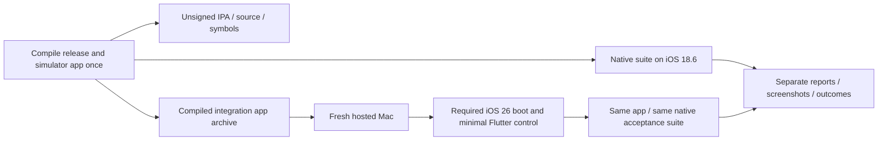

# iPhone review of mobile PRs after #172

Initial pass: 26 October 2026 (Europe/Paris), through merged PR #196.
The parity continuation carries **44 reviewed merged PRs through #225**, including
merged source `56bb6629a55f79b56af556da94d4e6ed8d83ec30`. Build 34 passes both complete
iOS 18.6/26.0 native suites through #217. Later reset and lyrics changes require
their own fresh native acceptance and do not borrow build-34 qualification.
The initial iPhone merge below used main `b705c10e37ea606a5154253413f82b3ebf7f846a` directly
(merge `b26d8b9e08a8acc4d60b8aa2e2b7e3c4b521fdb1`). All 20 PRs below are
included by ancestry, including stacked #180/#181; none is copied as a divergent
iPhone-only implementation. Rust, bridge dependencies and package locks are
unchanged by this main integration.

The shared Flutter screens are the iPhone screens. Android native widgets remain
Android implementations; their revised product design feeds the WidgetKit work
below. Inclusion in source is distinct from passing iPhone acceptance.

| PR | Relevant behavior carried into iPhone | Validation / remaining platform work |
| --- | --- | --- |
| [173](https://github.com/lokal-music/lokal-mobile/pull/173) | Bounded metadata backfill and startup repair; responsive large libraries. | CPU budget and metadata warmup regressions; large physical-phone libraries still need profiling. |
| [174](https://github.com/lokal-music/lokal-mobile/pull/174) | Artwork anchor recovery after queue/lyrics, full-art dismissal, compact queue design. | Artwork/morph and queue tests; native repeated panel visits and return screenshots added. |
| [175](https://github.com/lokal-music/lokal-mobile/pull/175) | Profile editor above persistent dock; wrapping Save/Cancel footer. | Existing profile widget tests plus native editor hit-testing/screenshot added. |
| [176](https://github.com/lokal-music/lokal-mobile/pull/176) | Autoplay preview and repeat-all without rebuilding active playback. | Autoplay/queue and failed-source regressions; preserve iOS system/Rust codec handoff. |
| [177](https://github.com/lokal-music/lokal-mobile/pull/177) | Faster critically damped opening and stable quality-badge geometry. | Route spring and identity-row layout tests; native full-player screenshot. |
| [179](https://github.com/lokal-music/lokal-mobile/pull/179) | Canvas chrome paint order, sharper YouTube art, source/size metadata. | Pixel assertions and artwork/metadata-sheet tests; real Canvas video still requires native acceptance. |
| [180](https://github.com/lokal-music/lokal-mobile/pull/180) | Discovery recovery, Tidal/Amazon sources and artwork; early widget iteration. | Shared discovery/source tests. Android widget code supplies design history, not an iOS extension. |
| [181](https://github.com/lokal-music/lokal-mobile/pull/181) | Large-library scheduling, compound artist/album lookup and search selection. | Warmup, album lookup, performance and search regressions. |
| [184](https://github.com/lokal-music/lokal-mobile/pull/184) | Canonical Deezer enrichment and measured byte-progress streaming. | Morneye streaming tests; opaque progressive handles retain the iOS system-engine processing guard. Live accounts remain unqualified. |
| [185](https://github.com/lokal-music/lokal-mobile/pull/185) | Online-first Flow/autoplay, global catalogue search, durable online playlist references. | Flow, radio, catalogue, playlist reference/import tests; preserve opt-in sources and manual-queue priority. |
| [186](https://github.com/lokal-music/lokal-mobile/pull/186) | Themed Discord community link on Home/Library/You. | Shared button/localization tests; external URL launch is separate from Discord rich presence. |
| [188](https://github.com/lokal-music/lokal-mobile/pull/188) | Songs filter restricts global results and corrects empty state. | Category/result filtering regressions. |
| [189](https://github.com/lokal-music/lokal-mobile/pull/189) | Themed global catalogue selector and provider-choice sheet; Amazon artwork. | Catalogue selector, provider/category and artwork tests. |
| [190](https://github.com/lokal-music/lokal-mobile/pull/190) | Live Now Playing, Flow/Radio and Cover Flow widget behavior. | Shared snapshot/recommendation contract carried forward; native WidgetKit still pending. |
| [191](https://github.com/lokal-music/lokal-mobile/pull/191) | Consistent Online songs section heading and spacing. | Online result layout/localization tests. |
| [192](https://github.com/lokal-music/lokal-mobile/pull/192) | Exactly Library/Online scopes, exclusive default-Songs categories, provider headings/artist portraits. | Narrow-phone filter tests and native scope/category interactions added. |
| [193](https://github.com/lokal-music/lokal-mobile/pull/193) | Songs/Artists/Albums/Lyrics in both scopes; retired-filter migration; incremental saved/embedded lyrics scanning and online LRCLIB. | Search migration, lyrics review/scanning tests; native filter coverage does not claim a live LRCLIB account/network test. |
| [194](https://github.com/lokal-music/lokal-mobile/pull/194) | Exactly three responsive artwork-led widgets; last-good cover while loading. | Adopt the three-family WidgetKit specification below; do not expose retired duplicate variants. |
| [195](https://github.com/lokal-music/lokal-mobile/pull/195) | Common local/online lyrics card: title, credits, matching excerpt without LRC timestamps, accent Play. | Lyrics result layout and matching/excerpt tests. |
| [196](https://github.com/lokal-music/lokal-mobile/pull/196) | Signed ARGB transport and compatible numeric preferences prevent Android widget fallback crashes. | Preserve upstream Kotlin and Dart regressions; use an explicit fixed-width color contract for future iOS snapshots. Android CI remains manually disabled. |

## WidgetKit design and implementation gates

Expose exactly three widget configurations, each responsive to the supported
small, medium and large iPhone families. The family controls density, not which
product it is. Album artwork remains visible at every size; reserve the sleeve
when empty and retain the last verified cover during replacement. Use theme and
album-derived surfaces, readable contrast and Dynamic Type; honor Reduce Motion.

| Configuration | Small | Medium / large | Empty / offline behavior |
| --- | --- | --- | --- |
| Now Playing | Cover, title, artist and play/pause when supported. | Cover, transport and system-driven progress; queue entry opens the app. | Last valid cover or branded sleeve; Open Lokal when there is no track. |
| Flow / Radio | Cover and active Flow/radio identity with primary action. | Current cover, station/context and supported transport. | Explain unavailable recommendations and open the app; no silent playback command. |
| Cover Flow | Cover-led recommendation with title and open/play entry. | A bounded strip of verified covers and current selection. | Keep available local recommendations, otherwise offer Open Lokal. |

```mermaid
flowchart LR
  Flutter[Shared player / Flow / recommendations] --> Snapshot[Versioned validated snapshot]
  Snapshot --> Assets[Bounded local artwork + last-good cover]
  Snapshot --> Group[App Group atomic persistence]
  Assets --> Group
  Group --> Timeline[WidgetKit timeline / system progress]
  Timeline --> Views[Now Playing · Flow/Radio · Cover Flow]
  Views --> Action[AppIntent on iOS 17+ / deep link on older OS]
  Action --> Inbox[Validated durable command inbox]
  Inbox --> Player[Existing app playback coordinator]
```

Implementation must validate IDs, bounded strings/arrays, finite nonnegative
position/duration, timestamps and a signed Int32 ARGB value (decode color as its
UInt32 bit pattern). Readers accept compatible legacy numeric widths without
trapping; corrupt fields fall back independently rather than replacing every
widget with one emergency layout. Never put credentials or transient stream URLs
in the App Group. Extension code reads snapshots and owned artwork; it must not
start a second Flutter/Rust audio engine or download arbitrary art at render time.

Apple's current [supported-capabilities table](https://developer.apple.com/help/account/reference/supported-capabilities-ios)
includes App Groups for the free Apple Developer account column as well as paid
memberships (checked 26 October 2026; the HTML table uses checkmark figures).
Do not assume a paid membership is necessary from older guidance. The actual
provisioning profile, matching host/extension group and Windows re-signing behavior
still require a signed-device test. [WidgetKit updates](https://developer.apple.com/documentation/widgetkit/keeping-a-widget-up-to-date)
are scheduled by the system; use timeline entries and system progress rather
than periodic app wakeups.

The initial base app used iOS 15. The maintainer subsequently chose a single
iOS 16+ app for current Chromecast SDK compatibility. Gate AppIntent interactive controls at iOS
17 and later; older widgets use deep links. WidgetKit schedules updates; do not
promise an unrestricted live refresh loop. Test stale timelines, artwork churn,
missing data, signed colors, cold-start command replay, offline behavior and text
scaling. Verify entitlements and extension re-signing with the Windows sideload
path before enabling this optional extension. A free-account re-sign that cannot
retain the App Group must still allow ordinary app playback, with a clear widget
availability explanation. Native widgets are not yet implemented or accepted.

## Validation record

All 20 PR merge commits are reachable from the integrated iPhone branch.
The pass enumerated 41 changed Dart test files. **All 248 cases in the 40
completable files now pass**, including search, lyrics-card layouts, catalogue
settings, Flow/autoplay, artwork/Canvas, profile editing, route motion, streaming,
playlist references and Android widget contracts.

The initial pass found seven failures. Two visual-test failures were resolved
by the compositing/harness fixes below. The other five search/Cover Flow failures
reproduced on untouched main `b705c10` before their fixtures were reconciled:
UI tests now override the current global catalogue interface instead of the
retired Apple-only provider; the narrow filter test scrolls and lays out Lyrics
before tapping it; Cover Flow expects the intended middle initial item. Stale
query protection, entity isolation, no library work in Online scope and the real
queued recommendation order remain asserted. The three corrected fixture files
also pass static analysis without findings.

The failed-source file initially stalled/failed on both branches. Its five cases
now pass after repairing fixture lifecycle: explicitly owned streams/disposal,
draining both the fake deadline clock and real cancellation event loop, and
stopping the deliberately paused crossfade ramp before widget-test invariants.
Expected errors, source-load counts, fresh-player recovery and crossfade player
identity assertions are retained. All 41 changed Dart files therefore have
passing focused runs: 248 checks across 40 files, plus five decoder-recovery
checks. This is not a green claim for the complete historical Flutter suite.

A separate post-merge iPhone regression selection passes all 41 cases, including
the actual host Rust metadata/QuickJS bridge (with `LOKAL_NATIVE_LIBRARY` set),
iOS storage/document handling, processing selection, codec routing, ReplayGain
and Desktop Link errors. These host checks do not replace the hosted iOS run.
Build 19 compiled/packaged the updated release IPA, but attempt 1 failed the
minimal Flutter control-app VM gate before Lokal could execute. Attempt 2 was superseded by the fixture/documentation commit. Build 20 then
passes the actual Library/Online controls, all four exclusive filters in each
scope, profile-editor hit testing above the dock, navigation and Keychain on
iOS 18.6, with screenshots (source `0d283e361ac664b809fa8a3360e389f1e8f93612`).
Its scanner assertion stops the remaining suite: the added artwork PNG is
correctly counted alongside the WAV, while the test expected only one file.
Create the artwork after the single-file scan to preserve the scanner assertion.
Player panel transitions and subsequent checks require the next native run. The native Android widget regression passes all five cases (including the real
SharedPreferences numeric boundary), and application/integration analysis finds
no errors (555 existing warning/info findings). Six focused player tests pass.

The Canvas pixel test now awaits raster work outside Flutter's fake clock,
retaining its actual pixel assertions. This exposed a real rendering defect:
chrome's OpacityLayer was positioned using a canvas-only transform when its child
had no repaint boundary. The portal now declares its compositing requirement,
so both boundary and non-boundary cases retain their transformed foreground
position. The identity-layout test also disposes/drains its marquee pause timer.

Build 17 passed the complete native suite on iOS 18.6 and 26.0, but its merge
checkout only included upstream PRs through #186. Build 18 passed the native suite
and real Bonjour/HTTP discovery on iOS 18.6 at source
`d345edb3dae4b3a41c4524d163d44bdb83fd5309`, with main parent
`63bba250dcfd67d97d3165cf61cecbe7fb6a8431` (through #194). Its iOS 26 simulator failed to boot,
so that runtime did not execute the newer suite. Neither run establishes complete
#196 UI coverage, physical iPhone acceptance or signed installation.

Build 19 / attempt 1 package metadata identifies source
`e66c0dfaf079f21954d67536643c080278258106`, tree
`3bc937d41e6ed94e55e3aaf2d65b4718d0fee7d2`, and SHA-256
`6092b2d934cc6f9d26f012aa5cdc8ae0bf2457b89639a086e28208a0c7c62550`.
All 33 device binaries passed CI inspection; the downloaded IPA and checksum
were verified locally. This package has the updated UI, but its new simulator
acceptance remains pending, and it has no physical-device qualification.

## Subsequent recovery and data-safety checks

Build 21 packages the app but fails minimal-control VM readiness before Lokal
execution. The control coordinator now permits exactly one fresh owned simulator
and opens Simulator.app for that device. Original and recovery evidence have
distinct names; the new UDID is published to following steps. Only the generated
control bundle can use this path. Installation errors propagate directly, a
second readiness failure fails the job, and Lokal tests receive no retry or
weakened acceptance. Nine Python coordinator contracts pass; these are not Apple
runtime tests. The recovery itself still requires a hosted result.

The new host persistence integration runs real Rust tag editing/scanning, the
production library indexer and real Isar. It checks unchanged rescans, retagging
with stable song IDs, playlist references and saved folders after database
close/reopen, Unicode paths, and an unchanged source-file copy. Only filesystem
locations/preferences are isolated. This does not establish Apple's Files picker,
a separate app process relaunch, signing or hardware behavior. The combined real
persistence, decoder recovery and iOS DSP/codec selection pass 17 checks; both new
Dart test files analyze without findings. Explicit library-path environment
variables are required, otherwise the host persistence case reports a skip.

## Further upstream pass: merged PRs 198–207

Main advanced during implementation. The branch now includes main
`a2e1e622983d7e871233653421cb42970e2d5063` through merges `24abfc0` and `dda337f`.
All 29 merged PRs after #172 are confirmed reachable, including the original 20.
No PR numbered #197 or #205 appeared in the mobile PR list for this audit.

| PR | iPhone disposition |
| --- | --- |
| #198 | Concurrent fallback search and explicit per-rendition 16/44.1 metadata are carried into Discovery. Keep the existing opaque progressive-stream processing guard. |
| #199 | The contextual Video action, full-player presentation and queue-preserving audio handoff are shared. Android's Media3 implementation remains Android-only; iPhone explicitly uses the official WKWebView embed fallback. Native AVPlayer presentation and live embed/audio-handoff qualification remain open. |
| #200 | Synchronized-only Space immersive lyrics and romanized/translated sublines use the shared player clock. New native generated-LRC/seek/entry/exit screenshot checks are added, pending a hosted result. |
| #201 | Turkish Flutter strings and runtime locale switching are included. All 11 supported Flutter languages are now declared in the iOS bundle. The port gates Android widget locale updates to Android; otherwise iPhone language selection invokes unavailable Android-provider operations. The readiness gate checks bundle/language parity. |
| #202 | Remote notification art is asynchronously cached to a local file, also usable by Swift Now Playing. Its existing partial-update handler preserves playback rate, duration and elapsed position. New native HTTP-cache-UIImage-Now Playing assertions distinguish a 40px remote fixture from earlier local art; pending native execution. |
| #203 | Add-to-playlist rows use real shared playlist artwork. Repair the upstream test's invalid constant-property expression, retaining its artwork assertions. |
| #204 | Heart timestamps, newest-liked-first order and persistent Liked sort/direction/location/quality/query apply to iPhone. |
| #206 | Preserve the Kotlin service-context fix and native localization regression guard; Android full-debug Kotlin compilation and five widget-preference tests pass after this merge. |
| #207 | Spotify account/cookie/liked-sync controls now appear together first in Data → Accounts; remove the duplicate Appearance entry. Resolve the merge while retaining iPhone icon/native settings adaptations. Hide unimplemented Android refresh-mode/RemoteViews settings on iPhone. |

Validation: all 43 cases in the nine affected files through #206 pass; the #207
placement/profile selection passes eight checks. Android full-debug Kotlin and
five native widget-preference cases pass; Android CI stays manually disabled.
Application/integration analysis has no errors (existing warnings/info remain).
The localization inventory passes with all languages present and fails explicitly
when Turkish is removed in an isolated source fixture. HTTP image/probe/404 and
shutdown behavior pass locally with a real server and stubbed Bonjour publisher;
that is not an Apple discovery or Now Playing pass.

See [the integration follow-up](IOS_FOLLOWUP_FEASIBILITY.md) for the verified
media-reset contract, current Google Cast SDK minimum OS and official iOS Discord
SDK path. Those remain implementation/qualification work, with explicit evidence
boundaries.

Additional port corrections from this pass: the dock's canonical enum labels
previously bypassed localization. Its visible labels, tooltips and accessibility
labels now resolve at build time (including localized Home and the existing ARB
Search label), while navigation IDs remain unchanged. A real dock widget test
switches Turkish/English and taps the same destination enums; the combined dock,
locale and shell selection passes 23 cases. Turkish output is regenerated from
the ARB with pinned Flutter and a repeated generation leaves no diff. Separate
localization/morph selections pass 16 checks (overlap).

Build 22 passes the simulator control gate and reaches the actual full player
with generated art, scanner/QuickJS and system WAV playback. Its dismissal check
fails after one timed pump. The native screenshot shows the normal full-player
layout; the harness now waits for completed opening animation, targets footer
InkWells instead of repeated panel/header text, and waits for dismissal over a
bounded sequence of frames. The route-disappearance assertion remains intact.
Reports now record each native stage immediately so later failures do not erase
prior measurements. The expanded Space/Turkish/HTTP Now Playing checks still
require a new hosted result; a debug-only native probe reports numeric metadata
and artwork dimensions without names, file paths or credentials.

Build 23 stops at static analysis because the newly added notification assertion
used an `instance` getter instead of the service's factory constructor. The
harness now calls `NotificationService()`, and full application/integration
preflight has no errors (566 warning/info findings remain). No native runtime
result is claimed for that attempt.

The maintainer chose one full-featured iOS 16+ distribution. New runner and pod
targets, native probe Clang triples, Cargokit's forwarded deployment target and
package inspection follow that decision. Standalone native-environment helper
contracts pass; a declared iOS 15 app is rejected by the package policy. Real
Apple iOS 16 compilation/package/runtime acceptance requires the next run.

### Build 24 native evidence (iOS 16 floor)

[Build 24](https://github.com/lokal-music/lokal-mobile/actions/runs/40273185020)
packages the new iOS 16 release and reaches the actual iOS 18.6 test app. Exact
merge source: `0fda1f5e314475639cde9ef26dc1ae8737c01270`.
Its incremental report passes post-172 search/profile UX, the corrected scanner,
QuickJS, WAV transport, repeated Queue/Lyrics panels and return to mini player,
**timed Space lyrics**, native EQ/pitch/positive ReplayGain, WavPack conversion,
the complete MP3/AAC/ALAC/96 kHz FLAC/AIFF/Vorbis/Opus corpus, the system-to-Rust
queue handoff, and Bonjour protocol filtering plus HTTP. Actual Space screenshots
show the expected current and next generated lyric at the retained song clock.

The run then fails at `nowPlayingMetadataState`: Runner Debug had C preprocessor
`DEBUG=1` but no Swift `SWIFT_ACTIVE_COMPILATION_CONDITIONS=DEBUG`, so the new
DEBUG-only metadata probe was excluded. Runner Debug now explicitly inherits and
sets Swift DEBUG; Release/Profile remain unaffected. No metadata assertion is
removed. Remote artwork and the subsequent Turkish switch still require the next
native run; iOS 26 was not reached. This is partial native evidence, not a fully
green run. The same logs expose repeated Android-only HomeWidget update calls on
iPhone; the Android publisher is now gated on iOS until a real WidgetKit snapshot
adapter exists, matching the already-gated settings UI.

## Subsequent merged PRs 209–210

The current port working branch merges main
`4504f64177e0826acacd7d06ab080718b947c3a4`, including both additional PRs.
There are now **31 merged mobile PRs after #172** in scope; #208 is the separate
unmerged iPhone Cast implementation, not an upstream main feature.

| PR | Shared behavior carried into iPhone | Adaptation / validation |
| --- | --- | --- |
| #209 | Liked rows remain mounted during heart updates; expired add-on sessions become fresh registered lookups at playback/queue time; stable liked IDs, source/Atmos identity, local files and configured network libraries are retained. Large queues use a separate resolver registry. | No Android-only bridge is required by this repair. Host tests cover restored streams, retained live handles/downloaded/local/Subsonic sources, 650-track queues, source-specific resolvers, provider stability and Atmos preservation. Actual live add-on availability remains separate. |
| #210 | Space is a subtitle overlay over the existing artwork/full cover/Canvas/video, with chrome hidden and carousel gestures disabled; tap exits and long press shows options. Video occupies the artwork slot; its controls and subtitles use its own clock. Syllable layout is cached. | Fix the upstream missing `ValueListenable` foundation import. Add an accessible Space exit surface. Native harness now asserts the actual artwork elements survive entry and the current generated lyric follows the retained song clock. Build 27 passes the retained-artwork/clock assertions and preserves the current overlay screenshot on both runtimes. Official embedded video uses captions below the unobstructed provider player, with explicit Space exit. iPhone uses the official embed with a dedicated API clock/transport and serialized output ownership; live WebKit/video acceptance remains pending. |

After the import correction, eight focused files pass **31 tests**, including
both new PRs, timed subtitle eligibility/clock/rewind, artwork layout/morph and
video route/embed contracts. The native fixture retains its queue/lyrics,
paused playback, artwork identity, current line and dismissal assertions.
No Android native source changes in these two PRs supersede the recorded
post-#207 Kotlin compilation; current shared Dart behavior is checked separately.

The video follow-up now drives the official iframe through its own clock and
transport, with an external-output lease serialized by PlayerService. Video uses
a generic localized Video badge, not the album's FLAC/Atmos quality claim; volume
instructions replace inactive album-only software-volume/shuffle/repeat controls,
and the heart addresses the displayed video's song. Space exit, video timing,
volume guidance and Video labels are supplied in all ten non-English Lokal maps.
The expanded player/ownership/Cast/Likes/locale selection passes **123 tests**;
the focused transport selection passes **41** (overlap). Node executes the actual
production iframe bridge against a controlled API contract. Native WebKit/live
YouTube checks remain separate; see `IOS_VIDEO_TRANSPORT.md`.

### Build 26: Cast-integrated application and pause acknowledgement

[Build 26](https://github.com/lokal-music/lokal-mobile/actions/runs/40286173853)
compiles the Cast-integrated iOS 16 app, inspects all **34** device binaries and
requires Cast core resources, privacy metadata and notice bundles. Its preserved
IPA SHA-256 is `10cbfbbe68a851cca91529c842d6bc0d6c3152f0a61b21ea3fa39612b7de138d`.
Exact source is `9c230b90f80e9536dd08b6d794a6485b057c0c44`, tree
`c61258b7559dc23008008883dfa7e08d8d5fb959`.

**The complete iOS 18.6 native suite passes**, including the actual registered
Cast bridge with no startup discovery, remote HTTP artwork into native Now
Playing, live Turkish switching, the full playback/DSP/codec corpus, source
handoff, updated search/profile/panels and Bonjour. This source still contains
the older pre-#210 Space stage; the current overlay is a subsequent change.

The iOS 26 run passes startup/search/profile/Keychain, scanner/QuickJS, Space,
EQ/pitch/ReplayGain, WavPack, MP3/AAC/ALAC/96 kHz FLAC/AIFF/Vorbis, then fails its
Opus Pause assertion (UI remains playing after awaited Pause). Later checks are
not reached. This is an application transport race, not a simulator boot failure,
and the test assertion is retained.

The native pause API previously returned on command enqueue. The iPhone path now
waits up to two seconds for the command worker to apply pause; it releases the
global engine mutex before waiting so synchronous UI queries remain available.
The worker reply is bounded/non-blocking, and a timeout does not claim cancellation.
Android's existing Pause path and all PCM/DSD/USB rendering logic remain unchanged.
The iPhone Rust adapter suppresses stale playing/buffering notifications until a
new explicit Play; failed pause restores actual backend state. The native harness
also checks Rust's actual paused state and repeats Opus resume/pause.

All **307 Rust tests pass**, including real command-worker acknowledgement and
paused render silence, no-source completion, delayed reply and timeout behavior.
Three targeted Dart tests pass for stale events, explicit resume and failure.
The latest affected Dart selection passes **90** checks; the earlier broader
player/Likes/locale selection passes **123** (overlap). New iPhone-native results
remain pending the next source build. Google Cast's real context initialization
without automatic discovery is also added as a DEBUG-only acceptance check;
receiver behavior remains unqualified.

### Build 27: complete native checkpoint on both runtimes

[Build 27](https://github.com/lokal-music/lokal-mobile/actions/runs/40305306973)
passes the complete native suite on **iOS 18.6 and 26.0**, plus release/AOT
compilation and inspection of all **34** iPhone binaries, iOS 16 minimum, Cast
resources/privacy/notices, source and symbols. Exact tested merge source:
`659140532c300887de408a362377f6a6779916bb`; tree:
`ecaf093a021db35bf75bb66d521656f147dbb2bb`. The matching unsigned IPA SHA-256 is
`61fd97565f0b64168e3b16e347c7496cf0e28b84c5d15e017eabd935776faaf8`.

Both runtimes pass startup/Keychain, updated search/profile/panels, scanner/tag
album-artist, QuickJS, AVPlayer transport, native EQ/pitch/ReplayGain, WavPack,
MP3/AAC/ALAC/96 kHz FLAC/AIFF/Vorbis/Opus, system-to-Rust queue handoff, real
Bonjour filtering/HTTP, remote artwork into Now Playing and live Turkish switching.
The #210 Space screenshot and element-identity assertions confirm the existing
artwork survives entry while generated captions follow the actual song clock.
The suite also confirms an external-owner acknowledgement gates actual AVPlayer
resume, a newer manual Pause defeats a stale video-exit resume, real Cast context
initialization starts no discovery, and repeated Opus resume/pause reaches Rust's
actual paused state. The original pause failure is resolved without weakening
its assertion. Independent [Rust device/simulator probes](https://github.com/lokal-music/lokal-mobile/actions/runs/40305307004)
and [Cast SDK probe 4](https://github.com/lokal-music/lokal-mobile/actions/runs/40305307048)
also pass on this source.

These are simulator and package results, not physical iPhone, iOS 16 runtime,
actual Cast receiver or live YouTube acceptance. The subsequent unobstructed
embedded-video Space layout and HTTP range fixes require their own source build.
The preceding build-24/build-26 sections are historical checkpoints.

## Further upstream review: #211–#216

Reviewed 26 October 2026 (Europe/Paris), main
`63280241a5216ef987111eb8cd17c93e0626f1e4`. This brings the integration to **37**
merged mobile PRs after #172. #208 is the port's own companion and is not counted.

| PR | Applied UI/behavior | iPhone adaptation and validation |
| --- | --- | --- |
| #211 | Fix `ValueListenable` import for Space release compilation. | Matches the correction already made in the port; preserve upstream `ValueNotifier` for the new smooth renderer. |
| #212 | Show Cover only when an enabled source can supply actual motion art/Spotify Canvas; allow re-enabling a disabled song. | Share revision-keyed async lookup and failure-safe availability. The source-order/cache tests pass; a static cover never advertises motion. |
| #213 | Prefer Last.fm albums and remove redundant provider discovery shelves. | Carry shared recommendation order, deduplication and shelf changes. Discovery tests pass; live account/catalogue availability remains separate. |
| #214 | Smooth unshaded Space syllables and hide shell footer on video routes. | Keep the standard Lyrics painter, use the root navigator with Lokal's existing full-player route, preserve the keyed embedded player and display captions below it. Provider touches remain reserved for its own controls. |
| #215 | Add concurrent/overlapping Space lines, Appearance video-quality preference, and separate album-artist targets. | Share concurrent renderer and artist links. Keep native Android height selection/generation guards; iPhone shows translated guidance for YouTube's quality control. A separate video advancing signal freezes Space during buffering. Build 29 passes two actual concurrent generated lines on iOS 18.6; iOS 26 does not execute because simulator boot fails. |
| #216 | Recover Android USB DAC registration and protect transfer/feedback lifetime. | Preserve upstream Kotlin/Rust changes. The transport is Android-only, not an iPhone USB feature. Compile verification and actual DAC qualification are separate. |

The current UI/transport/locale selection passes **114** tests; the focused video
clock/Space subset passes **16** (overlap). No analysis errors are found; existing
warning/info findings and the historical unused-ARB-key failure remain. Native
build 27 does not cover these subsequent changes. An opt-in live WebKit fixture
records observable readiness/playback/seek/Space and release, or a clearly
inconclusive provider/network result. See the current port continuation for scope.

### Screenshot-driven Library localization follow-up

The build-27 Turkish screenshot exposed six still-English Library shortcuts and
an English empty-library import action. The translations already existed for the
shortcuts, but the tile builder did not call the presentation lookup. The follow-up
now localizes those six labels and import/retry actions while preserving navigation
IDs. The import phrase is translated in all ten non-English Lokal maps.

The affected Library/components/dock/live-locale selection passes **24** tests,
including all six Turkish navigation targets and import at 320×568 with 200% text,
then a return to English. The native harness also adds explicit assertions for the
six translated labels. This follow-up is later than build 29's source and does not
borrow its native acceptance. The existing historical ARB unused-key failure is
unaffected.

The Android full-debug ARM64 APK also builds on the #216/iPhone-referrer source,
with the upstream resolver, USB registration and native transfer changes intact.
Its SHA-256 is `107b3f93afb65d308e6f082b58866f59ae6e30d3b4539fa3b97eec5919abb1f4`.
This is compile/package evidence, not a DAC, payload-fidelity or phone test.

### Build 29: current #216 source, real WebKit observations

[Build 29](https://github.com/lokal-music/lokal-mobile/actions/runs/40315993836)
packages the iOS 16+ app and passes the **complete iOS 18.6 native suite**, including
#215's two concurrent generated Space lines and the previous codec/DSP/queue,
Keychain, scanner, QuickJS, Cast initialization, external ownership, Bonjour,
remote-artwork and live-locale checks. Its Space screenshot now shows the smooth
unshaded concurrent presentation over the retained artwork.

Exact source: `f71f7501c5679188dbc99ee9776ea6d0da70d83d`; tree:
`fbab3adcabefc1806e4c9f2ed6ee777666ea9042`. The preserved unsigned IPA passes
inspection of all 34 device binaries and Cast resources/notices; SHA-256:
`d715ad0a46c4efebc82a5f946bd38004fdb966ff7e9ae64bfaa1cc5467294d07`.

The opt-in production WebKit probe reads the actual installed `app.lokal.mobile`
identity and observes real iframe API readiness. YouTube then returns error 150;
the screenshot explicitly shows **"Sign in to confirm you're not a bot"**. Position
advance is zero. The real native WebKit media-suspension acknowledgement succeeds.
The report correctly marks playback **inconclusive**; neither successful live
playback/seek nor a generic embedding prohibition is inferred from the error code.
The challenge is not bypassed, and no account credentials are introduced into CI.

The overall workflow fails because the **iOS 26 simulator does not boot**:
`simctl bootstatus` times out after 300 seconds and even the simulator screenshot
fails. Lokal never executes on that runtime. This is not a current iOS 26 app
pass; build 27 remains the last complete dual-runtime checkpoint. A fresh hosted
runner must retry the current source without weakening its native gate.

The later Library-label/raw-video-sample follow-ups have their own host checks and
await a new native source build. This checkpoint does not cover those later changes.

## Further upstream review: #217

Main `ba8c7f5b9e6ab4e004f106ec1c02231143fb1d5b`, reviewed 26 October 2026
(Europe/Paris). The integration now contains **38** merged mobile PRs after #172.

| PR | Applied UI/behavior | iPhone validation and limits |
| --- | --- | --- |
| #217 | Accept documented `.spotiflac-ext` imports alongside `.sflx`/`.morneye-ext`, with matching picker guidance and case-insensitive URL/file validation. Download workers have a host-controlled 256 MiB heap ceiling; browsing stays at 64 MiB. | The shared iPhone picker/installer benefits from the same change. Keep all archive/permission/hash validation. 42 package/panel tests and all 308 Rust tests pass, including eight real QuickJS tests. The Rust function/config field adds no bridge entrypoint. Current native evidence remains build 29 through #216; iOS compilation/execution and peak memory on the oldest supported phone still need the new source run/device acceptance. Metadata-only/lyrics-only providers are not working audio sources merely because their ZIP installs. |

The changed #217 Rust library also compiles successfully for Android ARM64 with
the real pinned NDK through Cargokit (`cargokitCargoBuildRust_lib_flick_playerDebug`).
This complements the earlier complete #216 APK build; it does not label that
older APK as containing #217 or establish physical extension/device acceptance.

### Build 32 and isolated current-runtime acceptance

[Build 32](https://github.com/lokal-music/lokal-mobile/actions/runs/40321960451)
passes the complete iOS 18.6 suite on the current source through #217, including
the six translated Library shortcut assertions and concurrent Space. Exact source:
`c2ad2f0bbcc8bfda32cb0e650647b8cfd72a77f5`; tree:
`aa72e2cbfcd0ee87020577637f93027365bdd44e`. The preserved iOS 16+ engineering IPA
SHA-256 is `6dda95cf443741d9d147a940f92bb0de2b35aa77fd858ca483cc77eed3589f2d`.

The raw-source video probe reaches the real iframe API and acknowledges native
WebKit suspension, but the hosted network again receives YouTube's sign-in/bot
challenge (150) with zero source-position advance. Playback remains inconclusive.
The iOS 26 simulator again fails to boot before any app test; the run is not a
complete dual-runtime pass.

The following CI change runs iOS 26 on a **fresh hosted Mac**, using the exact
already-compiled integration app from the iOS 18.6 build job. An archive preserves
bundle symlinks and executable modes; the receiving job downloads its exact
artifact ID and safely extracts it. Both OS gates stay required. A failing iOS
18.6 assertion does not suppress the second runtime when the compiled app exists;
cancelling a workflow does suppress extra jobs. Failed iOS 26 jobs can now be
retried without recompiling the IPA or rerunning the completed iOS 18.6 job.

The iOS 26 host also runs the minimal Flutter control before Lokal. Boot, control,
actual playback, reports and logs are recorded independently. No app assertion,
OS-version requirement or simulator boot check is relaxed. Driver timeouts now
match the selected four-minute deterministic/six-minute optional-video test bounds.
The updated workflow passes YAML/shell parsing and all nine existing simulator/
control-coordinator tests; the changed Dart driver analyzes without issues.

The compiled app's Bonjour fixture identity is also forwarded to the isolated
host, so retrying only that job does not change the identity baked into the app.
A screenshot-driven Library follow-up allows two-line shortcut labels and switches
to one column as text grows. All six Turkish labels fit the bundled app font at
200% on 320/393/430px screens; navigation/import and component/dock selection
passes **18** host tests. The native harness now checks rendered labels for actual
truncation; that added assertion still requires the next hosted run.

Build 33 was rejected during workflow validation before any runner or app test:
a runner-specific path was placed in job-level environment configuration. The
path now uses the step runtime environment. Local `actionlint` supplements YAML
and shell parsing to validate GitHub Actions expression context availability.

### Build 34: current complete dual-runtime checkpoint

[Build 34](https://github.com/lokal-music/lokal-mobile/actions/runs/40335805541)
passes the **complete native suite on both iOS 18.6 and 26.0**. The fresh iOS 26
host passes boot, minimal Flutter control and the same compiled integration app;
its fixture identity is preserved from the build job. Source:
`cf8bcfa4a8a2fe6b8f7224812e56af2ef9617c11`; tree:
`2ec3f9721139a923d35cb3983dc8fa3fd9d36c23`. The preserved IPA SHA-256 is
`fe0a5479a0e4ba364584438c408f90d6f48823747c40ada8cbd1058bd4446d21`.
All 34 device binaries, Cast resources/privacy/notices, source and matching symbols
are retained. The actual Turkish screenshot and native render assertions confirm
all six shortcut labels fit. This is the complete checkpoint through #217; it
does not cover the later reset foundation or lyrics continuation. The optional
network-dependent live video probe was not selected in this run.

### Lyrics continuation through #219

The recovery candidate carries **40 reviewed merged mobile PRs after #172**,
including the merged #218/#219 source at
`c8f8f574fdd2812a5a0e7398c47fac17cb6731ed`. The current published port checkpoint
above remains through #217 until this candidate's native gates pass.

| PR | iPhone UI / behavior | Verification |
| --- | --- | --- |
| [218](https://github.com/lokal-music/lokal-mobile/pull/218) | Validate LyricsPlus timing; fall back to plain text for unusable timelines. Show actual per-song provider hits and timing quality, preserve lyrics while checking an explicit provider, and save portable lyrics plus enhanced-LRC sidecars with downloaded audio. | Preserve app-owned iPhone Music fallback and byte-identical Atmos copies. Localize picker status/guidance in all ten phrase maps while keeping provider identifiers unchanged. Native codecs are regenerated with the request-fence API retained. |
| [219](https://github.com/lokal-music/lokal-mobile/pull/219) | Correct the native edit/read metadata model so downloaded lyrics can be written. | Keep the 11-field read result unchanged and put nullable lyrics in TagEditFields. Fix two new tests for the pinned Lofty API and add the field to the existing scanner fixture; the actual Rust suite passes. |

The lyrics/download/provider/locale selection passes **26** Flutter tests, including
Turkish at 200% on 320/393px screens with unchanged `lyricsplus` selection. All
**315** Rust tests pass, including actual FLAC lyrics persistence and ID3 USLT
mapping. Android ARM64 native compilation succeeds with the pinned NDK; its first
retry exhausted local generated cache space, after which only owned intermediate
outputs were removed and the real compilation rerun successfully. Whole app
analysis reports no errors (existing warnings/information remain). No live-provider
recording, iPhone download/background, or physical-device result is inferred.

The recovery observer remains deferred: request fencing and system/radio output
retirement are preparation, not enabled media-services reset recovery.

The updated candidate passes the exact **217-test** contract command committed
in the iPhone workflow, covering shared output ownership, Cast, video/Space,
retirement, lyrics/provider/download localization and add-ons. This is host
contract evidence; the revised bootstrap fence probe and latest source still
require the next hosted native run.

### Build 36 and recovery continuation

Build 36 at `e549395101eb8a11ea98ac693402ba59ddaeb341` passes the complete
ordinary iOS 18.6 suite and unsigned release packaging through #219. Its isolated
iOS 26 job fails during initial simulator inventory, before the app can run;
Build 34 remains the latest complete dual-runtime pass.

The connected recovery continuation retains track/source identity, queue,
position and video selection, preserves remote controls, and adds a localized
notice beneath content. Host checks cover all eleven locales at 200% on a
320px phone. The exact workflow contract selection passes 234 tests; native
posted-reset and delayed-HTTP acceptance is added but pending. Production
observation remains deferred; no physical reset or live-video pass is claimed.

### New upstream review queue — 27 October 2026

Four further merged PRs are confirmed, bringing the review scope to 44 merged
mobile PRs after #172 through #225. The recovery checkpoint implements the earlier 40 through #219. The stacked
parity continuation now carries these four, with the adaptations below.

| PR | Relevant iPhone behavior | Adaptation / acceptance |
| --- | --- | --- |
| [221](https://github.com/lokal-music/lokal-mobile/pull/221) | Save displayed lyrics from full player, inline lyrics and Space; preserve LRC/ELRC/TTML or export plain UTF-8. | Use an acknowledged iOS Files export, retain timing and translations, silent cancellation, no mutation of selected source or original sidecars. |
| [223](https://github.com/lokal-music/lokal-mobile/pull/223) | Native Monochrome FLAC discovery/playback/download source with bounded search and honest format labels. | Preserve source identity, opt-in source policy and iPhone progressive playback; actual stream format and hardware output remain measured separately. |
| [224](https://github.com/lokal-music/lokal-mobile/pull/224) | Accept streaming-only HTTP add-ons when explicit downloading is prohibited. | Retain manifest validation and download prohibition; use the existing iPhone streaming route rather than staging a prohibited library copy. |
| [225](https://github.com/lokal-music/lokal-mobile/pull/225) | Artist favorites filters/search, Spotify followed-artist import and remote-only rows. | Preserve legacy favorites, reuse secure configured credentials, additive read-only import with bounded pagination, no Spotify follows/unfollows or implicit login. |

### Parity continuation through #225

The four patches are ported onto `feat/ios-parity-through225`, stacked on the
reset candidate so its ongoing native run can finish independently.

- Lyrics export uses the pinned cross-platform byte-based Files picker API and
  acknowledges Save/cancellation. It preserves original timed formats and plain
  bytes; rendered desktop timing retains millisecond offsets. UTF-8 filenames
  fit a 255-byte iPhone file component without splitting surrogate pairs. The
  full-player/Space guard uses the actually displayed song after video yields.
- Monochrome is a native source with stable `mono` identity, disabled until
  explicitly enabled in Online sources. Source priority reloads after that
  persisted choice. Playback uses the existing iPhone progressive route;
  explicit downloads retain verification. No measured sample rate, bit depth,
  bit-perfect status or live-service success is invented.
- Streaming-only add-ons install while explicit library download remains
  prohibited by the resolver. Manifest/settings tests wait for actual completed
  persistence while driving both widget and HTTP-stream queues.
- Artist favorites preserve legacy flags, known remote-only names and local
  rows. Concurrent writes are serialized (the added race test fails before the
  fix). Spotify import uses the existing secure session and read-only v1 GET
  `libraryV3` transport; short/inconsistent/malformed pages and GraphQL partial
  errors fail before import. Existing v2 transport stays intact.
- New labels, status text and save feedback are localized in all ten non-English
  phrase maps. Artist filters/import controls fit all eleven locales at 200%
  on 320px using bundled fonts; source IDs and artist metadata remain unchanged.

The exact expanded iPhone workflow selection passes **295 Flutter tests**.
Whole lib/integration analysis has no errors (571 warnings/information).
Native code, API 141 bindings and dependency locks are unchanged from the
315-Rust-test checkpoint. Native/source-account/Files acceptance for this
continuation is pending; the new provider is not contacted by default.

## WidgetKit contract continuation — 27 October 2026

The three-configuration specification above now has a [concrete versioned wire
contract and implementation plan](IOS_WIDGETKIT.md). Canonical PlayerState feeds
a metadata-only allowlist with stable hashed IDs and owned cover filenames;
Swift/Foundation consumes the same 45-case corpus as Dart. The full new Dart
selection passes 54 tests. Swift execution, atomic group persistence, native
layouts/commands and Windows extension signing remain acceptance gates. The
Android publisher is unchanged and the iPhone widget feature stays unavailable
until the actual extension is installed and usable. No newly reviewed upstream
PR is counted by this foundation; the parity audit remains 44 through #225.
