# iPhone review of mobile PRs after #172

Initial pass: 26 October 2026 (Europe/Paris), through merged PR #196.
The subsequent pass below carries merged updates through #207 (29 PRs total). The iPhone
branch now merges main `b705c10e37ea606a5154253413f82b3ebf7f846a` directly
(merge `b26d8b9e08a8acc4d60b8aa2e2b7e3c4b521fdb1`). All 20 PRs below are
included by ancestry, including stacked #180/#181; none is copied as a divergent
iPhone-only implementation. Rust, bridge dependencies and package locks are
unchanged by this main integration.

The shared Flutter screens are the iPhone screens. Android native widgets remain
Android implementations; their revised product design feeds the WidgetKit work
below. Inclusion in source is distinct from passing iPhone acceptance.

| PR | Relevant behavior carried into iPhone | Validation / remaining platform work |
| --- | --- | --- |
| [173](https://github.com/lokal-music/lokal-mobile/pull/173) | Bounded metadata backfill and startup repair; responsive large libraries. | CPU budget and metadata warmup regressions; large physical-phone libraries still need profiling. |
| [174](https://github.com/lokal-music/lokal-mobile/pull/174) | Artwork anchor recovery after queue/lyrics, full-art dismissal, compact queue design. | Artwork/morph and queue tests; native repeated panel visits and return screenshots added. |
| [175](https://github.com/lokal-music/lokal-mobile/pull/175) | Profile editor above persistent dock; wrapping Save/Cancel footer. | Existing profile widget tests plus native editor hit-testing/screenshot added. |
| [176](https://github.com/lokal-music/lokal-mobile/pull/176) | Autoplay preview and repeat-all without rebuilding active playback. | Autoplay/queue and failed-source regressions; preserve iOS system/Rust codec handoff. |
| [177](https://github.com/lokal-music/lokal-mobile/pull/177) | Faster critically damped opening and stable quality-badge geometry. | Route spring and identity-row layout tests; native full-player screenshot. |
| [179](https://github.com/lokal-music/lokal-mobile/pull/179) | Canvas chrome paint order, sharper YouTube art, source/size metadata. | Pixel assertions and artwork/metadata-sheet tests; real Canvas video still requires native acceptance. |
| [180](https://github.com/lokal-music/lokal-mobile/pull/180) | Discovery recovery, Tidal/Amazon sources and artwork; early widget iteration. | Shared discovery/source tests. Android widget code supplies design history, not an iOS extension. |
| [181](https://github.com/lokal-music/lokal-mobile/pull/181) | Large-library scheduling, compound artist/album lookup and search selection. | Warmup, album lookup, performance and search regressions. |
| [184](https://github.com/lokal-music/lokal-mobile/pull/184) | Canonical Deezer enrichment and measured byte-progress streaming. | Morneye streaming tests; opaque progressive handles retain the iOS system-engine processing guard. Live accounts remain unqualified. |
| [185](https://github.com/lokal-music/lokal-mobile/pull/185) | Online-first Flow/autoplay, global catalogue search, durable online playlist references. | Flow, radio, catalogue, playlist reference/import tests; preserve opt-in sources and manual-queue priority. |
| [186](https://github.com/lokal-music/lokal-mobile/pull/186) | Themed Discord community link on Home/Library/You. | Shared button/localization tests; external URL launch is separate from Discord rich presence. |
| [188](https://github.com/lokal-music/lokal-mobile/pull/188) | Songs filter restricts global results and corrects empty state. | Category/result filtering regressions. |
| [189](https://github.com/lokal-music/lokal-mobile/pull/189) | Themed global catalogue selector and provider-choice sheet; Amazon artwork. | Catalogue selector, provider/category and artwork tests. |
| [190](https://github.com/lokal-music/lokal-mobile/pull/190) | Live Now Playing, Flow/Radio and Cover Flow widget behavior. | Shared snapshot/recommendation contract carried forward; native WidgetKit still pending. |
| [191](https://github.com/lokal-music/lokal-mobile/pull/191) | Consistent Online songs section heading and spacing. | Online result layout/localization tests. |
| [192](https://github.com/lokal-music/lokal-mobile/pull/192) | Exactly Library/Online scopes, exclusive default-Songs categories, provider headings/artist portraits. | Narrow-phone filter tests and native scope/category interactions added. |
| [193](https://github.com/lokal-music/lokal-mobile/pull/193) | Songs/Artists/Albums/Lyrics in both scopes; retired-filter migration; incremental saved/embedded lyrics scanning and online LRCLIB. | Search migration, lyrics review/scanning tests; native filter coverage does not claim a live LRCLIB account/network test. |
| [194](https://github.com/lokal-music/lokal-mobile/pull/194) | Exactly three responsive artwork-led widgets; last-good cover while loading. | Adopt the three-family WidgetKit specification below; do not expose retired duplicate variants. |
| [195](https://github.com/lokal-music/lokal-mobile/pull/195) | Common local/online lyrics card: title, credits, matching excerpt without LRC timestamps, accent Play. | Lyrics result layout and matching/excerpt tests. |
| [196](https://github.com/lokal-music/lokal-mobile/pull/196) | Signed ARGB transport and compatible numeric preferences prevent Android widget fallback crashes. | Preserve upstream Kotlin and Dart regressions; use an explicit fixed-width color contract for future iOS snapshots. Android CI remains manually disabled. |

## WidgetKit design and implementation gates

Expose exactly three widget configurations, each responsive to the supported
small, medium and large iPhone families. The family controls density, not which
product it is. Album artwork remains visible at every size; reserve the sleeve
when empty and retain the last verified cover during replacement. Use theme and
album-derived surfaces, readable contrast and Dynamic Type; honor Reduce Motion.

| Configuration | Small | Medium / large | Empty / offline behavior |
| --- | --- | --- | --- |
| Now Playing | Cover, title, artist and play/pause when supported. | Cover, transport and system-driven progress; queue entry opens the app. | Last valid cover or branded sleeve; Open Lokal when there is no track. |
| Flow / Radio | Cover and active Flow/radio identity with primary action. | Current cover, station/context and supported transport. | Explain unavailable recommendations and open the app; no silent playback command. |
| Cover Flow | Cover-led recommendation with title and open/play entry. | A bounded strip of verified covers and current selection. | Keep available local recommendations, otherwise offer Open Lokal. |

```mermaid
flowchart LR
  Flutter[Shared player / Flow / recommendations] --> Snapshot[Versioned validated snapshot]
  Snapshot --> Assets[Bounded local artwork + last-good cover]
  Snapshot --> Group[App Group atomic persistence]
  Assets --> Group
  Group --> Timeline[WidgetKit timeline / system progress]
  Timeline --> Views[Now Playing · Flow/Radio · Cover Flow]
  Views --> Action[AppIntent on iOS 17+ / deep link on older OS]
  Action --> Inbox[Validated durable command inbox]
  Inbox --> Player[Existing app playback coordinator]
```

Implementation must validate IDs, bounded strings/arrays, finite nonnegative
position/duration, timestamps and a signed Int32 ARGB value (decode color as its
UInt32 bit pattern). Readers accept compatible legacy numeric widths without
trapping; corrupt fields fall back independently rather than replacing every
widget with one emergency layout. Never put credentials or transient stream URLs
in the App Group. Extension code reads snapshots and owned artwork; it must not
start a second Flutter/Rust audio engine or download arbitrary art at render time.

Apple's current [supported-capabilities table](https://developer.apple.com/help/account/reference/supported-capabilities-ios)
includes App Groups for the free Apple Developer account column as well as paid
memberships (checked 26 October 2026; the HTML table uses checkmark figures).
Do not assume a paid membership is necessary from older guidance. The actual
provisioning profile, matching host/extension group and Windows re-signing behavior
still require a signed-device test. [WidgetKit updates](https://developer.apple.com/documentation/widgetkit/keeping-a-widget-up-to-date)
are scheduled by the system; use timeline entries and system progress rather
than periodic app wakeups.

The base app retains its iOS 15 floor. Gate AppIntent interactive controls at iOS
17 and later; older widgets use deep links. WidgetKit schedules updates; do not
promise an unrestricted live refresh loop. Test stale timelines, artwork churn,
missing data, signed colors, cold-start command replay, offline behavior and text
scaling. Verify entitlements and extension re-signing with the Windows sideload
path before enabling this optional extension. A free-account re-sign that cannot
retain the App Group must still allow ordinary app playback, with a clear widget
availability explanation. Native widgets are not yet implemented or accepted.

## Validation record

All 20 PR merge commits are reachable from the integrated iPhone branch.
The pass enumerated 41 changed Dart test files. **All 248 cases in the 40
completable files now pass**, including search, lyrics-card layouts, catalogue
settings, Flow/autoplay, artwork/Canvas, profile editing, route motion, streaming,
playlist references and Android widget contracts.

The initial pass found seven failures. Two visual-test failures were resolved
by the compositing/harness fixes below. The other five search/Cover Flow failures
reproduced on untouched main `b705c10` before their fixtures were reconciled:
UI tests now override the current global catalogue interface instead of the
retired Apple-only provider; the narrow filter test scrolls and lays out Lyrics
before tapping it; Cover Flow expects the intended middle initial item. Stale
query protection, entity isolation, no library work in Online scope and the real
queued recommendation order remain asserted. The three corrected fixture files
also pass static analysis without findings.

The failed-source file initially stalled/failed on both branches. Its five cases
now pass after repairing fixture lifecycle: explicitly owned streams/disposal,
draining both the fake deadline clock and real cancellation event loop, and
stopping the deliberately paused crossfade ramp before widget-test invariants.
Expected errors, source-load counts, fresh-player recovery and crossfade player
identity assertions are retained. All 41 changed Dart files therefore have
passing focused runs: 248 checks across 40 files, plus five decoder-recovery
checks. This is not a green claim for the complete historical Flutter suite.

A separate post-merge iPhone regression selection passes all 41 cases, including
the actual host Rust metadata/QuickJS bridge (with `LOKAL_NATIVE_LIBRARY` set),
iOS storage/document handling, processing selection, codec routing, ReplayGain
and Desktop Link errors. These host checks do not replace the hosted iOS run.
Build 19 compiled/packaged the updated release IPA, but attempt 1 failed the
minimal Flutter control-app VM gate before Lokal could execute. Attempt 2 was superseded by the fixture/documentation commit. Build 20 then
passes the actual Library/Online controls, all four exclusive filters in each
scope, profile-editor hit testing above the dock, navigation and Keychain on
iOS 18.6, with screenshots (source `0d283e361ac664b809fa8a3360e389f1e8f93612`).
Its scanner assertion stops the remaining suite: the added artwork PNG is
correctly counted alongside the WAV, while the test expected only one file.
Create the artwork after the single-file scan to preserve the scanner assertion.
Player panel transitions and subsequent checks require the next native run. The native Android widget regression passes all five cases (including the real
SharedPreferences numeric boundary), and application/integration analysis finds
no errors (555 existing warning/info findings). Six focused player tests pass.

The Canvas pixel test now awaits raster work outside Flutter's fake clock,
retaining its actual pixel assertions. This exposed a real rendering defect:
chrome's OpacityLayer was positioned using a canvas-only transform when its child
had no repaint boundary. The portal now declares its compositing requirement,
so both boundary and non-boundary cases retain their transformed foreground
position. The identity-layout test also disposes/drains its marquee pause timer.

Build 17 passed the complete native suite on iOS 18.6 and 26.0, but its merge
checkout only included upstream PRs through #186. Build 18 passed the native suite
and real Bonjour/HTTP discovery on iOS 18.6 at source
`d345edb3dae4b3a41c4524d163d44bdb83fd5309`, with main parent
`63bba250dcfd67d97d3165cf61cecbe7fb6a8431` (through #194). Its iOS 26 simulator failed to boot,
so that runtime did not execute the newer suite. Neither run establishes complete
#196 UI coverage, physical iPhone acceptance or signed installation.

Build 19 / attempt 1 package metadata identifies source
`e66c0dfaf079f21954d67536643c080278258106`, tree
`3bc937d41e6ed94e55e3aaf2d65b4718d0fee7d2`, and SHA-256
`6092b2d934cc6f9d26f012aa5cdc8ae0bf2457b89639a086e28208a0c7c62550`.
All 33 device binaries passed CI inspection; the downloaded IPA and checksum
were verified locally. This package has the updated UI, but its new simulator
acceptance remains pending, and it has no physical-device qualification.

## Subsequent recovery and data-safety checks

Build 21 packages the app but fails minimal-control VM readiness before Lokal
execution. The control coordinator now permits exactly one fresh owned simulator
and opens Simulator.app for that device. Original and recovery evidence have
distinct names; the new UDID is published to following steps. Only the generated
control bundle can use this path. Installation errors propagate directly, a
second readiness failure fails the job, and Lokal tests receive no retry or
weakened acceptance. Nine Python coordinator contracts pass; these are not Apple
runtime tests. The recovery itself still requires a hosted result.

The new host persistence integration runs real Rust tag editing/scanning, the
production library indexer and real Isar. It checks unchanged rescans, retagging
with stable song IDs, playlist references and saved folders after database
close/reopen, Unicode paths, and an unchanged source-file copy. Only filesystem
locations/preferences are isolated. This does not establish Apple's Files picker,
a separate app process relaunch, signing or hardware behavior. The combined real
persistence, decoder recovery and iOS DSP/codec selection pass 17 checks; both new
Dart test files analyze without findings. Explicit library-path environment
variables are required, otherwise the host persistence case reports a skip.

## Further upstream pass: merged PRs 198–207

Main advanced during implementation. The branch now includes main
`a2e1e622983d7e871233653421cb42970e2d5063` through merges `24abfc0` and `dda337f`.
All 29 merged PRs after #172 are confirmed reachable, including the original 20.
No PR numbered #197 or #205 appeared in the mobile PR list for this audit.

| PR | iPhone disposition |
| --- | --- |
| #198 | Concurrent fallback search and explicit per-rendition 16/44.1 metadata are carried into Discovery. Keep the existing opaque progressive-stream processing guard. |
| #199 | The contextual Video action, full-player presentation and queue-preserving audio handoff are shared. Android's Media3 implementation remains Android-only; iPhone explicitly uses the official WKWebView embed fallback. Native AVPlayer presentation and live embed/audio-handoff qualification remain open. |
| #200 | Synchronized-only Space immersive lyrics and romanized/translated sublines use the shared player clock. New native generated-LRC/seek/entry/exit screenshot checks are added, pending a hosted result. |
| #201 | Turkish Flutter strings and runtime locale switching are included. All 11 supported Flutter languages are now declared in the iOS bundle. The port gates Android widget locale updates to Android; otherwise iPhone language selection invokes unavailable Android-provider operations. The readiness gate checks bundle/language parity. |
| #202 | Remote notification art is asynchronously cached to a local file, also usable by Swift Now Playing. Its existing partial-update handler preserves playback rate, duration and elapsed position. New native HTTP-cache-UIImage-Now Playing assertions distinguish a 40px remote fixture from earlier local art; pending native execution. |
| #203 | Add-to-playlist rows use real shared playlist artwork. Repair the upstream test's invalid constant-property expression, retaining its artwork assertions. |
| #204 | Heart timestamps, newest-liked-first order and persistent Liked sort/direction/location/quality/query apply to iPhone. |
| #206 | Preserve the Kotlin service-context fix and native localization regression guard; Android full-debug Kotlin compilation and five widget-preference tests pass after this merge. |
| #207 | Spotify account/cookie/liked-sync controls now appear together first in Data → Accounts; remove the duplicate Appearance entry. Resolve the merge while retaining iPhone icon/native settings adaptations. Hide unimplemented Android refresh-mode/RemoteViews settings on iPhone. |

Validation: all 43 cases in the nine affected files through #206 pass; the #207
placement/profile selection passes eight checks. Android full-debug Kotlin and
five native widget-preference cases pass; Android CI stays manually disabled.
Application/integration analysis has no errors (existing warnings/info remain).
The localization inventory passes with all languages present and fails explicitly
when Turkish is removed in an isolated source fixture. HTTP image/probe/404 and
shutdown behavior pass locally with a real server and stubbed Bonjour publisher;
that is not an Apple discovery or Now Playing pass.

See [the integration follow-up](IOS_FOLLOWUP_FEASIBILITY.md) for the verified
media-reset contract, current Google Cast SDK minimum OS and official iOS Discord
SDK path. Those remain implementation/qualification work, with explicit evidence
boundaries.

Additional port corrections from this pass: the dock's canonical enum labels
previously bypassed localization. Its visible labels, tooltips and accessibility
labels now resolve at build time (including localized Home and the existing ARB
Search label), while navigation IDs remain unchanged. A real dock widget test
switches Turkish/English and taps the same destination enums; the combined dock,
locale and shell selection passes 23 cases. Turkish output is regenerated from
the ARB with pinned Flutter and a repeated generation leaves no diff. Separate
localization/morph selections pass 16 checks (overlap).

Build 22 passes the simulator control gate and reaches the actual full player
with generated art, scanner/QuickJS and system WAV playback. Its dismissal check
fails after one timed pump. The native screenshot shows the normal full-player
layout; the harness now waits for completed opening animation, targets footer
InkWells instead of repeated panel/header text, and waits for dismissal over a
bounded sequence of frames. The route-disappearance assertion remains intact.
Reports now record each native stage immediately so later failures do not erase
prior measurements. The expanded Space/Turkish/HTTP Now Playing checks still
require a new hosted result; a debug-only native probe reports numeric metadata
and artwork dimensions without names, file paths or credentials.
