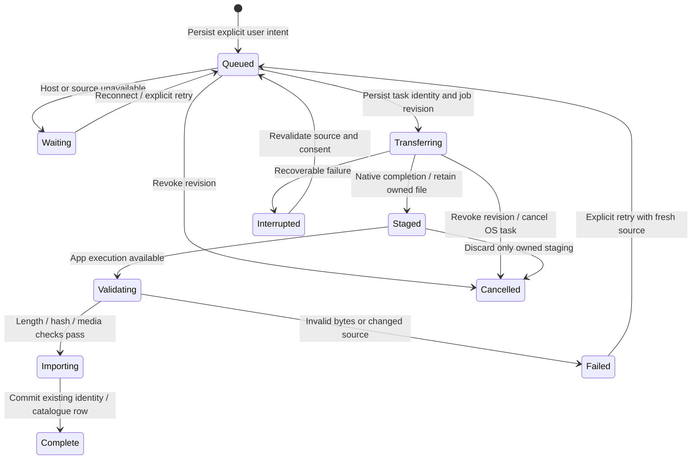

# iPhone transfer architecture

Status: source investigation and next implementation batch, 28 October 2026.
This design is not an implemented or accepted background-transfer feature.

## Existing paths and the suspension gap

`LinkFileCopy` rechecks both catalogues before explicit copying, so retries can
skip completed originals while preserving library IDs. `LokalDesktopSource`
downloads originals into temporary `.part` files, checks received length and
optional server SHA-256, then promotes/imports the file. Uploads stream local
bytes with a content hash. Those Dart requests/progress states are not durable
jobs across process loss. Request timeouts do not provide suspension recovery.

`LinkDownloadOutbox` persists opt-in uploads of completed phone downloads; it is
not a general transfer journal. Its absolute paths also need container rebasing
and ordering when organization, enqueue and flush overlap.
`DiscoveryPlaybackCache` has bounded byte/range transfers, but source URLs and
headers can expire. Persisting a signed playback URL would preserve neither
authentication nor replay semantics.

## Durable ownership and native transport

Use one app-owned background `URLSession` for eligible HTTP file transfers.
The OS owns networking while Flutter is suspended. Native delegates retain
downloads in owned staging and commit job events before acknowledging background
delivery. Normal app execution validates/imports through the existing library
path; native callbacks do not open Dart/Isar from an unrelated queue.

Each job records a random ID, revision, direction/kind, stable source identity,
destination policy, expected length/hash when available, and owned relative
paths. Native task IDs bind to a job revision. Late callbacks must validate that
binding before rename/import/completion; cancel and unlink cannot resurrect old
work. Startup reconciles journal, actual tasks and staging rather than trusting
a saved `transferring` label.

Download resume data is opaque and specific to that response/task. If a server
rejects continuation, revalidate before restarting; final integrity checks apply
to the entire file. Partial bytes never become a playable library recording.
Background uploads require a stable owned file, rather than a Dart stream or
`content://` handle. Hash/stage the explicitly selected source first. After an
ambiguous POST, query existing original-file identity/hash matching before another
upload; blind POST retries do not establish exactly-once behavior. Never move or
delete the user's original file.

## Source policy and credentials

Start with original transfers to/from the paired desktop, reusing server and
original-track IDs, current pairing and the existing file protocol. A changed
origin, revoked pairing or unsupported protocol pauses/fails explicitly. Reject
unexpected HTTP redirects. New tasks obtain credentials from the existing
Keychain-backed store. App journal records/logs contain no tokens, cookies,
signed URLs or authorization headers. The OS transport necessarily receives
authenticated task requests; do not duplicate those credentials in app manifests.
Cancel associated tasks on unlink/revocation, disable shared cookies/credential
storage/response caching, and keep TLS validation. Relative owned paths survive
container relocation during signing refresh.

Discovery/add-on saves require a separate adapter: persist stable recording and
provider intent, then re-resolve through the existing opted-in source. Opaque
streams, previews and unsupported transports cannot silently become ordinary
background downloads. Immediate-playback cache preparation retains its existing
latency, cancellation and cache-budget policies.

Normal suspension and OS process reclamation differ from explicit force-quit.
Do not promise continued execution after force-quit. On next launch reconcile
the job, recheck completed originals and apply only its current authorized retry
policy. Background audio does not authorize unrelated indefinite Dart work.

## UI and acceptance sequence

The copy surface should show persisted counts and honest queued, waiting,
transferring, awaiting import, paused and failed states. Retry/Cancel must remain
accessible at large text sizes in all eleven languages. Completed networking
and completed library import are separate facts; show a playable copy only after
import commits. Reconnection rechecks both catalogues to skip completed originals.

1. Implement the versioned journal, atomic replacement, owned-path policy,
   reconciliation, revision/cancel guards and identity checks. Test actual files
   and concurrent/delayed completion ordering.
2. Add the native delegate/Flutter bridge and app background-event routing;
   type-check/link the real iOS 16 SDKs with Swift 6 checks.
3. Integrate paired-desktop transport and durable progress UI through the
   existing identity-preserving import/upload paths.
4. Qualify against a host-side HTTP fixture outside the app process: disconnect,
   rejected ranges/source changes, cancellation with late completion, relaunch
   reconciliation and actual stored bytes/IDs. A Dart server inside the suspended
   app cannot prove this. Explicit force-quit is a distinct recovery case.
5. Extend eligible provider saves after equivalent stable re-resolution,
   preview/source and cellular-policy coverage.

Physical network/energy behavior remains separate acceptance. Batch the journal,
native transport and first product adapter before a full app build; local and
focused checks precede it.
