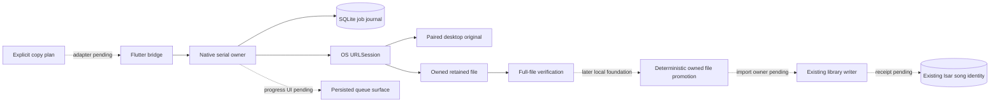
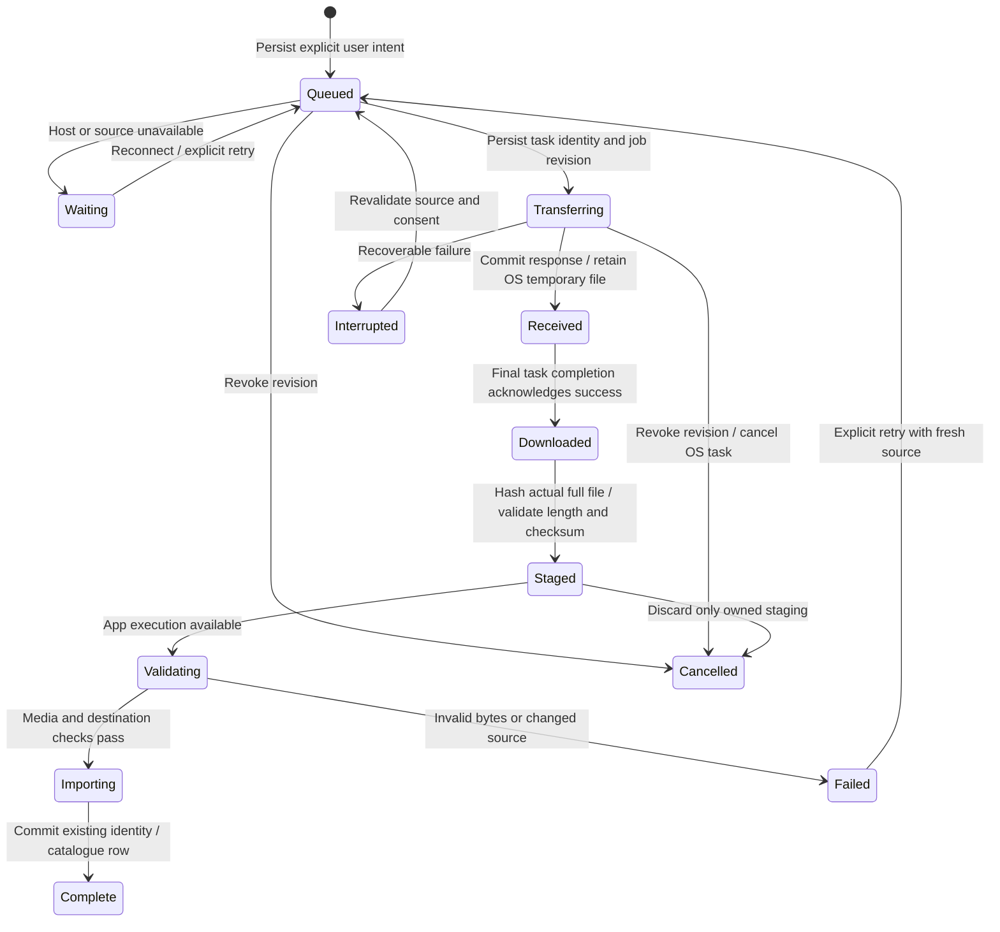
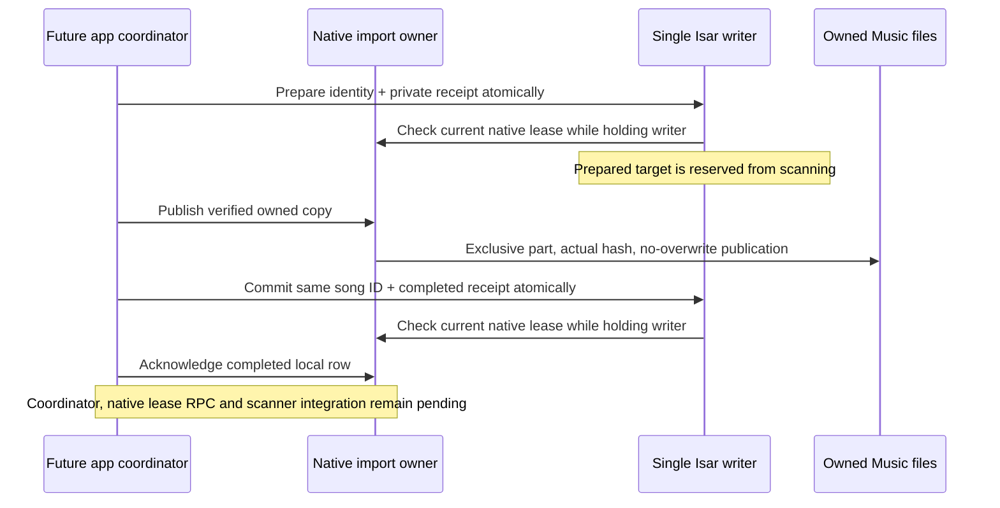

# iPhone transfer architecture

Status: native transport, app owner and typed Flutter bridge accepted in build
78; product library adapter pending, 28 October 2026. Both real iOS 16 SDK checks
and both complete iOS 18.6/26 app suites pass, including native channel ownership
and Keychain migration. Standalone native host contracts also pass five rounds.
This qualifies the integrated protocol, not OS suspension/daemon delivery.
Deterministic file promotion and private Isar receipts are later isolated
foundations; their product adapter, uploads and persisted progress are unfinished. Product capability keeps
native import/upload disabled and existing Dart copying remains active.

Solid connections are implemented in source. Core storage/network connections
have portable acceptance; the Flutter bridge has typed codec/ownership tests and
an actual registered-channel integration probe accepted in build 78. Dashed
connections are remaining product work. OS background execution still needs
separate iOS suspension/relaunch acceptance.

## Existing paths and the suspension gap

`LinkFileCopy` rechecks both catalogues before explicit copying, so retries can
skip completed originals while preserving library IDs. `LokalDesktopSource`
downloads originals into temporary `.part` files, checks received length and
optional server SHA-256, then promotes/imports the file. Uploads stream local
bytes with a content hash. Those Dart requests/progress states are not durable
jobs across process loss. Request timeouts do not provide suspension recovery.

`LinkDownloadOutbox` persists opt-in uploads of completed phone downloads; it is
not a general transfer journal. Its absolute paths also need container rebasing
and ordering when organization, enqueue and flush overlap.
`DiscoveryPlaybackCache` has bounded byte/range transfers, but source URLs and
headers can expire. Persisting a signed playback URL would preserve neither
authentication nor replay semantics.

## Durable ownership and native transport

Use one app-owned background `URLSession` for eligible HTTP file transfers.
The OS owns networking while Flutter is suspended. Native delegates retain
downloads in owned staging and commit job events before acknowledging background
delivery. Normal app execution validates/imports through the existing library
path; native callbacks do not open Dart/Isar from an unrelated queue.

Each job records a random ID, revision, direction/kind, stable source identity,
destination policy, expected length/hash when available, and owned relative
paths. Native task IDs bind to a job revision. Late callbacks must validate that
binding before rename/import/completion; cancel and unlink cannot resurrect old
work. Startup reconciles journal, actual tasks and staging rather than trusting
a saved `transferring` label.

Download resume data is opaque and specific to that response/task. If a server
rejects continuation, revalidate before restarting; final integrity checks apply
to the entire file. Partial bytes never become a playable library recording.
Background uploads require a stable owned file, rather than a Dart stream or
`content://` handle. Hash/stage the explicitly selected source first. After an
ambiguous POST, query existing original-file identity/hash matching before another
upload; blind POST retries do not establish exactly-once behavior. Never move or
delete the user's original file.

## Source policy and credentials

Start with original transfers to/from the paired desktop, reusing server and
original-track IDs, current pairing and the existing file protocol. A changed
origin, revoked pairing or unsupported protocol pauses/fails explicitly. Reject
unexpected HTTP redirects. New tasks read a single atomic origin/pairing/secret record from the existing
Keychain service; a separately written preference cannot redirect an older
bearer token. A public random pairing ID binds every production job to the
particular pairing, including when the same desktop is paired again. The native
reader refuses legacy split records; their remote-control configuration remains
readable in Dart and needs explicit verified migration before background use. App journal records/logs contain no tokens, cookies,
signed URLs or authorization headers. The OS transport necessarily receives
authenticated task requests; do not duplicate those credentials in app manifests.
Cancel associated tasks on unlink/revocation, disable shared cookies/credential
storage/response caching, and keep TLS validation. Relative owned paths survive
container relocation during signing refresh.

Discovery/add-on saves require a separate adapter: persist stable recording and
provider intent, then re-resolve through the existing opted-in source. Opaque
streams, previews and unsupported transports cannot silently become ordinary
background downloads. Immediate-playback cache preparation retains its existing
latency, cancellation and cache-budget policies.

Normal suspension and OS process reclamation differ from explicit force-quit.
Do not promise continued execution after force-quit. On next launch reconcile
the job, recheck completed originals and apply only its current authorized retry
policy. Background audio does not authorize unrelated indefinite Dart work.

## UI and acceptance sequence

The copy surface should show persisted counts and honest queued, waiting,
transferring, awaiting import, paused and failed states. Retry/Cancel must remain
accessible at large text sizes in all eleven languages. Completed networking
and completed library import are separate facts; show a playable copy only after
import commits. Reconnection rechecks both catalogues to skip completed originals.

1. Completed locally: typed journal, SQLite transactions, owned-path policy,
   native delegate, task reconciliation, revision/cancel and pairing guards,
   actual file verification and a separate real HTTP fixture.
2. Accepted in build 78: AppDelegate background-event routing, independent
   native owner and the actual paginated typed Flutter bridge. OS suspension/
   relaunch delivery remains separate acceptance. Early CI checks type-check both actual iOS SDKs and Flutter framework
   before building the full application. Unpair must retire
   native jobs/tasks before clearing the atomic Keychain record.
3. Integrate paired-desktop transport and durable progress UI through the
   existing identity-preserving import/upload paths.
4. Qualify against a host-side HTTP fixture outside the app process: disconnect,
   rejected ranges/source changes, cancellation with late completion, relaunch
   reconciliation and actual stored bytes/IDs. A Dart server inside the suspended
   app cannot prove this. Explicit force-quit is a distinct recovery case.
5. Extend eligible provider saves after equivalent stable re-resolution,
   preview/source and cellular-policy coverage.

Physical network/energy behavior remains separate acceptance. Batch the journal,
native transport and first product adapter before a full app build; local and
focused checks precede it.

## Implemented native contracts

`ios/Transfers` contains the typed model, SQLite journal, owned-file store,
request policy, credential reader and URLSession delegate. The runtime owns a
serial utility queue and at most two actual downloads. Progress stays in memory
and notifications are coalesced; transitions commit one job and its generation.
A summary contains counts, current progress and pairing pauses; job pages are
bounded to 100 records. A 10,000-job / 16 MiB journal limit bounds metadata.
There is an 8 GiB per-file limit. A 1,000-track queue test measures **8,272 bytes**
written to WAL for one transition, rather than rewriting the entire manifest.

The system SQLite library uses WAL and FULL synchronization. Unknown/future or
corrupt records, unexpected fields, symlinks and replaced staging roots fail
without silently resetting committed intent. Six independent processes create
48 jobs without lost updates. Child writers terminate immediately before and
after COMMIT; reopening reads the complete old or new transaction. These are
process-interruption checks, not a physical power-loss qualification.

A download passes four distinct boundaries: response metadata committed,
OS temporary file retained, final network success acknowledged, then actual
full-file hashing. A received body alone cannot become importable. Owned names
are derived from job UUID/revision under the current app container. Staging never
moves a user's original file. Only validated complete files can enter an import
phase. Late callbacks and checksum results cannot revive a cancelled revision.
Repeated verification is coalesced, retry retires its old file, and explicit
recovery reloads committed truth before reconciling OS tasks. Repeated shutdown
acknowledges all callers after file work drains.
Submission is idempotent for a frozen intent ID. A second active job for the same
paired original is rejected even if a reconstructed plan invents another UUID;
the product coordinator must present/reuse that existing job rather than creating
another physical copy.

Requests use only the paired original-file endpoint with opaque encoded IDs.
All redirects are refused. Cookies, shared credential storage and response
caching are disabled; normal TLS validation remains. Cellular, constrained and
expensive network access are disabled for this initial desktop-LAN adapter.
A 401/403 commits a desktop/pairing pause in the same transaction as the failed
job and stops draining that queue until explicit verified reconnect. Re-pairing
cannot authorize old intent. App records contain no tokens or token hashes.
The OS necessarily receives authenticated task requests.

A valid final 206 can represent an OS-assembled full response only when its
Content-Range ends at the total length, the retained file is that total length,
and whole-file checksum evidence is present. Range fragments, malformed or
incomplete ranges and mismatched lengths are refused. Actual iOS automatic
continuation remains a native acceptance case.

The standalone Python service generates a real WAV outside the Swift process.
Actual URLSession tests cover retained bytes, repeated submission, redirects,
truncation, wrong checksums, cancellation with late callbacks, rejected pairing,
no cookie forwarding and reconstruction from disk. Linux uses an ephemeral
session and system SHA-256 for portable tests. Apple's build uses CryptoKit and
the real platform SQLite module; the hosted workflow additionally type-checks
both iOS 16 arm64 device/simulator SDKs. Portable results do not qualify Apple's
background daemon, suspension, relaunch delivery, Keychain accessibility or
physical network behavior.

## Remaining app boundaries

The library adapter must claim a short import lease, use a deterministic owned
destination/receipt and reconcile the existing Isar original/server identity
before retrying. A process death after a successful file/database commit must
not create another copy. Import completion needs an acknowledged local-row
receipt. Cancel cannot roll back an already committed library write; current
model cancellation is rejected while importing. Lease retirement, recovery and
completion acknowledgement must be implemented before exposing these operations.

AppDelegate routes background completion independently of Flutter in continuation
source. The bridge implements one-shot main-thread replies, client ownership,
bounded pages and foreground-only observation. Its public capability explicitly
reports `libraryImport=false` and `upload=false`; the Dart product adapter must
require acknowledged library import before enabling native copying. The
paired-desktop coordinator must migrate legacy
credentials only after verified reconnect, enqueue the user's frozen plan,
resume after suspension and present persisted states. Unpair/reconfiguration
must retire associated native tasks and revisions, including after a journal
failure. Upload receipts and ambiguous POST reconciliation remain separate work.
Existing Dart copy/upload paths remain active until this adapter passes its
identity, cleanup, cancellation and recovery gates.

Run `python3 tool/ios_transfer_contracts.py --swiftc /path/to/swiftc` locally.
Linux can pass test-only SQLite header/library directories via the documented
CLI flags; no host SDK paths are committed. The hosted workflow adds
`--check-ios-sdks`. The shared synthetic credential fixture is decoded by both
Swift and Dart; real credentials are never test inputs.

### Apple-hosted continuation

Focused native run 1 compiled the macOS Swift core but failed with SQLite
CANTOPEN before reaching the SDK checks. A new portable regression reproduces
the same failure with an aliased parent directory. Apple's `/var` →
`/private/var` alias is incompatible with SQLite NOFOLLOW over an unresolved
full path. The continuation refuses a final-container symlink first, resolves
the trusted parent path, then checks its device/inode against the already opened
directory before opening the database with NOFOLLOW. The regression now passes;
a final-container symlink and database symlinks remain refused. This correction
needs another Apple-hosted run. SDK checks now execute independently before host
runtime tests so a host path failure cannot conceal their results.

### Native owner and SQLite lock continuation

`LokalTransferHost` now opens/reuses one runtime on a utility queue independently
of Flutter clients, retries recoverable storage initialization and retains OS
completion callbacks until successful initialization/reconciliation. AppDelegate
routing and the Flutter channel were subsequently wired into Runner in the
continuation below; real SDK/runtime acceptance remains pending. New jobs must match the current native pairing before they
are persisted. The paired request also retains the optional API-key header from
the atomic Keychain record, matching the existing desktop protocol.

A repeated concurrency run exposed a prototype locking defect: opening/closing
extra database or SHM descriptors for a file-safety check can release SQLite's
process-scoped POSIX locks. The checks now use descriptor-relative no-follow
metadata inspection without opening SQLite's files; permission changes use the
filesystem syscall directly. A separate-process probe attempts to acquire the
writer lock while a parent transaction is paused and another in-process reader
inspects the journal. It fails against the old implementation and passes after
the correction. SQLite keeps sole ownership of its database/WAL/SHM descriptors.

**Twelve consecutive complete portable rounds pass** with the corrected checks:
576 concurrent child job creations, both transaction crash boundaries on every
round, actual HTTP WAV/hash/cancel/auth/reconstruction checks and twelve engine
clients sharing one recovered owner. Each 1,000-record single-update check
writes 8,272 WAL bytes. The focused Apple workflow now runs five complete rounds
and both SDK checks. This continuation is local source until its next hosted
validation; it does not qualify installed-app background behavior or power loss.

### Typed app transport continuation

Runner now links nine native transfer files and owns one host independently of
Flutter engines. AppDelegate forwards the stable background-session identifier
to that host and retries initialization when protected data becomes available.
A main-actor method channel handles only bounded JSON bytes, fixed sanitized
errors and one-shot replies. Utility queues own the journal, network and hashing.
The bridge detaches observation while inactive; old engine/client disposal cannot
stop a replacement observer. Detaching the UI never cancels durable jobs.

The shared Swift/Dart intent fixture exercises Unicode metadata, whole-file
integrity, pairing grant, desktop account and existing local song/server identity.
The private enqueue API accepts only frozen intents; clients cannot submit phase,
revision, task identity, authorization headers or filesystem paths. The native
journal assigns state. Large Dart plans freeze before the first await and encode
outside the UI/audio isolate. Pages contain at most 100 records. Malformed JSON
and storage errors never echo credentials or recording metadata in error text.

Eight Dart protocol/transport cases and three complete updated native portable
rounds pass locally. A new real-channel integration probe checks actual native
capability, rejected state/header injection without journal mutation, bounded
pagination and observer replacement through Flutter's real binary messenger.
This probe is awaiting Apple execution and does not assert background daemon,
suspension or library-import qualification. Capability keeps import/upload false.
The existing product copy flow remains authoritative until deterministic import,
unpair/clear ordering and receipt recovery are implemented and accepted.

Build 76's full iOS 26 suite passed, but its iOS 18.6 run stopped at the legacy
Keychain check before playback. The old global Dart preparation future can let a
new account join an older unrelated migration that predates its legacy write.
Preparation now coalesces only per account, with global enumeration separate,
and native migration optionally selects that exact account. Four deterministic
concurrency/retry tests pass. The native probe now records synthetic fixture
presence before and after migration without exposing values; the next Apple run
must establish whether this correction resolves the observed failure.

### First embedded Apple SDK feedback

Focused native run 2 reached both SDK checks before host contracts. They exposed
two strict `String(validating:as:)` uses whose Apple availability starts at iOS 18.
The continuation uses Foundation's strict UTF-8 `String(data:encoding:)` at the
iOS 16 floor; real malformed identity/pause-text regressions preserve corruption
and reject it instead of inserting replacement characters.

The macOS host still reported CANTOPEN. Path canonicalization now uses POSIX
`realpath` and passes its resulting pathname directly to SQLite, avoiding any
subsequent Foundation URL normalization. Independent test-only SQLite connections
use the same canonical-parent rule. The next failure report includes a bounded
contract-stage label and SQLite's extended numeric code. Three updated portable
rounds pass; the Apple rerun must qualify this correction. No deployment-floor
increase or relaxed symlink/UTF-8 validation is used.

### Deterministic library-file promotion foundation

The next local continuation adds `LokalTransferLibrary`, a filesystem boundary
that is not yet exposed to Flutter or linked into Runner. The app supplies its
own Music root; callers cannot submit a destination path. A frozen job/revision
has one bounded, readable filename under Desktop Copies. An exclusive part is
copied from an open no-follow staging descriptor, fsynced and hashed against the
verified receipt, then published without replacing an existing destination.
Existing destinations are rehashed before reuse. A changed file is preserved
and reported as a conflict. A process interrupted between publication and part
retirement recovers only its exact same-inode pair; unrelated symlinks/hardlinks
are refused. Independent process writers use a stable owned flock file, separate
from SQLite's descriptors. Root replacement cannot redirect publication.

Three complete portable rounds pass with actual file bytes, six independent
promotion processes, and child exits immediately before publication, after
publication and after completed promotion. Every recovered case has one complete
copy and no stranded part. A repeated receipt also recovers after staging has
been removed. Corrupt same-length output, changed source, symlink/hardlink output,
symlink part and replaced-root cases preserve user files and reject the operation.
These are process/filesystem checks, not power-loss, playable-media or Isar
acceptance. The next boundary still needs native import ownership, media probing,
an identity-preserving database transaction and acknowledged row receipt. Product
capability remains disabled until those boundaries and clear/unpair ordering pass.

### Private receipt store and cancellation continuation (29 October)

The isolated `IosTransferImportStore` uses the locked Isar 3.3.2 native core,
with a separate private receipt collection. The collection is deliberately not
registered in the product database yet. `LibraryOpEntity` is unsuitable: those
records are exported to paired peers, whose library protocol does not accept
private transfer receipts. No account secret or absolute sandbox path is stored
in a receipt. The stable key is the native job ID plus its revision.

Preparation reserves the existing remote recording's ID, or allocates one ghost
row when the explicit copy plan has no local identity. Publication happens only
after that reservation. The final write changes the same song into a local copy
and commits the completed receipt in one transaction. Current descriptive/user
metadata, cover art, date added, history references and CUE ranges are preserved;
actual probed codec/quality replaces remote quality guesses. A deleted prepared
row is refused. A committed receipt remains historical evidence after deletion
and never recreates its song. Future/corrupt receipts are rejected and preserved.

Actual native Isar contracts pass locally, including all eight existing product
collections with every serialized field unchanged after schema addition; private
preparation does not enter the peer library journal. The same suite covers
metadata/history, CUE identity, changed accounts, destination conflicts, revoked
fixture ownership, transaction rollback, a clear waiting behind an existing
writer, six exact process-exit boundaries and six independent process writers
reserving one identity. The focused Apple workflow now runs this pure Dart tool
against the locked native macOS library too. This continuation is not yet hosted
acceptance. The native ownership callback and media result are fixture boundaries;
these checks do not prove an integrated decoder, native lease RPC or app import.

File promotion now also accepts an immediate cancellation token. It checks
between bounded copy/hash chunks; publication and revocation share a short lock.
Long copying and hashing never hold that lock. Actual filesystem tests interrupt
a 1 MiB copy after its first 256 KiB has been written, verify part cleanup and no
visible destination, then verify a fresh attempt's entire hash. Boundary checks
also cancel before and after publication. Cancellation after publication leaves
the complete file recoverable; its database reservation must remain until native
cleanup has drained. This is not yet connected to runtime cancellation.
Three complete updated portable Swift rounds pass, retaining the journal,
cross-process lock, real HTTP, pairing, crash-recovery and host-owner checks.

| Next integration gate | Required evidence before product enablement |
| --- | --- |
| Native ownership | A replacement engine and revoked pairing cannot validate an old import lease, including while a long file operation occupies the worker. |
| Library coordination | Scanner and import share one writer; reserved copies do not acquire a second song ID. Clear/delete/unpair win over delayed old imports. |
| Product adapter | Actual media reader, same recording ID, reopened receipts, truthful progress and explicit retry/cancel work through the real Flutter channel. |
| OS background transport | Actual suspended-app download and background-session callback reconciliation, separate from portable HTTP or fake lifecycle tests. |
| Release candidate | One batched complete app package passes both simulator suites and independent source/binary/symbol verification, then Windows signing and physical iPhone acceptance. |

Remaining integration gates are explicit: register the private schema safely;
native import claims, engine-owned leases and fast revocation; real media probing;
scanner exclusion inside its writer transaction; cancellation/cleanup before
reservation retirement; clear/unpair barriers; a root app coordinator and honest
localized progress. Exact pathname spelling alone must not be assumed to identify
a file on Apple's case-insensitive/Unicode-normalizing filesystem. The adapter
must also handle existing target-directory spelling before enabling scanning.
The receipt's reserved-path query and original-source lookup use their actual
Isar indexes rather than scanning every receipt/song for each imported file.
The complete actual native Isar contracts pass again after that query change.
The isolated database contracts use `relaxedDurability: false`. Product
`Database.init` currently inherits Isar's relaxed default; its iOS open must use
full durability before an import may acknowledge its database receipt or retire
the only staging copy. Process-exit tests do not establish power-loss durability.
Actual OS suspension/relaunch acceptance remains separate. Neither the native
library helper nor the receipt adapter is exposed as an enabled product import API.
