# iPhone transfer architecture

Current scope decision: the user restored the native background-transfer work
on 30 October 2026. Follow the [fixed completion milestones](IOS_FIRST_RELEASE.md).
Build120 is a separate foreground-copy checkpoint. The native replacement stays
disabled until its integration, mapping, upload and OS recovery gates pass.
Background audio and existing foreground copies continue independently.

The following sections retain historical implementation and qualification evidence.

Status: native transport, app owner and typed Flutter bridge accepted through
build84; product library adapter pending, 29 October 2026. Both real iOS16 SDK
checks, 20 complete Apple native rounds in run9, actual Isar process contracts,
1,130 Flutter regression checks and both complete installed iOS18.6/26 app
suites pass. Build84 includes through-#332 UI, explicit caller-client binding,
the private product schema and scanner writer guards. Both runtime jobs pass
on their first attempts using the same compiled integration app. The unsigned
IPA, 34 native binaries, 26 matching dSYM bundles and all 2,340 exported source
files are independently verified. Later tracked publication, bounded media
reader and completion acknowledgement source has no Apple acceptance yet.
This qualifies the integrated protocol, not OS suspension/daemon delivery.
Deterministic file promotion and private Isar receipts are later isolated
foundations; their product adapter, uploads and persisted progress are unfinished. Product capability keeps
native import/upload disabled and existing Dart copying remains active.

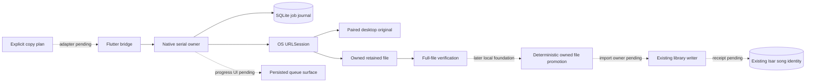

Solid connections are implemented in source. Core storage/network connections
have portable acceptance; the Flutter bridge has typed codec/ownership tests and
an actual registered-channel integration probe accepted in build 78. Dashed
connections are remaining product work. OS background execution still needs
separate iOS suspension/relaunch acceptance.

## Scoped URLSession retirement (source continuation, not product-enabled)

The next native safety boundary is implemented in `LokalTransferJournal.retireNetworkScope`
and `LokalTransferRuntime.retireNetworkScope`. A current app-owned Flutter
client submits one exact pairing scope. The native bridge synchronously revokes
old queued submission tickets before dispatch. SQLite then atomically advances
all non-complete, non-cancelled network job revisions and persists a
`pairingChanged` tombstone. If *any* matching job is importing into the Isar
catalogue, the entire transaction is refused with no partial changes. No
network task is cancelled until the journal write commits.

The runtime cancels matching URLSession tasks, waits for their delegate
completions and an ordered native file-worker barrier before replying. Late
callbacks cannot publish into retired revisions; journal recovery reloads the
tombstone before pumping work. Ordinary retry, enqueue and pairing resume
cannot reuse that retired pairing. Other desktop/pairing scopes are untouched.
Frozen import custody and verified staging are **not** deleted by this
network-only operation: separate app-attested Isar retirement and public-file
cleanup still own them.

### App pairing lifecycle (stacked on the scoped native foundation)

Desktop Link **Forget** and **Pair**, and Remote Control **Forget** and
**Save**, now enter the app-root pairing mutation barrier before changing the
atomic Keychain authority. Even while `libraryImport=false`, the root briefly
acquires a native observation client, recovers the URLSession journal, drains
native file work, reads the native public Keychain pairing and compares its
desktop ID, origin and pairing UUID with the credentials captured from Flutter
secure storage. A match must receive an acknowledged durable
`pairingChanged` retirement before the app can overwrite or clear credentials.
The root holds that observer until the mutation completes; failures block the
mutation rather than silently orphaning network tasks. Android is unchanged.

Legacy/manual remote credentials have no background-transfer authorization:
they may be cleared/replaced only if the native pairing is absent **and** the
recovered journal is empty. Native journal data combined with a missing,
different or unprovable pairing fails closed. The credentials store's serialized
`clearIfMatching` prevents an older confirmed Forget from clearing credentials
written by a later Pair/Save request; the controller also invalidates older
configuration revisions. Neither the native transfer protocol nor the journal
receives bearer tokens.

**Not a product background-transfer launch.** Only the pairing credential
lifecycle is connected. Generic Library Clear still has its own writer fence;
frozen Isar import custody, user files, and public-file cleanup remain separate
app-attested operations. Native `libraryImport=false` and `upload=false`
remain unchanged, and OS daemon suspension/force-quit, real-device signing,
upgrade behavior and source/account acceptance still require qualification.
The new contracts are committed but not CI- or device-verified at this stage.

## Existing paths and the suspension gap

`LinkFileCopy` rechecks both catalogues before explicit copying, so retries can
skip completed originals while preserving library IDs. `LokalDesktopSource`
downloads originals into temporary `.part` files, checks received length and
optional server SHA-256, then promotes/imports the file. Uploads stream local
bytes with a content hash. Those Dart requests/progress states are not durable
jobs across process loss. Request timeouts do not provide suspension recovery.

`LinkDownloadOutbox` persists opt-in uploads of completed phone downloads; it is
not a general transfer journal. Its absolute paths also need container rebasing
and ordering when organization, enqueue and flush overlap.
`DiscoveryPlaybackCache` has bounded byte/range transfers, but source URLs and
headers can expire. Persisting a signed playback URL would preserve neither
authentication nor replay semantics.

## Durable ownership and native transport

Use one app-owned background `URLSession` for eligible HTTP file transfers.
The OS owns networking while Flutter is suspended. Native delegates retain
downloads in owned staging and commit job events before acknowledging background
delivery. Normal app execution validates/imports through the existing library
path; native callbacks do not open Dart/Isar from an unrelated queue.

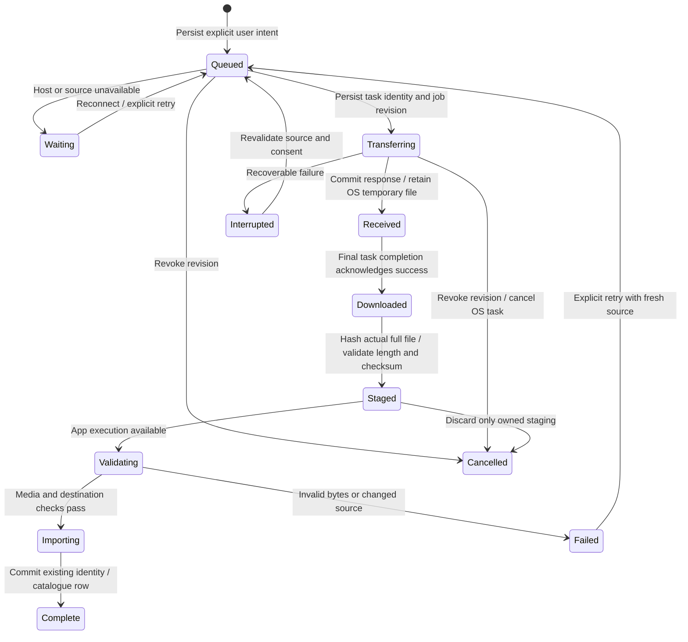

Each job records a random ID, revision, direction/kind, stable source identity,
destination policy, expected length/hash when available, and owned relative
paths. Native task IDs bind to a job revision. Late callbacks must validate that
binding before rename/import/completion; cancel and unlink cannot resurrect old
work. Startup reconciles journal, actual tasks and staging rather than trusting
a saved `transferring` label.

Download resume data is opaque and specific to that response/task. If a server
rejects continuation, revalidate before restarting; final integrity checks apply
to the entire file. Partial bytes never become a playable library recording.
Background uploads require a stable owned file, rather than a Dart stream or
`content://` handle. Hash/stage the explicitly selected source first. After an
ambiguous POST, query existing original-file identity/hash matching before another
upload; blind POST retries do not establish exactly-once behavior. Never move or
delete the user's original file.

## Source policy and credentials

Start with original transfers to/from the paired desktop, reusing server and
original-track IDs, current pairing and the existing file protocol. A changed
origin, revoked pairing or unsupported protocol pauses/fails explicitly. Reject
unexpected HTTP redirects. New tasks read a single atomic origin/pairing/secret record from the existing
Keychain service; a separately written preference cannot redirect an older
bearer token. A public random pairing ID binds every production job to the
particular pairing, including when the same desktop is paired again. The native
reader refuses legacy split records; their remote-control configuration remains
readable in Dart and needs explicit verified migration before background use. App journal records/logs contain no tokens, cookies,
signed URLs or authorization headers. The OS transport necessarily receives
authenticated task requests; do not duplicate those credentials in app manifests.
Cancel associated tasks on unlink/revocation, disable shared cookies/credential
storage/response caching, and keep TLS validation. Relative owned paths survive
container relocation during signing refresh.

Discovery/add-on saves require a separate adapter: persist stable recording and
provider intent, then re-resolve through the existing opted-in source. Opaque
streams, previews and unsupported transports cannot silently become ordinary
background downloads. Immediate-playback cache preparation retains its existing
latency, cancellation and cache-budget policies.

Normal suspension and OS process reclamation differ from explicit force-quit.
Do not promise continued execution after force-quit. On next launch reconcile
the job, recheck completed originals and apply only its current authorized retry
policy. Background audio does not authorize unrelated indefinite Dart work.

## UI and acceptance sequence

The copy surface should show persisted counts and honest queued, waiting,
transferring, awaiting import, paused and failed states. Retry/Cancel must remain
accessible at large text sizes in all eleven languages. Completed networking
and completed library import are separate facts; show a playable copy only after
import commits. Reconnection rechecks both catalogues to skip completed originals.

1. Completed locally: typed journal, SQLite transactions, owned-path policy,
   native delegate, task reconciliation, revision/cancel and pairing guards,
   actual file verification and a separate real HTTP fixture.
2. Accepted in build 78: AppDelegate background-event routing, independent
   native owner and the actual paginated typed Flutter bridge. OS suspension/
   relaunch delivery remains separate acceptance. Early CI checks type-check both actual iOS SDKs and Flutter framework
   before building the full application. Unpair must retire
   native jobs/tasks before clearing the atomic Keychain record.
3. Integrate paired-desktop transport and durable progress UI through the
   existing identity-preserving import/upload paths.
4. Qualify against a host-side HTTP fixture outside the app process: disconnect,
   rejected ranges/source changes, cancellation with late completion, relaunch
   reconciliation and actual stored bytes/IDs. A Dart server inside the suspended
   app cannot prove this. Explicit force-quit is a distinct recovery case.
5. Extend eligible provider saves after equivalent stable re-resolution,
   preview/source and cellular-policy coverage.

Physical network/energy behavior remains separate acceptance. Batch the journal,
native transport and first product adapter before a full app build; local and
focused checks precede it.

## Implemented native contracts

`ios/Transfers` contains the typed model, SQLite journal, owned-file store,
request policy, credential reader and URLSession delegate. The runtime owns a
serial utility queue and at most two actual downloads. Progress stays in memory
and notifications are coalesced; transitions commit one job and its generation.
A summary contains counts, current progress and pairing pauses; job pages are
bounded to 100 records. A 10,000-job / 16 MiB journal limit bounds metadata.
There is an 8 GiB per-file limit. A 1,000-track queue test measures **8,272 bytes**
written to WAL for one transition, rather than rewriting the entire manifest.

The system SQLite library uses WAL and FULL synchronization. Unknown/future or
corrupt records, unexpected fields, symlinks and replaced staging roots fail
without silently resetting committed intent. Six independent processes create
48 jobs without lost updates. Child writers terminate immediately before and
after COMMIT; reopening reads the complete old or new transaction. These are
process-interruption checks, not a physical power-loss qualification.

A download passes four distinct boundaries: response metadata committed,
OS temporary file retained, final network success acknowledged, then actual
full-file hashing. A received body alone cannot become importable. Owned names
are derived from job UUID/revision under the current app container. Staging never
moves a user's original file. Only validated complete files can enter an import
phase. Late callbacks and checksum results cannot revive a cancelled revision.
Repeated verification is coalesced, retry retires its old file, and explicit
recovery reloads committed truth before reconciling OS tasks. Repeated shutdown
acknowledges all callers after file work drains.
Submission is idempotent for a frozen intent ID. A second active job for the same
paired original is rejected even if a reconstructed plan invents another UUID;
the product coordinator must present/reuse that existing job rather than creating
another physical copy.

Requests use only the paired original-file endpoint with opaque encoded IDs.
All redirects are refused. Cookies, shared credential storage and response
caching are disabled; normal TLS validation remains. Cellular, constrained and
expensive network access are disabled for this initial desktop-LAN adapter.
A 401/403 commits a desktop/pairing pause in the same transaction as the failed
job and stops draining that queue until explicit verified reconnect. Re-pairing
cannot authorize old intent. App records contain no tokens or token hashes.
The OS necessarily receives authenticated task requests.

A valid final 206 can represent an OS-assembled full response only when its
Content-Range ends at the total length, the retained file is that total length,
and whole-file checksum evidence is present. Range fragments, malformed or
incomplete ranges and mismatched lengths are refused. Actual iOS automatic
continuation remains a native acceptance case.

The standalone Python service generates a real WAV outside the Swift process.
Actual URLSession tests cover retained bytes, repeated submission, redirects,
truncation, wrong checksums, cancellation with late callbacks, rejected pairing,
no cookie forwarding and reconstruction from disk. Linux uses an ephemeral
session and system SHA-256 for portable tests. Apple's build uses CryptoKit and
the real platform SQLite module; the hosted workflow additionally type-checks
both iOS 16 arm64 device/simulator SDKs. Portable results do not qualify Apple's
background daemon, suspension, relaunch delivery, Keychain accessibility or
physical network behavior.

## Remaining app boundaries

The library adapter must claim a short import lease, use a deterministic owned
destination/receipt and reconcile the existing Isar original/server identity
before retrying. A process death after a successful file/database commit must
not create another copy. Import completion needs an acknowledged local-row
receipt. Cancel cannot roll back an already committed library write; current
model cancellation is rejected while importing. Lease retirement, recovery and
completion acknowledgement must be implemented before exposing these operations.

AppDelegate routes background completion independently of Flutter in continuation
source. The bridge implements one-shot main-thread replies, client ownership,
bounded pages and foreground-only observation. Its public capability explicitly
reports `libraryImport=false` and `upload=false`; the Dart product adapter must
require acknowledged library import before enabling native copying. The
paired-desktop coordinator must migrate legacy
credentials only after verified reconnect, enqueue the user's frozen plan,
resume after suspension and present persisted states. Unpair/reconfiguration
must retire associated native tasks and revisions, including after a journal
failure. Upload receipts and ambiguous POST reconciliation remain separate work.
Existing Dart copy/upload paths remain active until this adapter passes its
identity, cleanup, cancellation and recovery gates.

Run `python3 tool/ios_transfer_contracts.py --swiftc /path/to/swiftc` locally.
Linux can pass test-only SQLite header/library directories via the documented
CLI flags; no host SDK paths are committed. The hosted workflow adds
`--check-ios-sdks`. The shared synthetic credential fixture is decoded by both
Swift and Dart; real credentials are never test inputs.


### Apple-hosted continuation

Focused native run 1 compiled the macOS Swift core but failed with SQLite
CANTOPEN before reaching the SDK checks. A new portable regression reproduces
the same failure with an aliased parent directory. Apple's `/var` →
`/private/var` alias is incompatible with SQLite NOFOLLOW over an unresolved
full path. The continuation refuses a final-container symlink first, resolves
the trusted parent path, then checks its device/inode against the already opened
directory before opening the database with NOFOLLOW. The regression now passes;
a final-container symlink and database symlinks remain refused. This correction
needs another Apple-hosted run. SDK checks now execute independently before host
runtime tests so a host path failure cannot conceal their results.


### Native owner and SQLite lock continuation

`LokalTransferHost` now opens/reuses one runtime on a utility queue independently
of Flutter clients, retries recoverable storage initialization and retains OS
completion callbacks until successful initialization/reconciliation. AppDelegate
routing and the Flutter channel were subsequently wired into Runner in the
continuation below; real SDK/runtime acceptance remains pending. New jobs must match the current native pairing before they
are persisted. The paired request also retains the optional API-key header from
the atomic Keychain record, matching the existing desktop protocol.

A repeated concurrency run exposed a prototype locking defect: opening/closing
extra database or SHM descriptors for a file-safety check can release SQLite's
process-scoped POSIX locks. The checks now use descriptor-relative no-follow
metadata inspection without opening SQLite's files; permission changes use the
filesystem syscall directly. A separate-process probe attempts to acquire the
writer lock while a parent transaction is paused and another in-process reader
inspects the journal. It fails against the old implementation and passes after
the correction. SQLite keeps sole ownership of its database/WAL/SHM descriptors.

**Twelve consecutive complete portable rounds pass** with the corrected checks:
576 concurrent child job creations, both transaction crash boundaries on every
round, actual HTTP WAV/hash/cancel/auth/reconstruction checks and twelve engine
clients sharing one recovered owner. Each 1,000-record single-update check
writes 8,272 WAL bytes. The focused Apple workflow now runs five complete rounds
and both SDK checks. This continuation is local source until its next hosted
validation; it does not qualify installed-app background behavior or power loss.


### Typed app transport continuation

Runner now links nine native transfer files and owns one host independently of
Flutter engines. AppDelegate forwards the stable background-session identifier
to that host and retries initialization when protected data becomes available.
A main-actor method channel handles only bounded JSON bytes, fixed sanitized
errors and one-shot replies. Utility queues own the journal, network and hashing.
The bridge detaches observation while inactive; old engine/client disposal cannot
stop a replacement observer. Detaching the UI never cancels durable jobs.

The shared Swift/Dart intent fixture exercises Unicode metadata, whole-file
integrity, pairing grant, desktop account and existing local song/server identity.
The private enqueue API accepts only frozen intents; clients cannot submit phase,
revision, task identity, authorization headers or filesystem paths. The native
journal assigns state. Large Dart plans freeze before the first await and encode
outside the UI/audio isolate. Pages contain at most 100 records. Malformed JSON
and storage errors never echo credentials or recording metadata in error text.

Eight Dart protocol/transport cases and three complete updated native portable
rounds pass locally. A new real-channel integration probe checks actual native
capability, rejected state/header injection without journal mutation, bounded
pagination and observer replacement through Flutter's real binary messenger.
This probe is awaiting Apple execution and does not assert background daemon,
suspension or library-import qualification. Capability keeps import/upload false.
The existing product copy flow remains authoritative until deterministic import,
unpair/clear ordering and receipt recovery are implemented and accepted.

Build 76's full iOS 26 suite passed, but its iOS 18.6 run stopped at the legacy
Keychain check before playback. The old global Dart preparation future can let a
new account join an older unrelated migration that predates its legacy write.
Preparation now coalesces only per account, with global enumeration separate,
and native migration optionally selects that exact account. Four deterministic
concurrency/retry tests pass. The native probe now records synthetic fixture
presence before and after migration without exposing values; the next Apple run
must establish whether this correction resolves the observed failure.


### First embedded Apple SDK feedback

Focused native run 2 reached both SDK checks before host contracts. They exposed
two strict `String(validating:as:)` uses whose Apple availability starts at iOS 18.
The continuation uses Foundation's strict UTF-8 `String(data:encoding:)` at the
iOS 16 floor; real malformed identity/pause-text regressions preserve corruption
and reject it instead of inserting replacement characters.

The macOS host still reported CANTOPEN. Path canonicalization now uses POSIX
`realpath` and passes its resulting pathname directly to SQLite, avoiding any
subsequent Foundation URL normalization. Independent test-only SQLite connections
use the same canonical-parent rule. The next failure report includes a bounded
contract-stage label and SQLite's extended numeric code. Three updated portable
rounds pass; the Apple rerun must qualify this correction. No deployment-floor
increase or relaxed symlink/UTF-8 validation is used.


### Deterministic library-file promotion foundation

The next local continuation adds `LokalTransferLibrary`, a filesystem boundary
that is not yet exposed to Flutter or linked into Runner. The app supplies its
own Music root; callers cannot submit a destination path. A frozen job/revision
has one bounded, readable filename under Desktop Copies. An exclusive part is
copied from an open no-follow staging descriptor, fsynced and hashed against the
verified receipt, then published without replacing an existing destination.
Existing destinations are rehashed before reuse. A changed file is preserved
and reported as a conflict. A process interrupted between publication and part
retirement recovers only its exact same-inode pair; unrelated symlinks/hardlinks
are refused. Independent process writers use a stable owned flock file, separate
from SQLite's descriptors. Root replacement cannot redirect publication.

Three complete portable rounds pass with actual file bytes, six independent
promotion processes, and child exits immediately before publication, after
publication and after completed promotion. Every recovered case has one complete
copy and no stranded part. A repeated receipt also recovers after staging has
been removed. Corrupt same-length output, changed source, symlink/hardlink output,
symlink part and replaced-root cases preserve user files and reject the operation.
These are process/filesystem checks, not power-loss, playable-media or Isar
acceptance. The next boundary still needs native import ownership, media probing,
an identity-preserving database transaction and acknowledged row receipt. Product
capability remains disabled until those boundaries and clear/unpair ordering pass.

### Private receipt store and cancellation continuation (29 October)

The isolated `IosTransferImportStore` uses the locked Isar 3.3.2 native core,
with a separate private receipt collection. The collection is deliberately not
registered in the product database yet. `LibraryOpEntity` is unsuitable: those
records are exported to paired peers, whose library protocol does not accept
private transfer receipts. No account secret or absolute sandbox path is stored
in a receipt. The stable key is the native job ID plus its revision.

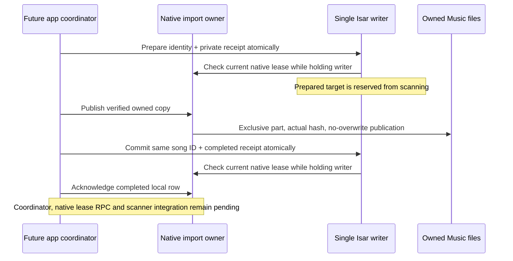

Preparation reserves the existing remote recording's ID, or allocates one ghost
row when the explicit copy plan has no local identity. Publication happens only
after that reservation. The final write changes the same song into a local copy
and commits the completed receipt in one transaction. Current descriptive/user
metadata, cover art, date added, history references and CUE ranges are preserved;
actual probed codec/quality replaces remote quality guesses. A deleted prepared
row is refused. A committed receipt remains historical evidence after deletion
and never recreates its song. Future/corrupt receipts are rejected and preserved.

Actual native Isar contracts pass locally, including all eight existing product
collections with every serialized field unchanged after schema addition; private
preparation does not enter the peer library journal. The same suite covers
metadata/history, CUE identity, changed accounts, destination conflicts, revoked
fixture ownership, transaction rollback, a clear waiting behind an existing
writer, six exact process-exit boundaries and six independent process writers
reserving one identity. The focused Apple workflow now runs this pure Dart tool
against the locked native macOS library too. This continuation is not yet hosted
acceptance. The native ownership callback and media result are fixture boundaries;
these checks do not prove an integrated decoder, native lease RPC or app import.

File promotion now also accepts an immediate cancellation token. It checks
between bounded copy/hash chunks; publication and revocation share a short lock.
Long copying and hashing never hold that lock. Actual filesystem tests interrupt
a 1 MiB copy after its first 256 KiB has been written, verify part cleanup and no
visible destination, then verify a fresh attempt's entire hash. Boundary checks
also cancel before and after publication. Cancellation after publication leaves
the complete file recoverable; its database reservation must remain until native
cleanup has drained. This is not yet connected to runtime cancellation.
Three complete updated portable Swift rounds pass, retaining the journal,
cross-process lock, real HTTP, pairing, crash-recovery and host-owner checks.

| Next integration gate | Required evidence before product enablement |
| --- | --- |
| Native ownership | A replacement engine and revoked pairing cannot validate an old import lease, including while a long file operation occupies the worker. |
| Library coordination | Scanner and import share one writer; reserved copies do not acquire a second song ID. Clear/delete/unpair win over delayed old imports. |
| Product adapter | Actual media reader, same recording ID, reopened receipts, truthful progress and explicit retry/cancel work through the real Flutter channel. |
| OS background transport | Actual suspended-app download and background-session callback reconciliation, separate from portable HTTP or fake lifecycle tests. |
| Release candidate | One batched complete app package passes both simulator suites and independent source/binary/symbol verification, then Windows signing and physical iPhone acceptance. |

The later source registers the private schema on iOS only, while keeping it
outside the public database exports and peer journal. Native import claims,
engine-owned leases and fast revocation are wired privately and product
capability remains disabled. Remaining integration gates include real media probing;
scanner exclusion inside its writer transaction; cancellation/cleanup before
reservation retirement; clear/unpair barriers; a root app coordinator and honest
localized progress. Exact pathname spelling alone must not be assumed to identify
a file on Apple's case-insensitive/Unicode-normalizing filesystem. The adapter
must also handle existing target-directory spelling before enabling scanning.
The receipt's reserved-path query and original-source lookup use their actual
Isar indexes rather than scanning every receipt/song for each imported file.
The complete actual native Isar contracts pass again after that query change.
The isolated database contracts use `relaxedDurability: false`. Product
`Database.init` now requests full durability for its iOS open before an import
may acknowledge a database receipt or retire the only staging copy. Other
platforms retain their existing mode. The actual native Isar contracts pass again;
a new iOS probe queries the real application collection without writing songs.
Apple acceptance of this later product open remains pending. Process-exit tests
do not establish power-loss durability.
Actual OS suspension/relaunch acceptance remains separate. Neither the native
library helper nor the receipt adapter is exposed as an enabled product import API.

### Native ownership and private bridge (29 October)

`LokalTransferImportOwnership` is a separate, ephemeral lock-protected owner.
It does not open SQLite/Isar, authorize pairing, run media probes or wait on a
file queue. The durable identity remains the native job/revision plus the private
Isar receipt. Replacing an engine or Dart client retires its active copy token;
old disposal/release cannot stop a replacement. Recovery-only leases cannot
authorize new library writes. Scope comparison canonicalizes the origin.

The bridge must capture an ownership ticket synchronously **before dispatching**
a claim to the utility queue. Clear/unpair rotates a barrier nonce even when no
lease exists yet. An old queued claim is then refused after its journal wait;
checking only an already active file token would leave that race open. Runtime
must still authorize pairing and re-read job phase/revision before issuing a
lease. These tickets do not replace those checks.

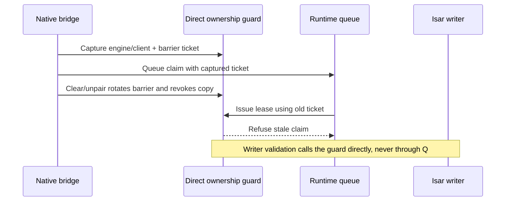

Three complete portable Swift rounds pass with the added ownership contracts:
24 actual concurrent claim threads, queued barriers before a lease exists,
engine/client replacement, unrelated-scope retention, canonical-scope revocation,
read-only recovery and direct guard/revocation while a real worker is blocked.
The continuation now links this guard and the library filename helper into
Runner. The host shares the same registry with its runtime; a separate engine
lifetime lease cancels old imports on disposal without tying that cancellation
to ordinary foreground observation. A replacement root Dart client also revokes
old authority. Stale engine observation cannot overwrite a current observer.

Private `claimImport`, `validateImport`, `validateImportReconciliation` and
`releaseImport` byte operations reject caller paths, engine identities and headers.
Every private import request carries the canonical client UUID from the acknowledged
root observation. The native bridge and runtime compare it with their actual
current owner; they never reinterpret a retired client's request as a request
from its replacement. Claim replies echo that validated UUID, and Dart refuses
foreign replies or leases before issuing another control call. This UUID is
ephemeral routing identity, not a credential or a journal field.
Claim checks the current journal phase/revision and pairing/account, persists
staged → validating, and returns only a native-derived relative target, ephemeral
lease and current staging path. Receipt-only recovery needs no current bearer,
exposes no staging path, and cannot pass the writer guard. A missing staging file
permits reconciliation; it is not permission to synthesize a recording.

Validation calls the registry directly on the bridge, without filesystem,
Keychain, host-queue or runtime-queue work. Release cancels publication immediately,
then traverses runtime → file worker → runtime before acknowledging release.
This ordering also covers file work not yet submitted by earlier queued native
operations. Recovery, shutdown, cancellation, phase/revision retirement and
persistence failure revoke import authority. Lost claim replies coalesce.

Three complete later portable Swift rounds pass with real HTTP/WAV staging,
durable claim/recovery/cancellation and a blocked native credential read.
Revocation before any lease exists prevents that queued claim from advancing
the journal. An active writer guard still completes during blocked native I/O;
release cancels it immediately and waits for queued work to drain. Fourteen
Flutter transport checks pass, including root-observation readiness, replacement
during a pending reply, strict ephemeral documents, frozen-intent/proof checks,
read-only refusal and invalid native acknowledgements. The actual Isar contracts
also pass again. These checks do not run the new bridge in an iOS app; the next
batched Apple acceptance remains required. Build 80 contains the earlier
file/receipt foundation and does not qualify this later wiring. The explicit
caller-client binding has three later portable native rounds and fourteen Dart
transport checks, with strict analysis clean. A real-channel simulator probe is
added for the next batched Apple acceptance; that new probe is not in build 82.

Next, invoke this guard inside the product Isar writer, connect real media
probing/promotion and the scanner reservation checks, and drain native file
cleanup before retiring reservations.
Revoke the token before queueing clear/unpair, then serialize native job
cancellation and the Isar mutation barrier. Cleanup of an already revoked file
operation must use the runtime's retained work record, not require its retired
UI lease to become valid again. A completed receipt is historical proof and may
be acknowledged without recreating a deleted song. No new native job JSON fields
are needed merely to persist ephemeral engine/client leases.

### Frozen import work and journal upgrade

Later local source upgrades the SQLite journal from schema 1 to 2 in one
`BEGIN IMMEDIATE` transaction. The stable directory/session names and job JSON
remain unchanged. `import_custody` retains the exact validated job/revision and
reserved positive Isar song ID; it does not store a bearer, absolute sandbox path
or ephemeral client/engine identity. The original job BLOBs, authentication
pauses and observable generation survive migration unchanged.

The frozen row deliberately outlives live job cancellation/retry. Cancellation
advances the live revision while retaining received history; retry also clears
that history. Neither may discard the old reservation's byte proof. A repeated
reserve coalesces for the same song and frozen intent across validating/importing;
a different song is refused. Job documents and custody documents share the
existing 16 MiB logical budget, with separately checked counts and byte totals.
Future schemas and unknown/corrupt custody documents are preserved and refused.

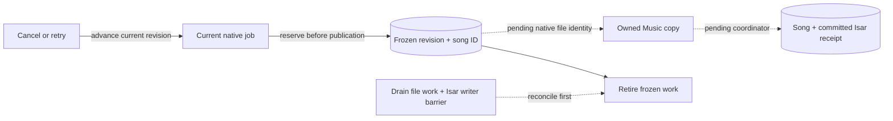

Three complete portable Swift rounds pass with actual v1 fixture migration,
process exits before/after the migration and reservation commits, six concurrent
migrators and six reservers, cancellation/retry history, a real combined-byte
capacity refusal, and corrupt/future-document preservation. These do not prove
power-loss durability or installed iOS acceptance. This native-only reservation
API is not exposed by the bridge. File inode/provenance recording, safe cleanup,
scanner coordination and the root application coordinator remain gates before
native product import is enabled.

### Scanner writer coordination

Later source routes the library scanner's upserts and removals through explicit
scanner repository methods. On iOS, those methods consult the private receipt
indexes **inside the same Isar write transaction**. Ordinary user repository
methods and Android's bulk paths keep their existing behavior. The guard uses
the native ASCII UUID/revision filename suffix instead of an exact display-title
path, so case, Unicode title spelling and sandbox-parent aliases cannot bypass
a prepared reservation. Matching UUIDs in another `Desktop Copies` directory
are conservatively protected too; no filesystem or native queue waits occur
inside the writer.

Prepared rows cannot be independently indexed or automatically removed.
Committed receipts reject a stale scan's new ID and path aliases; a fresh scan
of the current canonical recording can update it. Deleting a completed song
through an explicit user operation does not let a delayed scan recreate it.
Automatic deletion/CUE replacement retains the imported identity until an
accepted coordinator mapping and cleanup barrier exist. Missing-file handling,
CUE restructuring and accurate progress for excluded scan rows therefore remain
product-enablement gates, rather than being treated as completed scan parity.

Thirty focused Flutter scanner/path/repository checks pass. Actual Isar
contracts include a real scanner writer waiting behind preparation, protection
of source IDs, Unicode/case aliases, stale scans after completion and historical
deletion. The additional real iOS repository probe uses its own disposable
database; it is source/analyzer checked and awaits the next Apple app batch.
These guards do not enable product native imports or qualify file publication.


### Writer lock construction follow-up

Build83 and native run8 passed both actual iOS16 SDK/Flutter bridge checks, then
both failed in native round2 at `initializeWriter: unsafeFile`, before app
compilation. This localizes the old intermittent refusal to lock initialization;
it does not identify whether the old open, stat or metadata check failed.

Later source makes creation explicit: try one exclusive no-follow creation;
only EEXIST opens the existing name, without O_CREAT. It never unlinks or
recreates an existing lock. Open/stat failures retain their exact POSIX codes;
unsafe metadata emits only finite type/link-count diagnostics. The opened
regular, single-link inode must also match the named regular, single-link inode.
All root, inode, hash, timestamp, no-overwrite and cancellation checks remain.

Three full portable Swift rounds pass with six real constructors released
together at the creation boundary, six promotions, all existing crash/copy/HTTP
contracts, and refusal of symlink, unrelated hard-link, FIFO, directory and
replaced-inode lock nodes. Native run9 subsequently passes all 20 Apple rounds,
both actual iOS16 SDK/Flutter bridge checks and actual Isar contracts. Build84
also passes native preflight and the full inherited Flutter selection, and has
produced its independently verified unsigned IPA. Both complete installed
iOS18.6/26 suites subsequently pass on their first attempts using the same
compiled integration app. The previous failure's exact errno remains unknown.

### Tracked publication foundation

Later source adds a private `publishImport` contract. The app cannot supply a
source/destination path or ownership marker. It supplies only the active native
lease and prepared positive Song identity. The native runtime rechecks pairing,
uses the existing Documents/Music root, copies/hashes outside the ownership lock
and Isar writer, and advances only to `importing`. A physical copy is not a
completed Song. Product capability remains false, and this source is not in
build84.

```mermaid
sequenceDiagram
  participant A as Root app coordinator
  participant I as Isar writer
  participant N as Native ownership/runtime
  participant P as Private app-support part
  participant J as Native SQLite custody
  participant M as Documents/Music
  Note over A,I: Product preparation/media adapter still pending
  A-->>I: Prepare exact Song and receipt identity
  A->>N: Current lease and prepared Song ID
  N->>J: Reserve frozen revision; bind directory identities and native nonce
  N->>P: Exclusive copy; hash actual bytes; stamp native marker; fsync
  N->>J: Commit file inode, generation/birth/mtime and marker proof
  N->>N: Recheck current writer and immediate cancellation
  N->>M: Exclusive no-overwrite link; sync directory
  N->>P: Retire only the exact private/public inode pair
  N->>M: Reverify native proof, full hash and named inode
  N->>J: Persist importing
  N->>A: Verified relative receipt, frozen job and Song ID
  A-->>I: Commit actual media + Song + completed receipt atomically
  A-->>N: Acknowledge/drain after writer barrier (pending)
```

Incomplete copies stay in private app support. Recovery never adopts an
unmarked matching-byte Music file. It requires the persisted native root binding,
file identity and random marker, then verifies all actual bytes and timestamps.
A two-link crash state is repaired only when both names identify that proven
inode. A replaced/modified file, unrelated hard link, unsafe node or changed root
is preserved and refused. Cross-volume publication fails without overwriting
anything. Missing staging after successful publication is recoverable; missing
public bytes in `importing` cannot be recreated across an uncertain Isar commit.

Three complete portable Swift6 warnings-as-errors rounds pass. New actual file
contracts cover five process-exit boundaries, six process writers, lost staging
and acknowledgement, pre-existing equal bytes, replaced/modified files and
cancellation. Actual native-runtime HTTP WAV contracts cover current pairing,
exact Song binding, foreign/read-only refusal, cancellation while the real file
worker is blocked, release drainage and engine replacement after the public link.
All 18 focused Dart channel contracts pass; the new publication codec checks
frozen intent, exact target and byte proof, and rejects a delayed old-client
reply. These are filesystem/transport proofs, not decoder, installed-iOS,
Isar-completion, OS suspension or power-loss qualification.

Public Music deletion is deliberately unfinished. Cleanup must use durable
frozen custody after immediate revocation and file-worker drainage, cross the
Isar writer barrier, and coordinate Apple Files edits. A check followed by a
bare unlink cannot establish that a concurrently edited user file is safe to
delete. The next coordinator work also needs actual staged-byte media probing,
clear/unpair mutation epochs, completed-anchor CUE mapping and scan progress
that excludes protected rows. Enable the product adapter only after those
boundaries, owned uploads/progress and OS lifecycle acceptance are complete.

### Staged media reader foundation

Later source uses the bundled FFprobe session API with an argument list, never
a shell command. It sniffs retained `.download` bytes, restricts protocols to
local files and demuxers to known audio containers, disables MOV external
references, caps probe bytes/analysis/stream count, and decodes a bounded first
interval. A positive decoded-frame count, actual file size, duration, rate and
channel count are required. Audio selection prefers the default stream then
the lowest actual stream index. Source bit depth comes only from recognized
lossless/PCM/DSD encoding information; AAC/MP3 decoder sample width never
becomes a source-quality label. This is a short decode sample, not a guarantee
that every frame of a long recording is valid or every playback route supports
the codec.

The adapter checks the actual writer before/after reading, retires delayed
results, and bounds execution to 15 seconds. Cancellation targets only its own
positive native session ID; a missing ID never enters the plugin's cancel-all
API. It changes no global log policy and requests no tags, filenames or private
metadata in output. Fixed failures distinguish invalid media, lost authority,
timeout and reader unavailability. A missing/truncated plugin result is not
reported as proof that the download is corrupt.

`dart run tool/ios_transfer_media_contracts.dart` executes actual host
FFmpeg/FFprobe over generated PCM24, FLAC24, AAC, MP3 and a two-audio-track M4A.
Those contracts pass, including deterministic default-track selection,
Unicode/quoted `.download` paths, corrupt/header-only/empty input, changed byte
length and a retained network playlist making zero actual HTTP requests.
Targeted analysis is clean and the integration entry point compiles. A new
installed-app probe exercises the actual bundled native reader with generated
WAV/FLAC/AAC and invalid bytes; its lease callback is explicitly a fixture.
That probe and all later publication/media source are outside build84 and still
need Apple execution. No integrated product-import or OS lifecycle acceptance
is claimed. The next product work remains the root coordinator and its
Isar/cleanup/scanner/deletion barriers.

### Completion acknowledgement foundation

Later source adds private `acknowledgeImport` after the root has proved its
durable committed Isar receipt and exact prepared Song ID. Native cannot
independently inspect Isar: this API is the app's attestation, and normal
product import remains disabled until the actual root coordinator is accepted.
The native writer checks the exact frozen publication witness and importing
job in one SQLite transaction before recording completion. It then drains only
its private retained staging. It never edits, deletes, rehashes or recreates a
public Music file at this historical boundary.

Frozen provenance remains available after completion for lost-reply recovery.
A completed job can acquire only a receipt-only claim, without current pairing
credentials or a staged-source path. It cannot acquire a new publication
writer. Repeated acknowledgement leaves the job and observable generation
unchanged, preventing an event-driven recovery loop. The future coordinator
must bound recovery pages and retire terminal history deliberately; retaining
provenance is not a license for unbounded startup scanning or journal growth.

Actual native runtime contracts cover wrong-Song refusal, private staging
drainage, acknowledgement without a current pairing, lost completion replies
and complete read-only recovery. Deleted public copies stay deleted; edited
public bytes and untouched inodes remain preserved. The actual SQLite contract
also refuses a stale/unpublished custody witness without changing importing
state. All 19 focused Dart transport contracts pass and targeted analysis is
clean. These tests use an explicit app-commit attestation fixture, not a real
Isar commit. The coordinator checkpoint below supersedes that fixture-only
completion status; public-file abandonment, clear/unpair/CUE barriers and Apple
acceptance of this later source remain pending.

### Root coordinator checkpoint (after build84)

The app root now owns one capability-gated coordinator. It listens while
disabled, recovers the native owner, drains prior file work, then accepts
events. Foreground retries are explicit; no timer polls paused transfers.
Native recovery uses bounded keyset pages and keeps frozen revision/Song
bindings separate from current job state. Completed staging retirement is
durable, so ordinary progress does not repeatedly rehash completed history.
Normal native import/upload capabilities remain false: this checkpoint does
not activate background transfers or replace the existing foreground flow.

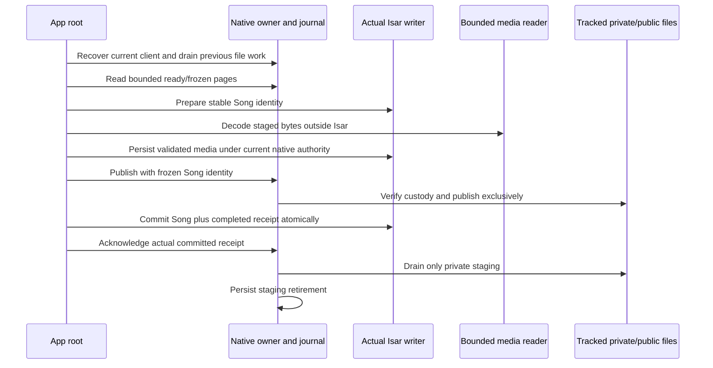

Validated quality is stored before publication in a nullable private receipt
field. A lost publication reply can therefore recover without inventing media
quality or requiring staging that native already retired. Codec and container
are distinct: PCM in a WAV retains a WAV file label. Native authority is checked
at both ends of actual Isar prepare/media/commit transactions. Committed
historical receipts acknowledge completion without recreating deleted Songs.

Host acceptance includes the actual coordinator and locked Isar engine, real
FFprobe WAV decoding, lost-reply/reopen recovery, missing-reservation refusal,
interrupted-reader retirement, capability-off inactivity and startup file-worker
barriers. The actual store suite upgrades a database written by the prior
schema in a separate process, exercises eight receipt/media process-exit
boundaries and rolls back writes after late native revocation. Three complete
portable native rounds and 23 focused Dart transport checks pass; targeted
analysis, workflow lint and the full integration entry compile pass locally.
The native port in the host coordinator harness is explicitly a fixture; this
does not qualify an installed end-to-end product import or OS relaunch.

Remaining recovery must also page Isar-only prepared reservations: a process
can stop before native custody is created. Old or canceled frozen work is
currently blocked as cleanup-required, preserving public files. Before product
activation, add retiring-state bookkeeping, Apple-coordinated abandonment,
clear/unpair submission epochs and OS-task drainage, atomic CUE/scanner mapping,
terminal-history retirement, owned uploads and persisted transfer UI. The
bundled decoder and this checkpoint still require their own Apple run. Build84
remains a separately qualified fallback, not evidence for this newer source.

### Isar orphan and abandonment continuation (outside PR338)

Later source also reads bounded private Isar reservation pages independently of
native custody. Ready prepared jobs can resume normally; unmatched reservations
and retiring candidates are reported as cleanup-required without publishing,
deleting or inventing proof. A durable `retiring` state blocks late import and
scanner writes until cleanup finishes. Final retirement requires that state;
both writer transitions recheck cleanup authority before commit. Actual Isar
contracts pass keyset deletion/insertion, reopen recovery, late guard rollback
and four additional process exits around retiring/retired commits (twelve total
receipt/media/retirement exit boundaries). Root contracts pass Isar-only orphan
detection and retiring-candidate refusal with the actual database.

The native filesystem half now contains an Apple `NSFileCoordinator` deletion
accessor. It coordinates before taking its own writer lock, checks the exact
frozen journal witness and retired live revision, verifies root/marker/inode/full
hash, and rechecks the named descriptor and timestamps before the short
cancelable unlink. Missing files stay missing; modified or replaced files are
preserved. This helper neither removes provenance nor claims private staging
drainage or Isar completion. It is not exposed through the runtime/channel.
Separate current-root cleanup authority and integration remain required.

Three portable native rounds pass, including live/completed-job refusal and an
explicit Linux public-deletion refusal. Portable Foundation lacks Apple's file
coordination. The Darwin-only owned/missing/edited/replaced/canceled cleanup
contracts are written but **have not run on Apple**; they are outside PR338 and
build85. No coordinated public cleanup acceptance or product activation is
claimed from host execution.

### Durable cleanup resolution continuation

The native journal now has a bounded optional resolution record, retained with
the frozen custody until the app confirms durable Isar retirement. It separates
an abandoned copy's owned/missing/preserved result from committed Isar history,
which must preserve public Music. Recording either decision requires a newer
matching native revision; an unpublished operation cannot claim committed
history. A recorded resolution cannot authorize public deletion again.

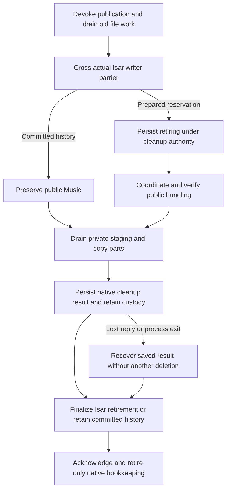

Only the journal resolution boundary is implemented in this continuation; the
full sequence above remains an integration requirement. Three complete portable
native rounds pass real SQLite resolution process exits before/after commit,
reopen preservation, unchanged live jobs, conflicting-decision refusal and
idempotent lost replies without another observable generation. File-cleanup
completion in those journal contracts is explicitly a caller fixture. Separate
runtime ownership of cleanup leases, integrated private-part drainage, channel/root integration and actual Apple
coordinated deletion remain pending. Ordinary cancellation still refuses the
uncertain importing boundary: cancellation there needs the Isar decision first,
then a separately authorized retired revision; weakening `cancel` is unsafe.

### Cleanup authority and private-link continuation

The registry now has a distinct cleanup permission and direct revocable guard.
It refuses publication tokens, ordinary write/reconciliation guards, foreign
clients and upgrades from an active cleanup claim. Twelve concurrent cleanup
claims coalesce; clear retires their token and queued ticket immediately. The
journal has a separate exact-custody retirement comparison for a prepared import
after the Isar barrier. Ordinary `cancel` still refuses importing, and a private
retirement without the journal comparison is also refused. This native boundary
preserves the frozen proof and received integrity while retiring the live revision;
the Isar decision is still an explicit fixture in these native contracts.

The private-file helper can now drain an interrupted partial, a stamped private
copy or its exact private/public two-link pair. It checks the native inode/birth/
marker identity when proof exists and never unlinks a public name. Editing public
audio does not prevent removal of our private hard link; strict public hash/mtime
checks remain unchanged. Actual process-exit contracts pass cancellation,
idempotent private drainage, preservation of edited public bytes, and refusal of
replacement private inodes and symlinks. All three complete portable native rounds
pass. Runtime/Runner/Dart cleanup integration and Apple execution of this newer
source remain pending; native product import/upload are still disabled.

### Drained cleanup claim and typed channel continuation

The private Runner bridge now fences publication synchronously when the current
root requests cleanup. Pending cleanup blocks new writer claims before entering
the host/file queues. The runtime grants a separate cleanup lease only after old
file work and its queued runtime callbacks have drained, then re-reads the exact
frozen native custody. A failed/missing reservation aborts only that pending
ticket and restores the ability to make fresh ordinary claims. Engine/client
replacement and global revocation retire pending cleanup as well as active work.

The typed Dart cleanup lease cannot become a publication/reconciliation lease.
It carries frozen intent, Song binding, fresh publication/current-phase facts
and an optional durable resolution; it carries no source path or private nonce.
The direct cleanup guard remains independent of file/SQLite queues. A real HTTP
WAV contract blocks the actual publisher after its public link, proves that
cleanup authority waits for drainage, then validates/releases cleanup without a
current pairing and resumes ordinary recovery. Missing-custody requests are
refused without inventing provenance or leaving submission permanently blocked.

Three complete portable native rounds pass; a final round also checks the added
publication flag. All 27 focused Dart transport contracts pass, including four
cleanup codec/channel checks; fatal-info analysis and workflow lint are clean.
These foundations were subsequently qualified in PR341/build86: both real iOS16
SDK/bridge checks, 20 Mac Foundation coordination rounds and complete installed
iOS18.6/26 suites. They do not include the later full root cleanup sequence.
Product native import/upload remain false.

The cleanup request now has its own strict three-field Swift decoder. A shared
JSON fixture checks the exact Dart request shape and actual native reply keys;
this caught and fixed reuse of the writer decoder's required `reconcileOnly`
field before Apple validation. Three native rounds and all 27 transport checks
pass the shared fixture. The installed-app probe additionally requires a valid
three-field missing-custody request to reach runtime (`TRANSFER_CHANGED`), then
checks ordinary missing-job classification. The separate actual HTTP native
contract proves a fresh writer can be granted after cleanup abort. A malformed
request must fail decoding instead. Build86 passes this probe on both runtimes.

### Runtime/root finalization continuation (outside PR341/build86)

Later source connects native resolution and app finalization as separate private
operations. A cleanup claim alone cannot delete a file: the app supplies its
exact durable Isar retiring/committed receipt binding. Native prepared retirement
compares frozen custody atomically and retains that cleanup permission while
advancing the live revision. File handling runs outside Isar/runtime queues;
public coordination, private-part and staging drainage finish before native
resolution is recorded. Concurrent callers coalesce. Only after actual Isar
retirement/committed history may finalization remove native bookkeeping.

The root now resumes known-custody cleanup, preserves committed history (including
deleted Songs), and recovers native-resolution or finalization reply loss without
repeating file handling. Current-revision committed imports use the existing
receipt-only completion route. Missing Isar reservations and contradictory states
remain nondestructively blocked. Isar-only orphans use the separate drained
bookkeeping witness below; they do not authorize public cleanup.

Foreground recovery is coalesced. Mutation/disposal retire the app epoch and
active cleanup token, then await old startup/foreground/file work before a caller
crosses its actual storage barrier. The app's clear/unpair/enqueue integration
still needs its own hooks and submission epochs before activation.

Three portable native rounds pass real HTTP/custody/staging, coalesced resolution,
idempotent finalization and committed-file preservation. Native driver Isar states
are explicit fixtures; Linux refuses public abandonment. Actual Isar/root checks
pass retiring→native resolution→Isar retired→native finalization ordering, lost
replies across reopen, edited-file preservation, deleted committed history and
coalesced foreground/mutation retirement. Their native port/file ownership is
explicitly a fixture. All 28 focused transport checks and fatal-info analysis
pass. This later driver/root integration has no Apple SDK/installed acceptance
yet. Native product import/upload remain false; owned uploads/progress,
clear/unpair/CUE and OS lifecycle work remained native-engine activation gates;
the first-release foreground-copy scope is now defined above.

### Older no-custody reservation recovery (outside build86)

An Isar preparation can commit before native custody exists. After cancellation,
the root now obtains a distinct `orphanCleanup` permission only after native
publication is fenced, earlier file work and runtime callbacks drain, a newer
native job revision is found, and the old revision has no custody. A missing
native job alone is refused. Existing custody must use normal tracked recovery.
This permission cannot pass writer, reconciliation or file-cleanup guards and
returns no target/source path, marker or deletion authority. Shared Swift/Dart
fixtures freeze its four-field request and reply keys.

The actual Isar transaction re-reads the exact receipt ID, operation, Song ID,
scope, source, relative suffix and declared integrity. It checks the direct
bookkeeping guard before and after the write, then retires only prepared/retiring
bookkeeping. A stale pending page cannot retire a committed receipt. No Song or
public file is changed. Root mutation/disposal also drains this separate lease.
Actual Isar tests cover late-guard rollback, mismatched source refusal, committed
history preservation and both process-exit edges; the suite now has fourteen
receipt/media/retirement commit-exit boundaries. The actual root harness verifies
reopen recovery and preserves an unrelated file at the target path without
calling file cleanup. Its native port remains an explicit fixture; portable
native HTTP/ownership/codec checks are separate evidence, with Apple execution
still pending for this source.

### Submission consent and held mutations (outside build86)

Submission now has a strict client-bound `{clientID, intents}` envelope. Dart
freezes consent before its first await, encodes away from the UI isolate, and
checks its local epoch/current observer before posting and after the native
reply. The isolate closure has its own top-level context so it cannot capture
the transport's unsendable Futures. Array-only requests, native state, paths
and credentials are refused at the bridge. A shared Swift/Dart fixture checks
the envelope.

Native captures a separate submission ticket synchronously before host dispatch.
Its epoch is independent of per-import lease releases. Client/engine handoff,
scope/global revocation and direct `retireSubmissions` invalidate old tickets;
the runtime checks before authorization, immediately before journal creation,
and before starting network work. A request already persisted when retirement
occurs still belongs to the subsequent native cancellation/storage barrier;
epoch fencing is not OS-task cancellation.

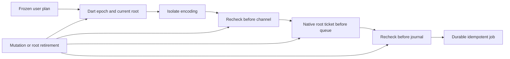

Root mutation pause now fences submissions before awaiting older work, drains
pending submission replies and import/cleanup leases, and remains held across
foreground events. Only explicit `resumeAfterMutation` releases it after the
caller finishes its actual storage operation. Startup retired during the pause
is retried rather than permanently cached. Tests exercise held foreground and
startup recovery with actual Isar, direct retirement while native authorization
is blocked, no stale persistence, fresh HTTP submission/idempotency, stale
success refusal and pending-reply drainage. Native Isar attestation/root RPC
fixtures remain explicit. The UI's app-wide clear/unpair ownership, OS-task
cancellation, journal/WAL handle retirement and installed acceptance are still
required; these foundations do not enable product native import/upload.


### App-level destructive UI fences (post-build-87 continuation)

The iPhone app-root now exposes a serial mutation barrier. Confirmed **Clear
library**, individual library/file deletion and desktop-pairing **Forget**
operations enter that barrier instead of directly racing the coordinator.
A healthy eligible coordinator must acknowledge its paused submission epoch,
release active native leases and drain import callbacks before the mutation.
A failed eligible-root startup refuses the mutation. Multiple UI writes
serialize through each pause/mutate/resume cycle; exceptions after a successful
pause still resume. The unsupported native-release adapter leaves existing
Android and iPhone foreground copy workflows unchanged.

This is an explicit, incomplete gate: native product import/upload remain
disabled. Full safe activation still requires journal/URLSession task
cancellation and storage barriers for *all* database and pairing mutation
entry points, native CUE/scanner ownership, durable upload/progress and actual
iOS suspension/relaunch plus real iPhone sideload acceptance. This source is
newer than the independently accepted build-87 artifact.

### App lifetime mutation ownership after PR354

The single transfer transport, coordinator and serialized mutation queue now
belong to a non-auto-disposed app provider. The lifecycle widget borrows that
session; replacing it cannot close an outstanding pairing retirement or create
an independent Clear/Forget queue. ProviderContainer disposal drains the
coordinator and attempts transport closure even if coordinator teardown fails.
The session rejects a coordinator constructed with a different transport.

The public Root library-mutation and pairing-retirement entry points from PR353
are retained, including verified Keychain identity, compare-and-clear and
one-shot observation while the product coordinator is disabled. Android/web
operations retain their existing bypass. Native import/upload flags remain off.

Twelve local lifetime, mutation and pairing-retirement checks pass, including a
mutation held across widget detach/remount, no detached lifecycle callbacks,
exactly one app-container disposal, stale authority refusal and serialized
operations. Targeted fatal-info analysis is clean. CI waits remain skipped at
the user's request; no Apple or physical qualification is claimed for this
later source. Durable preserve-public custody policy and actual Isar/file
reconciliation remain necessary before background-transfer activation.

### Preserve public files while reconciling Clear and Forget (after PR355)

Clear Library and Forget Desktop now run actual receipt reconciliation even
while product native imports are disabled. The temporary mutation role can
acknowledge completed history and retire prepared receipts; it cannot publish
new music. It reads the real Isar store, checks the native custody/lease, and
refuses the user-data mutation if either side is missing or inconsistent.
Prepared receipts become `retiring`, native cleanup is durably resolved, the
Isar receipt becomes `retired`, and native finalization follows that commit.
A failure preserves credentials/library metadata and can be retried.

Public-file preservation is a monotonic native custody policy. Its SQLite
commit precedes abandoned-import cleanup. A preserved abandonment returns
`preservedByRequest` without inspecting, recreating or unlinking a public
Music file; it makes no claim that the file exists. A restart cannot resume
publication from that custody. Scope cancellation records the same policy
atomically with cancelled job revisions, including older unresolved custody.
Private staging without custody is drained before cancellation is acknowledged.

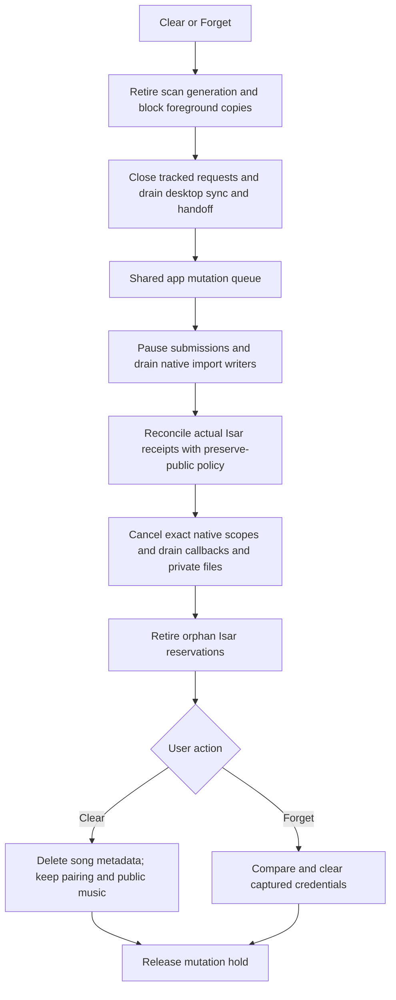

Clear cancels old plans without adding a permanent pairing pause. Forget adds
`pairingChanged`; ordinary reconnect/retry cannot remove that tombstone. A
separate retirement ticket survives its own per-job cancellations and duplicate
requests, but engine/client replacement invalidates it before acknowledgment.
No caller-supplied path, bearer credential or file-deletion permission enters
these new control messages.

Existing foreground desktop copies/uploads, metadata sync and queue handoffs
are tracked until their final database work finishes. Clear/Forget and generic
library mutations close tracked HTTP requests and wait for that work. Old copy
previews retain an invalidated epoch. Desktop catalogue scans and local folder
scans capture an epoch at subscription, including detached metadata tasks;
scanner repository writes check it inside Isar's writer. A queued stale write
cannot repopulate a cleared library. Android paths retain their previous
behavior.

Local evidence includes three repeated portable Swift/SQLite/file/real-HTTP
contract rounds, Flutter lifetime/pairing/foreground/scan contracts, and actual
Isar coordinator/store checks. Native RPC and Apple public-file coordination
remain explicit fixture/platform boundaries in host checks. The full Flutter
integration entry point is compiled separately; that is not an iOS SDK build.
No CI wait, signing, installed-app or physical-device acceptance is claimed
for this continuation. Build 103 (PR345) and build 111 (PR349) remain separate,
earlier qualified engineering sources; these changes do not update their IPA.

Native product import/upload flags remain **false**. Activation still requires
committed-anchor rescan/CUE identity mapping, bounded history retirement,
owned/idempotent uploads, unavailable-storage OS-task cancellation, and a
positive installed coordinator/native/Isar/media-reader integration probe plus
actual suspension/relaunch qualification. The generation fence does not grant
a scanner permission to replace a protected committed import anchor or change
its historical receipt. Other network-source writers need their own verified
mutation admission before enabling native background transfer coexistence.

### Fresh rescans retain historical import identities

A follow-up actual-Isar probe demonstrated that clearing Songs resets its
allocator to 1; deleting all rows without `clear()` also resets the allocator
when the empty collection is reopened. Changing the deletion API alone cannot
protect an import receipt that deliberately outlives its deleted Song.

The iPhone repository, desktop-copy/catalogue writer and new native import
reservation now allocate new Song IDs above both live Songs and retained
receipt IDs, inside the same Isar transaction as insertion. Bulk allocations
also avoid explicit IDs in that batch. A stale explicit ID cannot recreate a
deleted receipt anchor; invalid, duplicate or exhausted allocations fail before
insertion. Existing current rows retain their IDs. Android allocation is unchanged.

A new scan with a current mutation generation may index retained public bytes
at their canonical import-relative path after explicit deletion. That scan gets
a separate Song ID; the old committed receipt still reports its original
recording as removed, and the old native transfer cannot recreate it. Later
fresh scans may refresh the separate row. Unwitnessed scans, retired generations,
alternate relative-path spellings and attempts to recreate the old anchor remain refused.

This does not implement CUE expansion of a still-present native import anchor.
That needs an atomic anchor-preserving range replacement. Receipt pruning also
needs a durable identity high-water mark before deleting the last historical
ID evidence; do not prune those receipts as an incidental cleanup.


### Installed complete-import probe (source; Apple execution pending)

The DEBUG-only integration harness creates a separate native host/channel,
ephemeral URLSession, Music directory and actual Isar database. It accepts only
a localhost fixture port, chooses its own temporary paths, and uses synthetic
authorization in memory. It never changes Keychain or the production journal.
The production bridge and host retain their default namespace, root and session.
Release builds contain no integration-control handler.

The smoke suite submits a generated WAV through the real session/coordinator,
typed channel and native HTTP/file/custody writer, then verifies its actual
Isar Song/committed receipt, SHA-256 and bundled FFprobe media validation. Two
foreground reconciliations must retain one Song/receipt and one HTTP request.
Disposal closes the coordinator and client, closes Isar and HTTP, then drains
the native owner before its temporary directory is removed. Public product
background flags remain false; only the isolated coordinator explicitly opts
into unreleased APIs.

The SDK check now type-checks both DEBUG and release bridge variants for device
and simulator. Host compilation and Dart analysis do not qualify UIKit/file
coordination on an installed iPhone app. The installed probe must actually pass
before closing this milestone; ephemeral networking does not prove suspended
OS-daemon delivery, relaunch, real-desktop authorization or upload acceptance.

### Atomic CUE expansion and range updates

The iPhone Rust scanner now routes a known native-import file's CUE expansion
through one actual Isar writer transaction, before removing its raw row. The
mapper requires the current scan generation, a settled committed/retired receipt,
a canonical target and an exact structural snapshot of current rows. It rejects
empty/unbounded, duplicate or overlapping ranges and foreign supplied IDs.

Existing offsets retain their current Song IDs. A raw row can supply the first
new range's ID when that range has no existing identity; additional ranges use
the historical-receipt-aware allocator. Reused rows retain date added, desktop
binding and manual metadata edits. Obsolete ranges are removed only after all
replacements have been accepted in the same transaction. The receipt and audio
bytes are unchanged. If a later CUE edit removes the original anchored range,
its committed receipt stays historical and the removed ID is never recreated;
other existing range IDs remain stable.

Native-shaped CUE paths are reprocessed even if the audio timestamp is unchanged,
so a changed sidecar is not skipped by the old audio-only cache. Ordinary scan
cleanup protects all derived rows while the receipt is live; it cannot leave a
partially deleted CUE group. Android keeps its existing deletion/upsert path.

Actual Isar tests cover preparation refusal, first expansion, range insertion,
manual identity preservation, stale-snapshot/overlap refusal, post-replacement
rollback and reopen, anchored-range removal and unchanged public-file SHA-256.
Whole-CUE removal re-reads actual full-file metadata, including its duration,
before the same writer replaces the whole group. It prefers the still-live
original anchor, otherwise a surviving derived identity; a removed anchor is
never restored. Missing/invalid metadata retains the existing group. This runs
even when the last CUE/log sidecar has disappeared, while ordinary/Android
cleanup keeps its existing sidecar condition. Rollback/reopen and re-expansion
are covered by actual Isar contracts. Bounded history retirement remains in
milestone2. Native product capabilities remain disabled until all gates pass.

### Durable recording identity floor

A private singleton collection stores the greatest allocated Song ID. iPhone
startup seeds it from the existing library and receipts before publishing the
database; each allocation advances it in the same writer as insertion. Library
clear records the floor before removing songs. Deleting derived CUE ranges,
clearing receipts and reopening an empty database cannot reset this counter.
Unknown versions, exhaustion and attempts to recreate a deleted explicit ID
fail without resetting the store. Android keeps Isar's existing allocation.

The counter retains identity evidence needed for later history compaction; it
does not authorize deleting live import receipts or native custody. Those retain
file/recovery provenance until a separate acknowledged cleanup is safe.

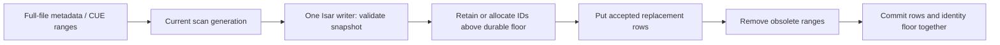


### Completed-import history compaction

Schema 3 adds indexed completion records containing only job UUID, completed
revision, original Song ID and SHA-256 of the frozen user intent. The immutable
intent hash excludes progress, retry revision and phase. These records do not
contain a bearer, file path, publication marker or library write permission.

The root asks for bounded keyset pages only after recovery or import completion.
Native keeps the newest 200 completed imports visible. Older entries qualify
only with exact publication custody and confirmed private staging retirement.
For each candidate the root obtains a reconciliation-only lease, reads its
actual committed Isar receipt, and checks the original Song ID. A deleted Song
is valid history; compaction must not recreate it.

Native rechecks ownership after the file-worker barrier, refuses any remaining
OS task for that UUID, and atomically inserts the completion record while
removing the full job/custody documents and updating their usage counters.
No public file is opened or changed. Library receipts and the durable recording
ID floor are retained. A repeated compact request with the same live lease is
read-only; after process recovery the entry no longer appears as work. A
replayed frozen enqueue is recognized from its hash and starts no new request;
reusing its UUID with changed intent is refused. Pairing-revocation pauses are
never compacted.

Full active jobs/custody keep their existing 10,000-entry/16-MiB budget. The
fixed-shape, indexed completion record collection has a separate one-million-row
limit and never evicts duplicate-submission evidence to make room. A capacity
failure rolls back the complete transaction. Failed, cancelled, uploading and
unfinished jobs are not candidates for this operation; their retry/dismissal
semantics belong with the durable queue controls.

The schema migration adds the new table/counter without re-encoding existing
job/custody BLOBs. Native tests cover an independent v2 database as well as v1
migration, both compaction commit-exit boundaries, wrong identity/quota rollback,
recent-history retention, replay after recovery, and missing/edited public files.
The actual Isar/coordinator contracts cover committed-receipt verification,
deleted-Song preservation, missing-receipt refusal, lost replies and root
retirement. Their native port remains a fixture; separate native contracts use
actual HTTP/files/SQLite. Host tests and DEBUG bridge syntax parsing do not
establish Apple SDK, installed-app or OS-background qualification. Both product
capability flags remain false.

```mermaid
sequenceDiagram
  participant Root as App coordinator
  participant Isar as Library database
  participant Native as Native transfer owner
  participant Journal as Native SQLite journal
  Root->>Native: Page older acknowledged completions
  Root->>Native: Claim reconciliation-only lease
  Root->>Isar: Read matching committed receipt and original Song ID
  Root->>Native: Compact under current owner
  Native->>Native: Drain prior file work and check OS tasks
  Native->>Journal: Atomically retain intent hash; remove full job/custody
  Journal-->>Native: Durable completion record
  Native-->>Root: Acknowledge (safe to retry a lost reply)
  Note over Root,Journal: Isar receipt, recording-ID floor and public audio remain intact
```

## Owned upload snapshot boundary (continuation after PR369)

`LokalTransferFiles.stageUpload` now copies a borrowed, already-authorized file
descriptor into the private UUID/revision-derived `.upload` file after durable queued
intent is recorded (see the recovery continuation below). It reads with positional, bounded chunks, preserving
the source descriptor's offset and never moving or modifying the recording.
It checks the frozen size/SHA-256, source identity/modification state, private
single-link regular-file binding and current container root, then syncs the
body and directory. Its 1GiB limit matches the current desktop originals API.
The app must still supply current submission consent and an authorized source;
this helper accepts no Flutter path and does not grant source access.

A matching existing body makes a lost preparation reply idempotent. Modified,
partial, symlinked or substituted bodies fail closed. A new failed/cancelled
copy removes only the exact private inode it created. Actual process-exit tests
leave a partial snapshot and prove it cannot be acknowledged or silently sent
on reopening. Runtime preparation now has durable intent first; incomplete private bodies can
be reset only for never-started intent with a fresh source grant, or retired
after durable cancellation/drainage. Unknown bodies without a durable job remain
quarantined and cannot be adopted by a new intent.

This is the file boundary, not a native upload feature. The native-only admission/task/receipt path is implemented in the continuation
below. App source authorization/upload admission and user queue controls remain to
be connected. Positive matching and terminal cleanup are implemented below.
The desktop `server/linkUpload.js` last changed at
`0bb366877c119c76bfa3be5c5b06d8c4b0728cd5`; its hash lookup alone is not proof
of a durable, concurrency-safe idempotency contract. Do not blindly retry a POST
whose response was lost. Native `upload` and `libraryImport` stay false pending
those integrations and the fixed Apple lifecycle/package gates.

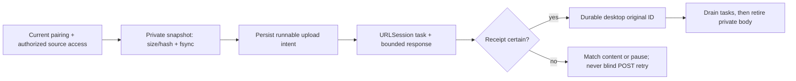

Snapshot, native admission and network/receipt boxes have portable host coverage.
App authorization/queue wiring and Apple background delivery remain
integration/qualification requirements. Positive matching and private-body
retirement now have native/typed-bridge host coverage.

## Native upload runtime continuation

The native-only `enqueueUpload` API now duplicates a caller's already-authorized
source descriptor and requires a current submission ticket. It stages and hashes
the private snapshot on the file worker, rechecks the exact desktop, account,
pairing and atomic credential record's origin spelling, records queued intent before copying, then persists task binding
before resuming a file-backed URLSession POST. At most two tasks
or preparations share the session capacity. No absolute caller path enters the
journal or request. The app source-selection/Isar adapter is still required;
this API is not exposed by the Flutter bridge and does not enable product uploads.

The request uses the desktop originals endpoint's raw octet-stream and base64url
metadata contract. Metadata headers are deterministic and bounded. Upload replies
are retained up to16KiB, with strict JSON boolean/ID/integrity checks and exact
endpoint/task/revision authorization. The current peer's verified `file_hash` or
an explicit `alreadyPresent` receipt is required before storing the original ID.
Redirects never forward the body or credentials. Cookies and credential caches
remain disabled. Upload progress reports sent bytes and the frozen body size.

A replay of the same live/completed frozen intent is read-only. A new UUID cannot
bypass existing history for the same local recording, bytes, account and pairing.
If a task or response disappears, the job becomes interrupted and retains its
verified snapshot. Recovery, ordinary Retry and Reconnect issue no further audio
POST for it. A never-started queued job requires a fresh submission ticket and
its existing verified body before starting. Positive content matching is implemented in the continuation below. Safe
retry after an ambiguous POST remains a peer-contract requirement; absence from a query alone
must not be treated as permission to resend.

The journal's atomic pairing-retirement transaction now includes uploads and
downloads. A blocked importing download rolls back the entire mixed batch.
Individual cancellation also records its still-draining task's scope, allowing
subsequent Forget/Clear to wait for that callback. Cancellation prevents a late
receipt from completing the retired revision; it cannot undo a remote commit.
Uncertain private bodies remain retained. Drained terminal cleanup and automatic
scoped retirement are implemented in the continuation below.

Portable tests use real HTTP, files, the native journal and actual delegate
callbacks. They cover successful/existing receipts, byte/hash/Unicode metadata,
lost replies, queued and missing-task recovery, consent retirement while the
credential queue is blocked, wrong account/pairing/origin, malformed or oversized
fixed/chunked replies, wrong hashes, redirects, authentication pause and scoped
cancellation/drainage. The synthetic endpoint models the wire contract, not the
desktop database's concurrency, fsync or exactly-once semantics.

Swift Corelibs Foundation6.0.3 has a host defect: `_ProtocolClient.didLoad` force
unwraps a data-task cast for a download when the session delegate also conforms
to DataDelegate. Linux contracts therefore use an upload-only runtime subclass
that adds only protocol conformance and overrides no runtime methods. Download
contracts use the base owner. Apple Foundation uses the combined session owner;
its SDK checks, mixed-direction execution and actual background lifecycle remain
pending. The test tool can preserve its executable with `--preserve-binary` for
failure diagnosis. Native `upload` and `libraryImport` remain false.

## Upload recovery and private-body retirement

`matchUploadedOriginal` now queries the exact paired desktop's existing
`POST /api/remote/files/match` endpoint with one `{size, sha256}` fingerprint.
It sends no audio. The ephemeral foreground probe bounds declared and streamed
replies to16KiB, rejects redirects/cookies, and accepts only a single index0
match with an opaque original ID. It requires active root-client consent before
starting and again after response/session drainage, including account, token and
frozen-job checks. Engine recovery, cancellation, shutdown and Forget drain the
probe before admitting its result. A positive match commits the original ID;
empty, unavailable or malformed replies leave uncertain intent unchanged.

The typed Dart bridge validates the returned frozen intent, revision, terminal
state and existing receipt. Observation startup, client replacement and the
library mutation epoch fence every upload-control RPC, including one waiting
for observation acknowledgement. These are private coordinator methods; they
add no upload UI and leave product capabilities disabled.

Upload intent is now recorded before private copying. A new intent cannot adopt
an existing private filename, and recovery without a source requires an existing
durable job. Copy/hash failure leaves a never-started waiting row. With a fresh
authorized source, no live/unattributed OS task and unchanged durable intent,
preparation can replace an incomplete private snapshot. It cannot reset an
interrupted audio POST. Unknown legacy bodies without a job remain quarantined.

`cleanupUploadBody` requires a completed or cancelled durable upload and absence
of matching/unattributed OS tasks. It crosses the file-worker barrier, rereads
the exact terminal job and removes only its derived private body. Cancellation
uses the retired revision's filename; repeated cleanup succeeds without a file.
Symlinks/hardlinks and nonterminal intent are refused. Original Music files,
receipts and intent history remain untouched. Forget/Clear also retire completed
upload bodies after drainage. Failures retain their OS scope until final
callbacks, closing the gap after a response rejects an upload but before the
system task has finished cancelling.

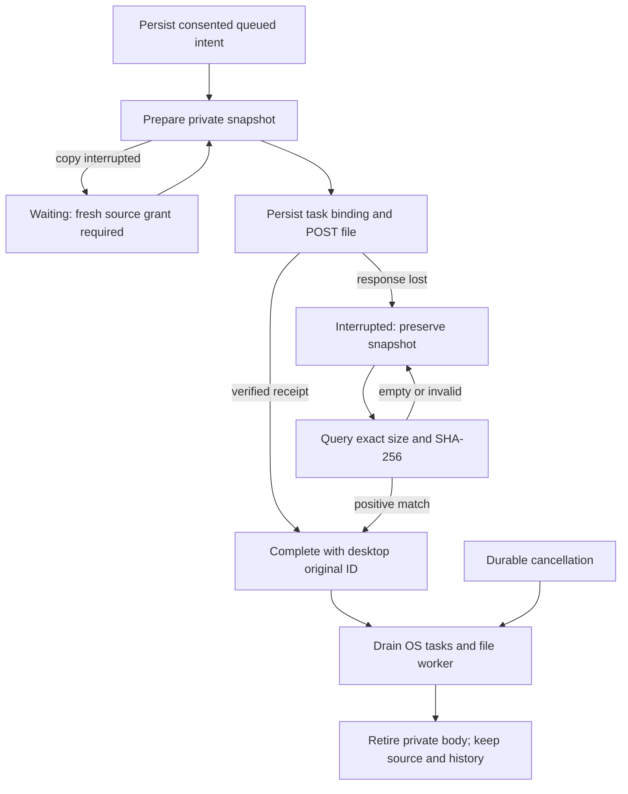

Host evidence uses real HTTP/tasks, files and SQLite, plus typed-channel tests.
It covers lost-response matching without another audio POST, negative/malformed/
large/chunked/redirect replies, stale consent/account/recovery, partial preparation
retry, unbound-body adoption refusal, idempotent terminal cleanup and Forget.
This does not establish desktop database durability/idempotency, Apple mixed
session behavior, suspended execution, or an exact-source AOT IPA. Native upload
admission/source grants and queue UI remain to be integrated before qualification.
