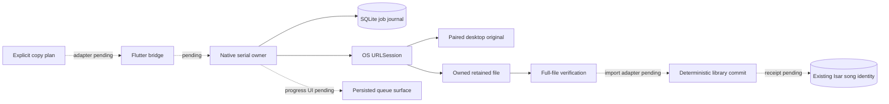
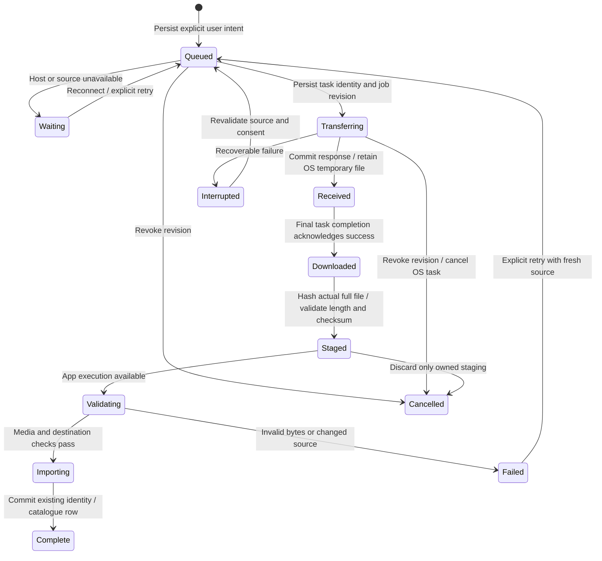

# iPhone transfer architecture

Status: native transport core implemented, app adapter pending, 28 October 2026.
Swift 6 portable tests exercise the SQLite journal, actual owned files and a real
URLSession download delegate against a separate HTTP server. The iOS background
configuration is source only until Apple SDK/runtime acceptance. AppDelegate /
Flutter integration, deterministic library import, uploads and persisted progress
UI are not enabled in the product yet. The currently qualified IPA is build 74;
this transfer core is not in that package.

Solid connections have portable implementation/tests. Dashed connections are
remaining app work; the OS background execution path still needs iOS acceptance.

## Existing paths and the suspension gap

`LinkFileCopy` rechecks both catalogues before explicit copying, so retries can
skip completed originals while preserving library IDs. `LokalDesktopSource`
downloads originals into temporary `.part` files, checks received length and
optional server SHA-256, then promotes/imports the file. Uploads stream local
bytes with a content hash. Those Dart requests/progress states are not durable
jobs across process loss. Request timeouts do not provide suspension recovery.

`LinkDownloadOutbox` persists opt-in uploads of completed phone downloads; it is
not a general transfer journal. Its absolute paths also need container rebasing
and ordering when organization, enqueue and flush overlap.
`DiscoveryPlaybackCache` has bounded byte/range transfers, but source URLs and
headers can expire. Persisting a signed playback URL would preserve neither
authentication nor replay semantics.

## Durable ownership and native transport

Use one app-owned background `URLSession` for eligible HTTP file transfers.
The OS owns networking while Flutter is suspended. Native delegates retain
downloads in owned staging and commit job events before acknowledging background
delivery. Normal app execution validates/imports through the existing library
path; native callbacks do not open Dart/Isar from an unrelated queue.

Each job records a random ID, revision, direction/kind, stable source identity,
destination policy, expected length/hash when available, and owned relative
paths. Native task IDs bind to a job revision. Late callbacks must validate that
binding before rename/import/completion; cancel and unlink cannot resurrect old
work. Startup reconciles journal, actual tasks and staging rather than trusting
a saved `transferring` label.

Download resume data is opaque and specific to that response/task. If a server
rejects continuation, revalidate before restarting; final integrity checks apply
to the entire file. Partial bytes never become a playable library recording.
Background uploads require a stable owned file, rather than a Dart stream or
`content://` handle. Hash/stage the explicitly selected source first. After an
ambiguous POST, query existing original-file identity/hash matching before another
upload; blind POST retries do not establish exactly-once behavior. Never move or
delete the user's original file.

## Source policy and credentials

Start with original transfers to/from the paired desktop, reusing server and
original-track IDs, current pairing and the existing file protocol. A changed
origin, revoked pairing or unsupported protocol pauses/fails explicitly. Reject
unexpected HTTP redirects. New tasks read a single atomic origin/pairing/secret record from the existing
Keychain service; a separately written preference cannot redirect an older
bearer token. A public random pairing ID binds every production job to the
particular pairing, including when the same desktop is paired again. The native
reader refuses legacy split records; their remote-control configuration remains
readable in Dart and needs explicit verified migration before background use. App journal records/logs contain no tokens, cookies,
signed URLs or authorization headers. The OS transport necessarily receives
authenticated task requests; do not duplicate those credentials in app manifests.
Cancel associated tasks on unlink/revocation, disable shared cookies/credential
storage/response caching, and keep TLS validation. Relative owned paths survive
container relocation during signing refresh.

Discovery/add-on saves require a separate adapter: persist stable recording and
provider intent, then re-resolve through the existing opted-in source. Opaque
streams, previews and unsupported transports cannot silently become ordinary
background downloads. Immediate-playback cache preparation retains its existing
latency, cancellation and cache-budget policies.

Normal suspension and OS process reclamation differ from explicit force-quit.
Do not promise continued execution after force-quit. On next launch reconcile
the job, recheck completed originals and apply only its current authorized retry
policy. Background audio does not authorize unrelated indefinite Dart work.

## UI and acceptance sequence

The copy surface should show persisted counts and honest queued, waiting,
transferring, awaiting import, paused and failed states. Retry/Cancel must remain
accessible at large text sizes in all eleven languages. Completed networking
and completed library import are separate facts; show a playable copy only after
import commits. Reconnection rechecks both catalogues to skip completed originals.

1. Completed locally: typed journal, SQLite transactions, owned-path policy,
   native delegate, task reconciliation, revision/cancel and pairing guards,
   actual file verification and a separate real HTTP fixture.
2. Next: Apple SDK type checking and native protocol acceptance; connect the
   AppDelegate background-event handler and paginated Flutter bridge. The native
   owner must exist independently of the Flutter engine. Unpair must retire
   native jobs/tasks before clearing the atomic Keychain record.
3. Integrate paired-desktop transport and durable progress UI through the
   existing identity-preserving import/upload paths.
4. Qualify against a host-side HTTP fixture outside the app process: disconnect,
   rejected ranges/source changes, cancellation with late completion, relaunch
   reconciliation and actual stored bytes/IDs. A Dart server inside the suspended
   app cannot prove this. Explicit force-quit is a distinct recovery case.
5. Extend eligible provider saves after equivalent stable re-resolution,
   preview/source and cellular-policy coverage.

Physical network/energy behavior remains separate acceptance. Batch the journal,
native transport and first product adapter before a full app build; local and
focused checks precede it.

## Implemented native contracts

`ios/Transfers` contains the typed model, SQLite journal, owned-file store,
request policy, credential reader and URLSession delegate. The runtime owns a
serial utility queue and at most two actual downloads. Progress stays in memory
and notifications are coalesced; transitions commit one job and its generation.
A summary contains counts, current progress and pairing pauses; job pages are
bounded to 100 records. A 10,000-job / 16 MiB journal limit bounds metadata.
There is an 8 GiB per-file limit. A 1,000-track queue test measures **8,272 bytes**
written to WAL for one transition, rather than rewriting the entire manifest.

The system SQLite library uses WAL and FULL synchronization. Unknown/future or
corrupt records, unexpected fields, symlinks and replaced staging roots fail
without silently resetting committed intent. Six independent processes create
48 jobs without lost updates. Child writers terminate immediately before and
after COMMIT; reopening reads the complete old or new transaction. These are
process-interruption checks, not a physical power-loss qualification.

A download passes four distinct boundaries: response metadata committed,
OS temporary file retained, final network success acknowledged, then actual
full-file hashing. A received body alone cannot become importable. Owned names
are derived from job UUID/revision under the current app container. Staging never
moves a user's original file. Only validated complete files can enter an import
phase. Late callbacks and checksum results cannot revive a cancelled revision.
Repeated verification is coalesced, retry retires its old file, and explicit
recovery reloads committed truth before reconciling OS tasks. Repeated shutdown
acknowledges all callers after file work drains.
Submission is idempotent for a frozen intent ID. A second active job for the same
paired original is rejected even if a reconstructed plan invents another UUID;
the product coordinator must present/reuse that existing job rather than creating
another physical copy.

Requests use only the paired original-file endpoint with opaque encoded IDs.
All redirects are refused. Cookies, shared credential storage and response
caching are disabled; normal TLS validation remains. Cellular, constrained and
expensive network access are disabled for this initial desktop-LAN adapter.
A 401/403 commits a desktop/pairing pause in the same transaction as the failed
job and stops draining that queue until explicit verified reconnect. Re-pairing
cannot authorize old intent. App records contain no tokens or token hashes.
The OS necessarily receives authenticated task requests.

A valid final 206 can represent an OS-assembled full response only when its
Content-Range ends at the total length, the retained file is that total length,
and whole-file checksum evidence is present. Range fragments, malformed or
incomplete ranges and mismatched lengths are refused. Actual iOS automatic
continuation remains a native acceptance case.

The standalone Python service generates a real WAV outside the Swift process.
Actual URLSession tests cover retained bytes, repeated submission, redirects,
truncation, wrong checksums, cancellation with late callbacks, rejected pairing,
no cookie forwarding and reconstruction from disk. Linux uses an ephemeral
session and system SHA-256 for portable tests. Apple's build uses CryptoKit and
the real platform SQLite module; the hosted workflow additionally type-checks
both iOS 16 arm64 device/simulator SDKs. Portable results do not qualify Apple's
background daemon, suspension, relaunch delivery, Keychain accessibility or
physical network behavior.

## Remaining app boundaries

The library adapter must claim a short import lease, use a deterministic owned
destination/receipt and reconcile the existing Isar original/server identity
before retrying. A process death after a successful file/database commit must
not create another copy. Import completion needs an acknowledged local-row
receipt. Cancel cannot roll back an already committed library write; current
model cancellation is rejected while importing. Lease retirement, recovery and
completion acknowledgement must be implemented before exposing these operations.

AppDelegate must route background completion independently of Flutter. The
bridge needs one-shot main-thread replies, client ownership, bounded pages and
foreground-only observation. The paired-desktop coordinator must migrate legacy
credentials only after verified reconnect, enqueue the user's frozen plan,
resume after suspension and present persisted states. Unpair/reconfiguration
must retire associated native tasks and revisions, including after a journal
failure. Upload receipts and ambiguous POST reconciliation remain separate work.
Existing Dart copy/upload paths remain active until this adapter passes its
identity, cleanup, cancellation and recovery gates.

Run `python3 tool/ios_transfer_contracts.py --swiftc /path/to/swiftc` locally.
Linux can pass test-only SQLite header/library directories via the documented
CLI flags; no host SDK paths are committed. The hosted workflow adds
`--check-ios-sdks`. The shared synthetic credential fixture is decoded by both
Swift and Dart; real credentials are never test inputs.
