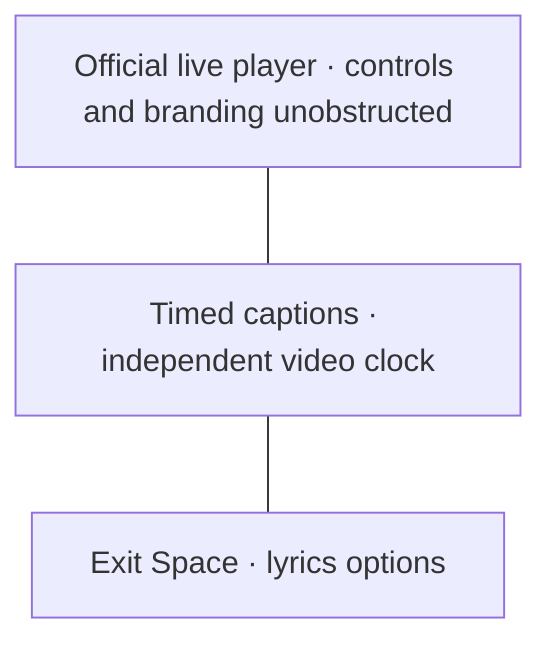
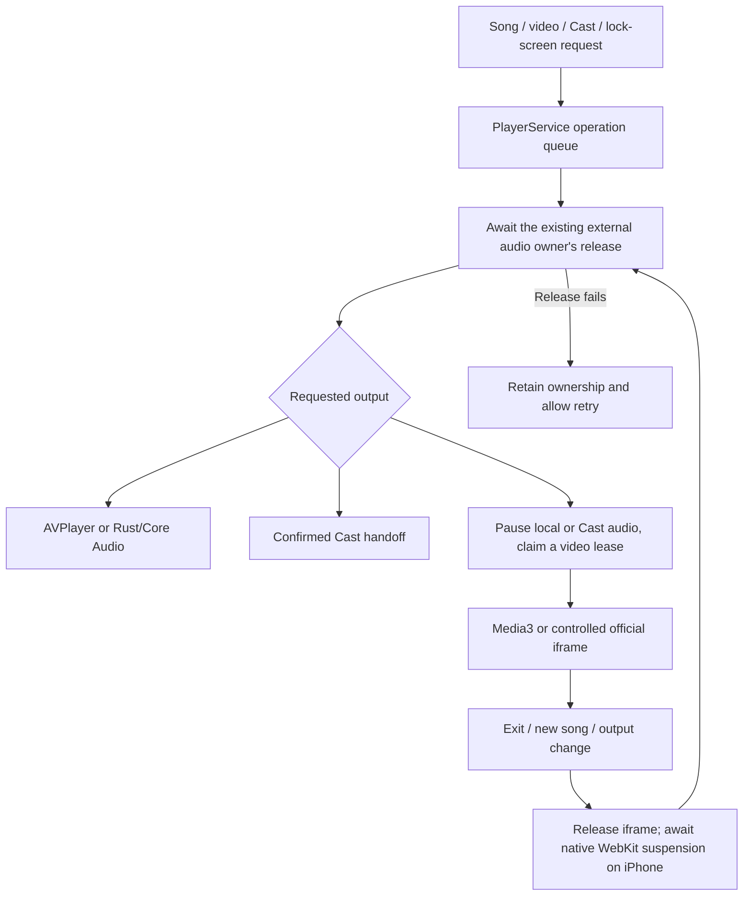

# iPhone music-video transport

PR #210 keeps Video in the artwork slot and Space on the same live player.
The iPhone adapter uses YouTube's official iframe player with its documented
[IFrame API](https://developers.google.com/youtube/iframe_api_reference).
It does not extract media URLs or proxy video streams. Android retains Media3
and its official-embed fallback. A direct iPhone AVPlayer stream adapter is not
implemented by this work.

The embed reports actual player position, duration, state and errors through a
main-frame, origin-restricted WebView handler. Full-player play/pause/seek and
Space subtitles use that video clock, independently of the paused album version.
The shared controller keeps `nativeNotifier` false for an embed, with a distinct
`timingAvailableNotifier` for an observed usable clock. A monotonic stopwatch
interpolates only while playing and not buffering; no ticker runs while paused.
Expired surfaces cannot overwrite or detach a replacement controller lease.

## Unobstructed official player

YouTube's [required minimum functionality](https://developers.google.com/youtube/terms/required-minimum-functionality)
prohibits overlays in front of any part of the embedded player and using its touch
events for other actions. The embed therefore keeps provider controls/branding
visible, puts loading/error UI below the WebView, disables Lokal artwork gestures
and like-burst overlays for embeds, and uses the provider's fullscreen control.
Lokal's fullscreen-cover chrome is not drawn over the embed.

For embedded video, Space reparents the same keyed player into a dedicated layout:
video above, timed captions below, explicit Exit Space and lyrics options beneath.
Album artwork and native Android video retain their existing Space presentation.
The embed stays at least 200 logical pixels high; short windows scroll and long
captions scroll within their own area. Tests cover a 320×280 short window and
393×852/430×932 phones with 200% text scaling, player tap ownership, no caption
intersection, explicit exit, and preservation of the original player State.

## One audio owner

Acquisition and local playback operations use the same player queue. The external
lease coalesces concurrent release attempts and stays owned on failure. Selecting
another song, resuming from lock-screen controls or changing output must first
release video. Initial video routes show preparation until their lease is acquired,
so they cannot start before the preceding audio yields.

The iframe starts with autoplay disabled; its ready callback starts playback only
if release has not already been requested. An early exit cannot trigger delayed
autoplay. On iPhone, release awaits
[`WKWebView.setAllMediaPlaybackSuspended`](https://developer.apple.com/documentation/webkit/wkwebview/setallmediaplaybacksuspended(_:completionhandler:))
through the locked WebView plugin's native completion handler. This suspends media
in every frame and prevents late playback until teardown. A regular pause uses
the iframe command plus native `pauseAllMediaPlayback`. Backgrounding suspends the
web player; a later explicit Play lifts suspension. Closing a video route and
leaving video for album audio await release; failures keep video owned for retry.

Returning to album audio preserves its separate saved position. Resume is checked
inside the player queue against the original song object, output-lease revision
and user-intent revision. A newer song, output acquisition or manual pause wins.
Previous/Next first yield video before changing the audio queue. Fullscreen yield
also restores the portrait/system-chrome policy.

## Evidence and remaining gates

The focused transport selection passes **41** tests. A broader affected
player/Cast/Likes/locale selection passes **123** (overlap). Host tests cover delayed acknowledgement, concurrent release, synchronous and
asynchronous failure/retry, a replacement acquired during cleanup, stale surface
detachment, late completions after disposal, and independent video transport/time.
The actual inline production JavaScript is executed by Node against a controlled
YouTube API contract: startup/seek/snapshot, release before ready, delayed pause
while buffering, late play after release and API error handling. It makes no
network requests and does not substitute for a live YouTube or WebKit test.
CI requires Node for this selection; other developer hosts explicitly skip just
that JavaScript contract if Node is unavailable.

The iPhone harness adds controlled external-owner acknowledgements around actual
PlayerService/AVPlayer resume and a stale exit/manual-pause race. These native
checks pass on both iOS 18.6 and 26.0 in build 27. Its Space checks confirm the
actual player artwork elements survive overlay entry and use the real song clock.
That checkpoint precedes the unobstructed embedded-video layout; no live iframe
acceptance is inferred from the controlled owner test.

Still required: observed iframe API readiness and origin/referrer behavior in real
WKWebView, playback and seek accuracy, error/age/region restrictions, background
and interruption behavior, fullscreen preservation, route/back/queue changes and
physical-device audio handoff. Native video DSP/audio-only processing options and
live service availability require their own product/receiver checks. No actual
YouTube session, physical iPhone or flawless video/audio handoff is claimed solely
from host contracts or native method availability.

Video mode displays a localized Video badge without borrowing the album's
lossless/Atmos claims. Its options show device-volume guidance and the displayed
video's heart instead of controls belonging to the paused album engine. The new
presentation phrases are translated across the existing ten non-English Lokal
maps. Live video format/DSP behavior is not inferred from the album metadata.

The subsequent layout/iframe/Space/real HTTP selection passes **24** host tests.
The real HTTP tests include suffix and oversized ranges, clamped endpoints,
unsatisfiable and empty files, malformed/multipart fallback, HEAD, method rejection
and raw AAC MIME. These prove HTTP byte/framing behavior, not receiver support.

The #214/#215 continuation preserves root video navigation using Lokal's existing
full-player route, smooth unshaded syllables, concurrent/overlapping lines and
separate artist targets. Native Android keeps the persisted height ceiling and
stale-resolution guard. The iPhone Appearance row directs the user to YouTube's
own quality control rather than presenting a nonfunctional height selector.
Space listens to a separate advancing signal, which stops when a video buffers.

For native investigation, manually dispatch the iPhone workflow with
`live_video_probe=true`. The public short fixture uses the actual production
WKWebView and API bridge. Its report records readiness/provider error, measured
position advance, pause/seek, same-State Space entry/exit and native suspension.
Unavailable/restricted playback is **inconclusive**, with a screenshot. A
successful native release acknowledgement alone is not video playback acceptance.
The deterministic playback corpus and its status remain visible separately.
