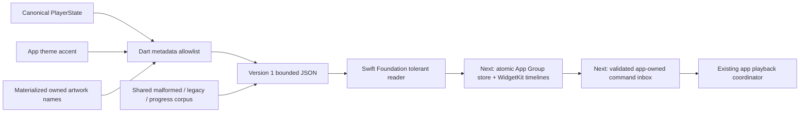

# iPhone widgets: shared data and implementation gates

Status: metadata contract implementation, 27 October 2026 (Europe/Paris).
The Dart canonical-state builder and tolerant Swift/Foundation reader are
implemented. The shared synthetic corpus covers both readers; native execution
of the new Swift workflow is pending. **No WidgetKit target, App Group publisher,
widget entitlement or iPhone widget UI is enabled by this change.**

The product remains exactly three configurations—Now Playing, Flow / Radio and
Cover Flow—with responsive small/medium/large families. Artwork, Dynamic Type,
Reduce Motion, empty/offline states and iOS 16/17 action differences follow the
[post-172 widget specification](IOS_POST172_REVIEW.md#widgetkit-design-and-implementation-gates).
The existing Android publisher and its settings remain independent.

The reader is deliberately independent of UIKit/WidgetKit and can be compiled
and exercised before extension provisioning. The new macOS contract workflow
compiles the real reader in Swift 6 with warnings as errors; Dart and Swift run
the same expected fixture values. A host/reader pass establishes the wire
boundary, not extension installation, rendering or signed-device behavior.

## Version 1 wire boundary

| Field | Rule |
| --- | --- |
| `schemaVersion` | Exactly 1; unknown/missing/bool versions produce an empty snapshot. Unknown additive fields are discarded. |
| `revision` | Nonnegative integer through 2^53−1. Future persistence must allocate it monotonically and acknowledge the actual written revision. |
| `updatedAtMs` | Milliseconds since UTC epoch, positive through 2100-01-01. Invalid/missing time is stale. |
| `current` | Nullable metadata record: alias, title, artist, album and owned artwork filename. No codec/backend or delivery URL is inferred. |
| Record `id` | 64 lowercase hex characters. The app builder hashes `lokal-widget-track-v1` + NUL + the stable app song ID with SHA-256. It never exports raw IDs/paths/remote IDs. |
| Labels/status | At most 256 Unicode scalars / 1024 UTF-8 bytes; controls and invalid surrogates are discarded. Bound scanning to 1024 input scalars. Trim ASCII spaces consistently across runtimes. |
| `artwork`, `lastArtwork` | Content-addressed 64-hex `.jpg`/`.png` filename only. No URL, absolute path, traversal or URI. Current valid art replaces last-good art; unavailable art retains an explicitly supplied valid last-good filename. |
| `positionMs`, `durationMs` | Integral, nonnegative and at most seven days. A known duration caps position; no current record clears both values. This display limit does not restrict playback. |
| `isPlaying`, `playbackRate` | Explicit bool and finite rate 0.25–4.0. A missing record cannot be playing; no string/numeric truth conversion. |
| `accentArgb` | Valid signed Int32; legacy unsigned UInt32 becomes its signed bit pattern. Reject out-of-range/fractional/bool values before conversion. Zero delegates to the renderer's theme default. |
| `queueCount` | Integer 0–1,000,000, from canonical `upNext` count. |
| `flowKind`, `flowStatus` | `none` / `flow` / `radio`, plus bounded app-localized status. No discovery starts while building the snapshot. |
| `recommendations` | At most 12 distinct valid records from the first 48 candidates. Invalid rows fall back independently. |

Documents are bounded to 64 KiB and eight nesting levels before parsing. Both
decoders reject malformed Unicode/nonfinite JSON consistently. They normalize
individual damaged fields without discarding unrelated valid metadata. Every
accepted normalized document must round-trip within the same byte budget.

Progress projects only a confirmed playing, known-duration, current recording.
Use the captured raw position, elapsed wall time and captured playback rate,
capped at duration. Hold the recorded position when paused, over 15 minutes old,
more than five minutes in the future, or missing a valid timestamp. Validate
extreme clock values before subtraction/conversion. This contract never causes
playback or uses a periodic widget process to imitate a live player.

## Next implementation boundaries

1. **Atomic store and artwork.** Resolve the actual provisioned App Group at
   runtime; report unavailable explicitly. Copy/downsample verified artwork into
   the owned group directory with byte/pixel limits, content hashes and atomic
   writes. Reject symlink escapes. Write the complete snapshot atomically after
   its referenced assets exist; serialize publications and reject a superseded
   acknowledgement. Retain referenced/last-good artwork during cleanup. Do not
   fetch remote artwork inside an extension render pass.
2. **Read-only WidgetKit target.** Implement the three layouts from the shared
   spec, theme-derived surfaces, accessibility labels, stale/empty states and
   system progress. Validate the exact extension's device/simulator linkage,
   rendered family/large-text snapshots and timeline reload budgeting. The basic
   sideload IPA must remain independent of extension entitlements.
3. **Owned commands.** Use iOS 16 deep links and eligible iOS 17+ AppIntent entry
   points. A durable bounded inbox needs command UUID, expiry, expected current
   alias/revision and an absolute action, so replay cannot toggle twice or play
   the wrong newer selection. The app must validate, serialize, perform and
   acknowledge through the existing playback coordinator. The extension must
   never create another Flutter/Rust engine. App-start failures remain visible;
   dequeuing a command is not playback acknowledgement.
4. **Windows/device acceptance.** Prove matching host/extension App Groups in
   the actual free-account profile and Windows re-sign/install/upgrade/refresh
   path. Apple's capability table is not proof of a particular profile or tool.
   A missing group must leave base-app playback usable and explain widget
   availability. No paid-membership assumption or signing credential belongs in
   this repository or CI.

Current Dart coverage includes the shared corruption/legacy/progress corpus,
immutable exports, maximum-size payload, canonical clock/theme mapping, stable
aliases, bounded recommendations and absence of source URLs/private paths.
The Foundation executable additionally checks extreme native clock/numeric
values. Actual WidgetKit rendering, background controls and signed installation
remain open until those later gates pass.
