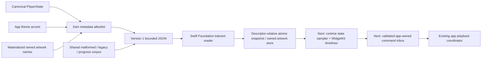
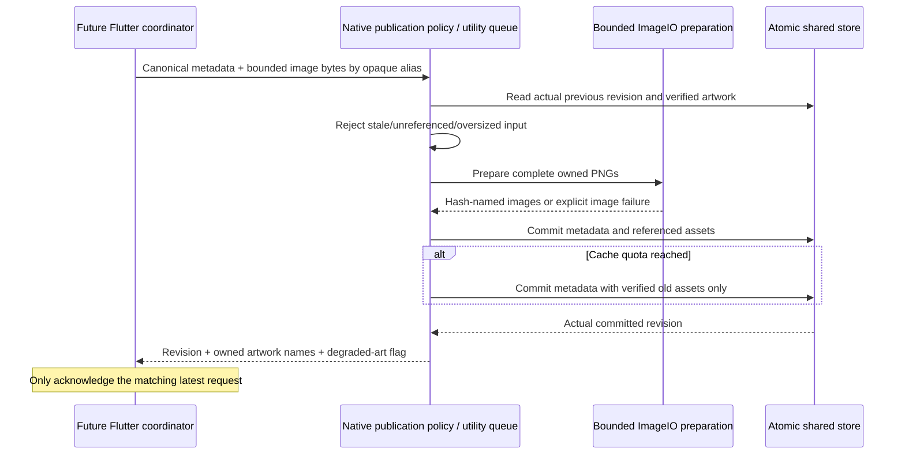

# iPhone widgets: shared data and implementation gates

Status: native reader, atomic storage and host publication policy passed; host bridge candidate, 27 October 2026 (Europe/Paris).
The canonical-state builder and Swift/Foundation reader pass the hosted Swift 6
[shared contract run](https://github.com/lokal-music/lokal-mobile/actions/runs/40447057390):
45 shared cases plus native numeric/clock guards and 64 Dart contracts. The [storage run](https://github.com/lokal-music/lokal-mobile/actions/runs/40450346881)
also passes 19 real filesystem/image/process cases and the actual iOS 16 arm64
device plus arm64 simulator SDK checks with Swift 6 warnings treated as errors.
The [corrected publication run](https://github.com/lokal-music/lokal-mobile/actions/runs/40472952795)
passes the reader's 45 cases, storage's 20 cases and publication's 14 cases,
plus the actual iOS 16 SDK checks. The current candidate adds the host channel
and Flutter coordinator. **No runtime state sampler, WidgetKit target,
widget entitlement or iPhone widget UI is enabled yet.**

The product remains exactly three configurations—Now Playing, Flow / Radio and
Cover Flow—with responsive small/medium/large families. Artwork, Dynamic Type,
Reduce Motion, empty/offline states and iOS 16/17 action differences follow the
[post-172 widget specification](IOS_POST172_REVIEW.md#widgetkit-design-and-implementation-gates).
The existing Android publisher and its settings remain independent.



The reader is deliberately independent of UIKit/WidgetKit and can be compiled
and exercised before extension provisioning. The new macOS contract workflow
compiles the real reader in Swift 6 with warnings as errors; Dart and Swift run
the same expected fixture values. A host/reader pass establishes the wire
boundary, not extension installation, rendering or signed-device behavior.

## Version 1 wire boundary

| Field | Rule |
| --- | --- |
| `schemaVersion` | Exactly 1; unknown/missing/bool versions produce an empty snapshot. Unknown additive fields are discarded. |
| `revision` | Nonnegative integer through 2^53−1. Future persistence must allocate it monotonically and acknowledge the actual written revision. |
| `updatedAtMs` | Milliseconds since UTC epoch, positive through 2100-01-01. Invalid/missing time is stale. |
| `current` | Nullable metadata record: alias, title, artist, album and owned artwork filename. No codec/backend or delivery URL is inferred. |
| Record `id` | 64 lowercase hex characters. The app builder hashes `lokal-widget-track-v1` + NUL + the stable app song ID with SHA-256. It never exports raw IDs/paths/remote IDs. |
| Labels/status | At most 256 Unicode scalars / 1024 UTF-8 bytes; controls and invalid surrogates are discarded. Bound scanning to 1024 input scalars. Trim ASCII spaces consistently across runtimes. |
| `artwork`, `lastArtwork` | Content-addressed 64-hex `.jpg`/`.png` filename only. No URL, absolute path, traversal or URI. Current valid art replaces last-good art; unavailable art retains an explicitly supplied valid last-good filename. |
| `positionMs`, `durationMs` | Integral, nonnegative and at most seven days. A known duration caps position; no current record clears both values. This display limit does not restrict playback. |
| `isPlaying`, `playbackRate` | Explicit bool and finite rate 0.25–4.0. A missing record cannot be playing; no string/numeric truth conversion. |
| `accentArgb` | Valid signed Int32; legacy unsigned UInt32 becomes its signed bit pattern. Reject out-of-range/fractional/bool values before conversion. Zero delegates to the renderer's theme default. |
| `queueCount` | Integer 0–1,000,000, from canonical `upNext` count. |
| `flowKind`, `flowStatus` | `none` / `flow` / `radio`, plus bounded app-localized status. No discovery starts while building the snapshot. |
| `recommendations` | At most 12 distinct valid records from the first 48 candidates. Invalid rows fall back independently. |

Documents are bounded to 64 KiB and eight nesting levels before parsing. Both
decoders reject malformed Unicode/nonfinite JSON consistently. They normalize
individual damaged fields without discarding unrelated valid metadata. Every
accepted normalized document must round-trip within the same byte budget.

Progress projects only a confirmed playing, known-duration, current recording.
Use the captured raw position, elapsed wall time and captured playback rate,
capped at duration. Hold the recorded position when paused, over 15 minutes old,
more than five minutes in the future, or missing a valid timestamp. Validate
extreme clock values before subtraction/conversion. This contract never causes
playback or uses a periodic widget process to imitate a live player.

## Next implementation boundaries

1. **Atomic store and artwork.** Resolve the actual provisioned App Group at
   runtime; report unavailable explicitly. Copy/downsample verified artwork into
   the owned group directory with byte/pixel limits, content hashes and atomic
   writes. Reject symlink escapes. Write the complete snapshot atomically after
   its referenced assets exist; serialize publications and reject a superseded
   acknowledgement. Retain referenced/last-good artwork during cleanup. Do not
   fetch remote artwork inside an extension render pass.
2. **Read-only WidgetKit target.** Implement the three layouts from the shared
   spec, theme-derived surfaces, accessibility labels, stale/empty states and
   system progress. Validate the exact extension's device/simulator linkage,
   rendered family/large-text snapshots and timeline reload budgeting. The basic
   sideload IPA must remain independent of extension entitlements.
3. **Owned commands.** Use iOS 16 deep links and eligible iOS 17+ AppIntent entry
   points. A durable bounded inbox needs command UUID, expiry, expected current
   alias/revision and an absolute action, so replay cannot toggle twice or play
   the wrong newer selection. The app must validate, serialize, perform and
   acknowledge through the existing playback coordinator. The extension must
   never create another Flutter/Rust engine. App-start failures remain visible;
   dequeuing a command is not playback acknowledgement.
4. **Windows/device acceptance.** Prove matching host/extension App Groups in
   the actual free-account profile and Windows re-sign/install/upgrade/refresh
   path. Apple's capability table is not proof of a particular profile or tool.
   A missing group must leave base-app playback usable and explain widget
   availability. No paid-membership assumption or signing credential belongs in
   this repository or CI.

Current Dart coverage includes the shared corruption/legacy/progress corpus,
immutable exports, maximum-size payload, canonical clock/theme mapping, stable
aliases, bounded recommendations and absence of source URLs/private paths.
The Foundation executable additionally checks extreme native clock/numeric
values. Actual WidgetKit rendering, background controls and signed installation
remain open until those later gates pass.


## Atomic store and artwork candidate

`LokalWidgetStore` accepts an explicitly supplied container; its optional iOS
factory resolves the actual provisioned App Group or throws unavailable. A
read-only instance cannot create a missing store. The host publisher is not
wired, so this introduces no entitlement dependency into base-app startup.

The store opens its owned directory without following a terminal symlink and
retains that descriptor. All subsequent I/O uses fixed/validated flat names and
`openat` / `renameat` / `unlinkat`. Regular-file and single-link checks reject
FIFOs, directories and hard links; nonblocking opens prevent a planted FIFO from
hanging the widget. Moving/replacing the original container path cannot redirect
a held descriptor to another directory. Instance locking and a regular-file
`flock` serialize separate threads, instances and processes.

```mermaid
sequenceDiagram
  participant P as Future host publisher
  participant I as ImageIO preparation
  participant S as Owned store + process lock
  participant R as Widget reader
  P->>I: Bounded PNG/JPEG bytes, off the main queue
  I-->>P: Downsampled metadata-free PNG + content hash
  P->>S: Candidate revision + referenced prepared images
  S->>S: Reject stale revision; validate cache and asset set
  S->>S: Write and fsync owned temporary images; rename
  S->>S: Verify every referenced image hash
  S->>S: Preserve previous snapshot; atomically rename new snapshot
  S-->>P: Acknowledge the committed revision
  R->>S: Bounded regular-file snapshot / image reads
  S-->>R: Complete old or new document, verified image bytes
```

| Boundary | Candidate behavior |
| --- | --- |
| Artwork input | PNG/JPEG only, complete single image, at most 12 MiB, each dimension at most 12,000 and at most 40 million pixels before decoding. |
| Artwork output | ImageIO applies orientation and downsamples to a maximum 600px edge; new PNG encoding removes original metadata. At most 2 MiB per owned image; filename is SHA-256 of the encoded bytes. |
| Cache | At most 32 artwork files / 16 MiB. Preserve current/previous references and ten minutes of reader grace. Remove only expired unreferenced owned artwork. Reclaim a dead writer's temporaries while holding the exclusive writer lock. |
| Publication | Positive revision greater than the committed revision; all referenced images must exist and verify before acknowledgement. No unreferenced or duplicate prepared image batch. |
| Write failure | Complete current snapshot remains available. Partial asset staging is reusable verified cache, never a claimed new snapshot. |
| Cache full | Return an explicit error. A metadata-only update retaining an existing verified cover remains possible; the future publisher must use that fallback rather than freeze title/state. |
| Bad stored snapshot | Reject oversized/malformed/future-schema data explicitly; do not silently overwrite it. An explicit owned-cache repair action belongs in host integration. |
| File protection | Device temporaries require protection class C (after first unlock). Simulator skips this kernel policy; signed-device/lock-screen verification remains open. |

The new macOS executable exercises nineteen actual filesystem/image/process
cases, including independent native child processes, descriptor/path replacement,
symlinks, hard links, FIFOs, real permission denial, image decoding/metadata
removal, incomplete assets, cache quotas and reference/grace retention. The
workflow also type-checks the source with the actual iOS 16 device and simulator
SDK targets. These gates pass in run `40450346881`, job `122011345223`, at
source `e7ed8035126e1d645f17c1f23a6761ee05c5fb71`, tree
`1be6c4c35decac65e9e16cf36fcddb98d09f43c5`. This is native storage evidence,
not App Group entitlement or extension installation evidence.

Atomic rename establishes reader visibility and failure behavior; physical
power-loss durability, actual App Group sandbox access, protected-device reads,
background execution and WidgetKit timelines still require their own acceptance.
The existing Android publisher and playback/transport code are unchanged.


The first storage workflow passes the unchanged 45-case Swift reader and Dart
checks, then stops at the iOS device SDK check: the SDK does not expose the
`PROTECTION_CLASS_C` alias. The correction uses Foundation's public
`completeFileProtectionUntilFirstUserAuthentication` policy on a private probe,
verifies the reported Foundation attribute, reads that descriptor's actual class
and applies it to the held owned-file descriptor. No private keybag constant is
guessed. Probe failure stays explicit and is retried on a later publication;
simulator code does not claim device protection. The corrected device/simulator SDK checks and all nineteen storage cases
pass in the hosted run above. Physical file-protection behavior remains pending.


## Host publication policy candidate

`Publication/LokalWidgetPublisher.swift` adds the synchronous native publication
policy, intended for a host-owned utility queue. It does not construct an audio
engine, resolve an implicit App Group, fetch artwork, reload timelines or attach
the Flutter host yet. The bridge must first confirm the installed shared-container
capability; base-app playback remains independent of that capability.

The input is the bounded canonical metadata document plus image bytes keyed by
its opaque current/recommendation aliases. At most thirteen images and 12 MiB
in aggregate are accepted before image decoding. Unknown aliases and stale
revisions fail explicitly. Snapshot normalization removes unrelated input fields;
prepared artwork is content-addressed and deduplicated before committing.

The returned acknowledgement contains the actual committed revision, owned
filenames by alias, last-good background artwork and a degraded-artwork flag.
An invalid image preserves a verified same-track cover when available. Artwork
from a different track may remain the separate last-good background; it is never
silently attached as the new track's cover. If the owned cache is full, retry
with verified existing covers and no new images so title/pause/seek metadata can
still advance. Other storage errors and stale writes never become success.
Read the actual stored revision on startup; do not assume a restarted process
can overwrite the previous writer with revision one.



Fourteen new native cases exercise actual storage/images, restarted revision
reads, duplicate covers, invalid images, distinct-track fallback, stale writers,
unreferenced images, aggregate quotas, bad schema/documents, allowlist privacy,
full-cache metadata fallback and concurrent publication. The hosted workflow
compiles the same policy with Swift 6 warnings-as-errors and both iOS 16 SDK
targets before running those cases. These policy checks subsequently passed in
run 40472952795; the initial pending status is superseded by that native result. The preceding reader/store
passes remain scoped to their original source; no app bridge, WidgetKit layout,
App Group provisioning, timeline or physical-device acceptance is inferred.


### Held-reader inode replacement correction

The first publication workflow passes the unchanged 64 Flutter contracts, all
45 Swift reader cases, and both actual iOS 16 SDK checks **including the new
publisher**. Its storage concurrency case then fails; publication execution is
skipped in that run. The reader previously required `st_nlink == 1` after
`openat`. A writer can legitimately replace that exact pathname between open
and fstat, reducing the held old descriptor's link count to zero even though
its complete immutable bytes remain readable.

Bounded reads now accept a regular held descriptor with zero or one link.
`O_NOFOLLOW`, nonregular/FIFO rejection, hard-link rejection (`> 1`), and strict
single-link writer/cleanup descriptors remain. A deterministic new storage case
performs an actual independent-store commit immediately after the reader's open
and before its fstat: the held read must return complete revision one, and the
next read complete revision two. The test hook is absent by default. Native
storage now has twenty cases and logs the actual concurrency errors if any
recur. The publication suite runs independently after prior failures while the
workflow retains every failing gate. Run 40472952795 subsequently passed all
20 storage cases, 14 publication cases, 45 reader cases, 64 Flutter cases and
both iOS 16 SDK checks for source `1cfc1ae59f47b95368afcda863c04fda5bc34b5b`.


## Host channel and request coordinator candidate

`LokalWidgetBridge` registers `lokal/widgets` in the actual Runner; its shared
contract/store/publication sources are explicit Xcode target members. A serial
utility queue owns image preparation and storage. Results and any requested
WidgetKit reload return on the main queue, only after a real commit. A timeline
reload request is not proof of rendering or guaranteed scheduling.

The bridge resolves only the installed bundle's optional `LokalWidgetAppGroup`
configuration. **Setting an identifier does not grant an entitlement.** The
standalone IPA leaves that key absent. It returns `notConfigured` without opening
any container; an inaccessible configured group is explicitly unavailable.
Corrupt storage reports repair required. No private app-container fallback,
caller-provided group identifier, source path or second audio owner is created.
A native integration probe exercises this exact unconfigured bridge and its
rejected publication, before continuing ordinary app/playback acceptance; that
new native app probe still requires its first hosted execution. The focused
macOS workflow also checks the real bridge against the downloaded Flutter
framework for both iOS 16 SDK targets with Swift 6 warnings-as-errors. Its
one-shot reply wrapper transfers typed sendable payloads across queues and
invokes Flutter callbacks on the main queue; no mock Flutter API stands in for
the actual framework during this check.

`IosWidgetPublicationCoordinator` accepts already sampled canonical snapshots.
It coalesces pending requests, serializes acknowledged writes, reads the stored
revision on preflight, preserves the supplied source timestamp/position, and
discards obsolete artwork results and receipts. Counters cannot wrap or reuse a
failed operation's revision. A timed-out image future remains owned until its
real completion, so another stuck image job cannot pile up. Fresh metadata can
still be published without new images. Explicit retry rechecks availability;
retained failed work does not create a retry/polling loop. A request submitted
while a failure notification is being delivered is scheduled exactly once.

The method-channel transport validates native wire types/revisions, allows
image keys only for referenced opaque aliases, and bounds image count/aggregate
bytes. The coordinator validates receipt identity and owned filenames before
exposing them. Fourteen asynchronous coordinator cases plus seven actual-codec
method-channel cases pass; the complete widget selection now passes **85 Flutter
contracts** with strict analysis reporting no issues. The expanded app selection
plus these cases passes **525 Flutter tests**. Host analysis has no errors.

The runtime sampler still needs to bind canonical player/theme/Flow state,
read materialized owned artwork, and budget state/seek/heartbeat updates. Do not
submit every position tick or replace sampling timestamps with image completion
time. Actual shared-profile publication, extension rendering/actions and the
Windows install/upgrade/refresh path remain independent qualification gates.
